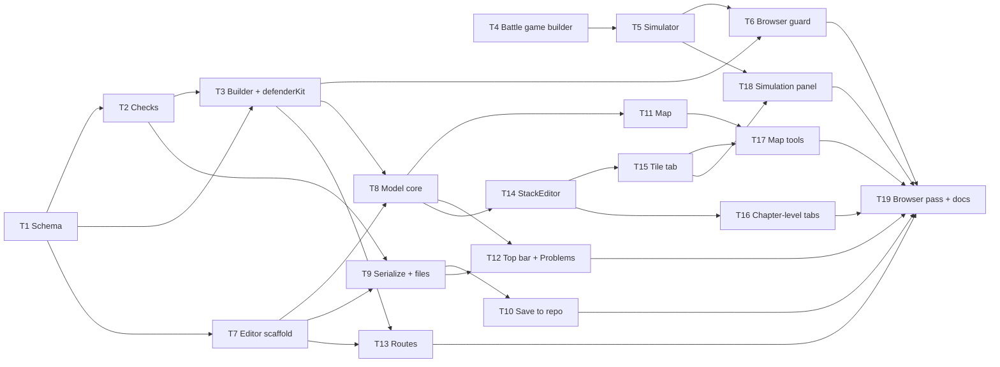

# Campaign editor — build plan

Status: done. T1–T19 are done.

Design: [campaign_editor.md](./campaign_editor.md). Review it answers: [campaign_editor_review.md](./campaign_editor_review.md). When this plan and the design disagree, the design wins and this plan is updated.

This file splits the work into tasks one agent can finish in one session. Each task names what to read, the files it owns, the contract it must keep, the tests that prove it, and the command that must pass.

## How to work a task

1. Pick a task whose **Depends on** tasks are all `done` in [Progress](#progress). Set it to `in progress` with your branch name.
2. Read **Read first**. Read the [Contracts](#contracts) the task uses. Do not change a contract; if one is wrong, stop and write the problem in the task's Notes cell.
3. Change only the files under **Files**. A file another task owns is off limits, except the imports a contract requires.
4. Run **Verify**. All of it passes before the task is done.
5. Set the task to `done` with the commit hash. Put anything the next task must know in Notes.

Ground rules for every task:

- No deploy, no `terraform`, no AWS calls. This work is local.
- `cd apiv2 && npm test` passes after every apiv2 task. Existing tests are not deleted or loosened to make them pass.
- Match the surrounding code: ES modules with `.js` import suffixes in `apiv2`, Vitest, no new runtime dependency in `apiv2`.
- Comments only for a constraint the code cannot show.
- Do not touch `site/`, `terraform/`, or `chapter-i.json` contents (T18 is the exception for docs, not data).

## Facts the tasks rely on

Checked against the code on 2026-11-17.

| Fact | Where |
|---|---|
| `JSON.stringify(JSON.parse(file), null, 2) + '\n'` reproduces `chapter-i.json` byte for byte. Canonical output only has to fix key order. | `chapter-i.json` |
| `ChapterI.ts` parses `chapter-i.json` with `parseChapterSettings`, throws `Chapter I settings: …` on the first check error, and exports `CHAPTER_I` from `buildChapterDefinition`. | `domain/campaign/ChapterI.ts` |
| `Campaign.ts`, `ChapterI.ts`, and `Autobattle.ts` bundle with esbuild `--platform=browser`: 20, 19, and 49 input files, no Node built-in, no AWS SDK, no `process.env`. `shared/errors` is browser-safe. | esbuild metafile |
| `playAutobattle(game, cap)` creates `new Logger()` inside. `Logger` writes every entry with `console.log`; one battle writes about 29 lines. 200 battles take about 30 ms in Node with logging muted. | `application/campaign/Autobattle.ts`, `shared/logging/Logger.ts` |
| `factsFromGame(game, attackId)` turns a finished or broken game into `BattleApplyFacts` (kind, leftovers, NPC leftovers, round wins). | `application/campaign/Repair.ts` |
| `createBattle(spec)` builds the `Game` inline (context, two inventory rows, campaign link) then saves it. `zeroCoinInventory` and `stackedInventory` are private helpers in the same file. No test calls `createBattle` directly. | `application/services/GameProcessorService.ts` |
| `CampaignService` attack passes `levelName: tile.difficulty`, `rounds` from the tile, `humanItems: committedItems ?? wager`, and the garrison's items, currencies, and algorithm. | `application/services/CampaignService.ts` |
| Dig is `DIG_TURNS * tile.mines * unitFor(product)`. `DIG_TURNS` is 2, exported from `CampaignInventory.ts`. | `Campaign.ts` `dig` |
| Replaying the bundled file: the bare rush scores 200; the south-stash route stops at the citadel attack with 6 copper; losing the gate once then rushing ends at 6 turns, score 0. | Replay against `Campaign` |
| Root has no `package.json`. Node is 22. `apiv2` already has `zod` and `esbuild`. | repo |
| `.gitignore` already ignores `node_modules`, `dist`, `.vite`. | `.gitignore` |

## Task map



Lanes that can run at the same time:

| Lane | Tasks | Starts when |
|---|---|---|
| Server settings | T1 → T2 → T3 | now |
| Battle | T4 → T5 | now |
| Editor base | T7 → T9 → T10 | T1 done |
| Editor model and views | T8 → T11, T12, T14 → T15, T16 → T17 | T3 and T7 done |
| Routes | T13 | T3 and T7 done |
| Guard and simulation | T6, T18 | T5 (and T15 for T18) done |
| Finish | T19 | all |
## Contracts

Types and functions more than one task touches. Names, paths, and shapes are fixed.

### C1. Settings schema — `apiv2/src/domain/campaign/ChapterSettingsSchema.ts` (T1)

```ts
export const ChapterSettingsSchema: z.ZodType<ChapterSettings>;
export type ChapterSettings = { /* z.infer of the schema */ };
export type TileSettings = ChapterSettings['tiles'][number];
export type RewardSettings = { items: ItemStack; currencies: CurrencyStack };

/** Throws Error(`Chapter settings ${path}: ${message}`) on the first issue. */
export function parseChapterSettings(value: unknown): ChapterSettings;
/** Never throws. Issues carry Zod paths. */
export function safeParseChapterSettings(value: unknown):
  | { ok: true; settings: ChapterSettings }
  | { ok: false; issues: { path: (string | number)[]; message: string }[] };
```

Shape, every object `.strict()` (an unknown field is an issue, so the editor never drops data silently):

| Field | Type |
|---|---|
| `id`, `title`, `goal` | non-empty string |
| `rulesetVersion` | integer ≥ 1 |
| `tileCount` | integer ≥ 0 (the 19 is a check) |
| `rules.digCost`, `searchCost`, `increaseMinesCost` | count |
| `rules.battleEntry` | `'fee' \| 'wager'` |
| `rules.attackFee` | count, optional |
| `rules.battleKit` | item stack, optional |
| `rules.marketplace` | item stack |
| `rules.scoreWeights` | `{ base, perTurn, perVictory, perSilver, perCopper }`, counts |
| `rules.economyConsumesActionPoint` | boolean |
| `rules.actionPointsPerTurn` | count |
| `startingInventory` | `{ items: item stack, currencies: currency stack }` |
| `defenderKits` | `{ easy, normal, hard }`, item stacks |
| `rounds` | `{ easy, normal, hard }`, `'BO5' \| 'BO7'` |
| `easyRewards` | `{ stones, scissors, papers, copper }`, rewards |
| `tiles[]` | see below |

Tile: `q`, `r` integers; `product` `'stones' | 'scissors' | 'papers' | 'copper'`; `mines`, `maxMines` counts; `difficulty` `'easy' | 'normal' | 'hard' | null`; `revealed` boolean; optional `owner` literal `'player'`, `objective` boolean, `label` string, `npcAlgorithmId` non-empty string, `reward` reward, `stash` reward, `defenderKit` item stack.

A count is a non-negative integer. An item stack is a record whose keys are in `ITEM_KEYS` and whose values are counts; a currency stack the same with `CURRENCY_KEYS`. An unknown key is an issue whose path ends in that key. A reward is `{ items: item stack, currencies: currency stack }`, both required.

### C2. Checks — same file (T2)

```ts
export interface Problem {
  level: 'error' | 'warning';
  code: ProblemCode;
  path: (string | number)[];
  tile?: { q: number; r: number };
  message: string;
}
export function checkChapterSettings(
  settings: ChapterSettings,
  options?: { baseline?: ChapterSettings }
): Problem[];
export function chapterErrors(problems: Problem[]): Problem[];
```

`ProblemCode` is a string union. Codes, levels, and the rule each one tests:

| Code | Level | Fires when |
|---|---|---|
| `tile-count` | error | `tiles.length !== 19` or `tileCount !== 19` |
| `tile-off-map` | error | `!onMap(q, r)` |
| `tile-duplicate` | error | two tiles share `(q, r)` |
| `mines-range` | error | `mines > maxMines` or `maxMines < 1` |
| `no-owned-tile` | error | no tile has `owner: 'player'` |
| `no-objective` | error | no tile has `objective: true` |
| `objective-owned` | error | an owned tile has `objective: true` |
| `difficulty-missing` | error | a tile that is not owned has `difficulty: null` |
| `owned-field` | error | an owned tile has a non-null `difficulty`, or `reward`, `npcAlgorithmId`, or `defenderKit` |
| `npc-unknown` | error | `npcAlgorithmId` not supported (`assertSupportedNpcAlgorithm` throws) |
| `entry-field` | error | fee without `attackFee`, fee with `battleKit`, wager without `battleKit`, wager with `attackFee` |
| `price-zero` | error | a `marketplace` value below 1 |
| `action-points-zero` | error | `actionPointsPerTurn < 1` |
| `version-unchanged` | warning | `baseline` given, `rulesetVersion` equal, and anything differs except `title`, `goal`, a tile `label`. Message ends "Best score keeps the highest total over all versions." |
| `objective-many` | warning | more than one objective |
| `action-points-many` | warning | `actionPointsPerTurn > 1` |
| `economy-point` | warning | `economyConsumesActionPoint` is true |
| `neighbor-hidden` | warning | a neighbor of an owned tile has `revealed: false` |
| `objective-adjacent` | warning | an objective is a neighbor of an owned tile |
| `label-duplicate` | warning | two tiles share a non-empty `label` |
| `fee-unaffordable` | warning | fee entry and `attackFee > startingInventory.currencies.copper + Σ owned (mines × unitFor(product))` |
| `objective-stash` | warning | an objective has `stash` |
| `reward-empty` | warning | a normal or hard tile, not owned, without `reward` |
| `mines-zero` | warning | `mines === 0`; message says "owned" when the tile is owned |
| `dig-net` | warning | a copper tile with `mines ≥ 1` and `DIG_TURNS × mines × unitFor('copper') − digCost ≤ 0`. Gesture tiles are skipped: their dig pays items, not copper. |
| `kit-size` | warning | a `defenderKit` whose item total is above the next difficulty's kit total or below the previous one's |
| `kit-no-gestures` | warning | a `defenderKit` with 0 `stones`, `scissors`, and `papers` |

`path` points at the field (`['tiles', 7, 'mines']`, `['rules', 'marketplace', 'NT_effect']`). Tile problems also set `tile`. The bundled file returns no error. Order: errors first, then warnings, each in the order of the table, then tile order.

### C3. Definition builder — `apiv2/src/domain/campaign/ChapterDefinitionBuilder.ts` (T3)

```ts
export function buildChapterDefinition(settings: ChapterSettings): CampaignDefinition;
export function effectiveReward(settings: ChapterSettings, tile: TileSettings): RewardSettings;
export function effectiveDefenderKit(settings: ChapterSettings, tile: TileSettings): ItemStack; // {} when owned
export function tileRounds(settings: ChapterSettings, tile: TileSettings): TileRounds | null;
```

`effectiveReward`: `tile.reward`, else `easyRewards[product]` when easy, else empty. `effectiveDefenderKit`: `tile.defenderKit`, else `defenderKits[difficulty]`, else `{}`. The builder runs no checks; callers check first. And in `CampaignInventory.ts`:

```ts
export const DIG_TURNS = 2;
```

### C4. Battle game builder — `apiv2/src/application/campaign/BattleGameBuilder.ts` (T4)

```ts
export function buildBattleGame(spec: BattleGameSpec, gameId: string, now: number): Game;
```

Same game `createBattle` builds today, minus the id generation and the save. Throws on an unsupported algorithm.

### C5. Simulator — `apiv2/src/application/campaign/BattleSimulator.ts` (T5)

```ts
export interface SimulationInput {
  humanItems: ItemStack;
  npcItems: ItemStack;
  rounds: TileRounds;
  levelName: TileDifficulty;
  npcAlgorithmId: string;
  runs: number;          // seeds 1..runs
}
export interface SimulationResult {
  runs: number;
  wins: number;
  losses: number;
  capped: number;                       // broken at the autobattle throw cap
  winRate: number;                      // wins / runs
  cappedRate: number;
  averageRoundWins: { player: number; npc: number };   // finished runs only
  itemsSpent: { average: ItemStack; worst: ItemStack }; // humanItems − leftovers, finished runs only
  garrisonAfterLoss: ItemStack | null;  // average NPC leftovers over losses
  secondAttack: { runs: number; winRate: number } | null; // one per loss
}
export function simulateBattles(input: SimulationInput): SimulationResult;
```

A second attack for loss `i` uses the player leftovers against the NPC leftovers, seed `runs + i`. Averages are rounded to 2 decimals. Same input, same output.

### C6. Editor model — `tools/campaign-editor/src/model/document.ts` (T8)

```ts
export type Cell = { q: number; r: number };
export type TabId = 'tile' | 'chapter' | 'rules' | 'inventory' | 'rewards' | 'routes' | 'problems';
export type Brush =
  | { field: 'difficulty'; value: 'easy' | 'normal' | 'hard' }
  | { field: 'product'; value: 'stones' | 'scissors' | 'papers' | 'copper' }
  | { field: 'revealed'; value: boolean }
  | { field: 'kit'; value: 'default' };
export type StackPath =
  | ['startingInventory'] | ['rules', 'battleKit'] | ['defenderKits', 'easy' | 'normal' | 'hard']
  | ['easyRewards', 'stones' | 'scissors' | 'papers' | 'copper'];

export interface EditorState {
  doc: ChapterSettings;
  baseline: ChapterSettings;   // as loaded; feeds version-unchanged
  sourceName: string;          // 'bundled', a file name, or 'draft'
  selection: Cell[];
  tab: TabId;
  brush: Brush | null;
  overlay: 'design' | 'start';
  routes: Route[];             // the designer's; reference routes load separately
  ownerMemory: Record<string, Pick<TileSettings, 'difficulty' | 'npcAlgorithmId' | 'reward' | 'defenderKit'>>; // key "q,r"
}

export type DocAction =      // recorded by history
  | { type: 'setChapter'; patch: Partial<Pick<ChapterSettings, 'title' | 'goal' | 'rulesetVersion'>> }
  | { type: 'setRules'; patch: Partial<Omit<ChapterSettings['rules'], 'marketplace' | 'battleKit' | 'attackFee' | 'battleEntry'>> }
  | { type: 'setBattleEntry'; entry: 'fee' | 'wager' }   // removes the other field, seeds the new one (fee 10, kit {})
  | { type: 'setAttackFee'; fee: number }
  | { type: 'setMarketplaceItem'; item: InventoryItemKey; price: number | null } // null = not for sale
  | { type: 'setStack'; path: StackPath; items: ItemStack; currencies?: CurrencyStack }
  | { type: 'setRounds'; difficulty: 'easy' | 'normal' | 'hard'; rounds: 'BO5' | 'BO7' }
  | { type: 'setTiles'; cells: Cell[]; patch: Partial<Pick<TileSettings, 'label' | 'product' | 'mines' | 'maxMines' | 'difficulty' | 'revealed' | 'objective' | 'npcAlgorithmId'>> }
  | { type: 'setOwner'; cells: Cell[]; owner: 'player' | 'neutral' }
  | { type: 'setReward'; cells: Cell[]; reward: RewardSettings | null }   // null = Default
  | { type: 'setKit'; cells: Cell[]; kit: ItemStack | 'copy-difficulty' | null } // null = Default
  | { type: 'setStash'; cells: Cell[]; stash: RewardSettings | null };

export type UiAction =       // not recorded
  | { type: 'load'; doc: ChapterSettings; sourceName: string }
  | { type: 'select'; cells: Cell[]; additive?: boolean }
  | { type: 'setTab'; tab: TabId }
  | { type: 'setBrush'; brush: Brush | null }
  | { type: 'setOverlay'; overlay: 'design' | 'start' }
  | { type: 'setRoutes'; routes: Route[] };

export function reduce(state: EditorState, action: DocAction | UiAction): EditorState;
```

`history.ts`: `{ past: ChapterSettings[]; future: ChapterSettings[] }`, `dispatch(action, groupId?)`, `undo()`, `redo()`. Consecutive doc actions with the same `groupId` are one undo step (a brush drag). `load` clears history and sets `baseline`.

Owner rules inside `reduce`: `setOwner` to player saves the four fields to `ownerMemory`, then clears them, `difficulty: null`, `objective` unset. Back to neutral restores from `ownerMemory`, or `difficulty: 'easy'`, no algorithm, no reward, no kit.

### C7. Routes — `tools/campaign-editor/src/routes/walk.ts` (T13)

```ts
export type RouteStep =
  | { type: 'attack'; q: number; r: number; result?: 'win' | 'loss' }   // default win
  | { type: 'search' | 'dig' | 'upgrade'; q: number; r: number }
  | { type: 'buy'; item: InventoryItemKey; amount: number }
  | { type: 'end_turn' };
export interface Route { name: string; steps: RouteStep[] }
export interface StepResult {
  step: RouteStep; ok: boolean; error?: string;
  turn: number; copper: number; silver: number; owned: number;
}
export interface RouteResult { route: Route; steps: StepResult[]; completed: boolean; score: CampaignScoreRecord | null }
export function walkRoute(settings: ChapterSettings, route: Route): RouteResult;
```

### C8. Save endpoint (T10)

`POST /__campaign-editor/save`, body the canonical text, `content-type: application/json`. `200 { path }` after writing; `422 { problems }` when parse or checks fail; `400 { message }` when the body is not JSON. Registered only by the dev server.

### C9. Serializer — `tools/campaign-editor/src/model/serialize.ts` (T9)

```ts
export function serializeChapter(settings: ChapterSettings): string;    // canonical text, trailing newline
export function readChapterText(text: string):
  | { ok: true; settings: ChapterSettings }
  | { ok: false; issues: { path: (string | number)[]; message: string }[] };
```

## Server tasks (apiv2)

### T1 — Settings schema

**Depends on:** none.
**Read first:** `ChapterI.ts` (whole), `CampaignInventory.ts`, `value-object/GamePlayerInventory.ts` (the key constants), `dto/campaign/campaignSchemas.ts` (Zod style), C1.
**Files:** create `domain/campaign/ChapterSettingsSchema.ts`, `domain/campaign/ChapterSettingsSchema.test.ts`.

Steps:
1. Write the schema in C1. Import `ITEM_KEYS` and `CURRENCY_KEYS`; build the stack schemas from them so a key added there is accepted here.
2. `parseChapterSettings` and `safeParseChapterSettings`. Messages name the path in dotted form (`tiles.7.mines`).
3. Do not wire it into `ChapterI.ts` yet (T3 does).

Tests:
- The bundled JSON parses, and the result is deep-equal to the input.
- One failing case each: negative count, non-integer, unknown item key in a tile stash (path ends in the key), unknown currency key, unknown top-level field, unknown tile field, bad `rounds` value, `difficulty: 'extreme'`, `owner: 'npc'`, missing `rules`.
- A tile with `defenderKit` parses.

**Verify:** `cd apiv2 && npm test`.

### T2 — Checks

**Depends on:** T1.
**Read first:** C2, `Hex.ts`, `Garrison.ts` (`assertSupportedNpcAlgorithm`), `CampaignInventory.ts` (`unitFor`), [campaigns.md](./campaigns.md) "Map", "Fog and reveal".
**Files:** edit `ChapterSettingsSchema.ts` (add C2); create `domain/campaign/ChapterSettingsChecks.test.ts`, `domain/campaign/__fixtures__/chapterSettings.ts` (a `bundled()` deep clone helper and small mutators).

Steps:
1. Implement every row of the C2 table with its exact code and level. `DIG_TURNS` does not exist until T3; use a local `const DIG_TURNS = 2` and leave a Notes entry so T3 swaps the import.
2. `version-unchanged` compares a deep copy of both settings with `title`, `goal`, and every tile `label` removed.
3. Sort as C2 says.

Tests: the bundled file returns no error and exactly four warnings, `dig-net` on the four copper tiles (the camp, `(-1,1)`, `(2,-1)`, `(0,2)`). Then one test per code: mutate the bundled clone, assert the code, level, `path`, and `tile`. `version-unchanged` has three: changed price fires, changed label does not, bumped version does not.

**Verify:** `cd apiv2 && npm test`.

### T3 — Definition builder, per-tile kit, dig constant

**Depends on:** T1, T2.
**Read first:** `ChapterI.ts`, `CampaignDefinition.ts`, `Campaign.ts` `dig`, C1–C3, the B5 section of [campaign_editor_review.md](./campaign_editor_review.md).
**Files:** create `domain/campaign/ChapterDefinitionBuilder.ts`, `ChapterDefinitionBuilder.test.ts`, `domain/campaign/__fixtures__/chapter-i.definition.json`; edit `ChapterI.ts`, `CampaignInventory.ts`, `Campaign.ts` (dig line only), `ChapterSettingsSchema.ts` (swap the local `DIG_TURNS` for the import), [campaigns.md](./campaigns.md).

Steps:
1. **First**, before changing code, write `JSON.stringify(CHAPTER_I, null, 2)` to `__fixtures__/chapter-i.definition.json` with a throwaway script. Commit it alone. This is the golden output.
2. Move `makeTile`, `stash`, `defenderKit`, `validateTile`, and the assembly in `buildChapterI` into `buildChapterDefinition(settings)`. Add `effectiveReward`, `effectiveDefenderKit`, `tileRounds`; `makeTile` uses them.
3. Garrison kit: `effectiveDefenderKit(settings, tile)`. A custom kit replaces the difficulty kit; it is not added.
4. `ChapterI.ts` becomes: import JSON, `parseChapterSettings`, `chapterErrors(checkChapterSettings(...))`, throw `Error('Chapter I settings: ' + first.message)` when any, `export const CHAPTER_I = buildChapterDefinition(settings)`. Delete the `read*` functions.
5. `DIG_TURNS` in `CampaignInventory.ts`; `Campaign.ts` dig uses it.
6. [campaigns.md](./campaigns.md): in "Chapter I ruleset version 1" and the defender-kit text, say a tile may name its own `defenderKit`, which replaces the difficulty kit whole; Chapter I version 1 uses none.

Tests:
- `JSON.parse(JSON.stringify(CHAPTER_I))` equals the golden fixture.
- A tile with `defenderKit: { scissors: 9 }` on a normal tile gets a garrison of exactly 9 scissors and nothing else.
- `effectiveReward`: easy tile without reward → `easyRewards[product]`; normal without → empty; custom wins.
- `tileRounds`: owned → null; hard → `rounds.hard`.
- Existing `Campaign.test.ts` and `CampaignService.test.ts` pass unchanged.

**Verify:** `cd apiv2 && npm test && npm run build`.

### T4 — Battle game builder

**Depends on:** none.
**Read first:** `GameProcessorService.createBattle` and the two inventory helpers at the bottom of that file, `CampaignGamePort.ts`, C4, `Autobattle.test.ts` `battle()`.
**Files:** create `application/campaign/BattleGameBuilder.ts`, `BattleGameBuilder.test.ts`; edit `GameProcessorService.ts`.

Steps:
1. Move the game construction and `zeroCoinInventory` / `stackedInventory` into `buildBattleGame(spec, gameId, now)`. `assertSupportedNpcAlgorithm` moves with it.
2. `createBattle` keeps the repository guard, makes `gameId` and `now` as today, calls the builder, saves with `ifNoneMatch: '*'`.

Tests:
- Builder: usersIds `[userId, 'NPC_1']`, status Created, `RoundsLength`, `KindOfGame.Extended`, level name, campaign title, human row has zero coins and exactly `humanItems`, NPC row has `npcItems` and `npcCurrencies`, campaign link fields including seed and algorithm.
- `createBattle` with an in-memory repository fake: the saved entity's inventories and link match the builder's game for the same spec; `ifNoneMatch: '*'` was passed.
- Unsupported algorithm throws before any save.

**Verify:** `cd apiv2 && npm test`.

### T5 — Battle simulator

**Depends on:** T4.
**Read first:** C5, `Autobattle.ts`, `Repair.ts` `factsFromGame`, `npcSeed.ts`, `Logger.ts`.
**Files:** create `application/campaign/BattleSimulator.ts`, `BattleSimulator.test.ts`, `shared/logging/SilentLogger.ts`; edit `Autobattle.ts` (optional logger parameter only).

Steps:
1. `SilentLogger extends Logger` and overrides `info`, `warn`, `error`, `debug` with no-ops.
2. `playAutobattle(game, maxPlayerThrows = AUTOBATTLE_THROW_CAP, logger: Logger = new Logger())`. Existing callers are unchanged.
3. `simulateBattles`: for seed 1..runs, `buildBattleGame` with a fixed fake spec (`userId: 'sim-player'`, `campaignId: 'sim'`, `attackId: 'sim-' + seed`, `tile: { q: 0, r: 0 }`, `title: 'Simulation'`, `npcCurrencies: {}`), `playAutobattle(game, cap, silent)`, `factsFromGame`. Classify win, loss, broken (→ `capped`). Then second attacks per C5.
4. `now` is a constant (`0`), so nothing depends on the clock.

Tests:
- Deterministic: two calls with the same input are deep-equal.
- Pinned: gate (`npcItems` = bundled normal kit, `BO5`, `levelName: 'normal'`, `humanItems` = bundled starting items) and citadel (hard kit, `BO7`) at `runs: 200`, `toMatchSnapshot()`. A changed engine or script then shows as a snapshot diff.
- An NPC kit with no gestures: win rate 1.
- `runs: 200` for the citadel finishes under 2 s (assert with a generous bound; record the measured time in Notes).

**Verify:** `cd apiv2 && npm test`.

### T6 — Browser guard

**Depends on:** T3, T5.
**Read first:** `esbuild.config.mjs`.
**Files:** create `apiv2/src/browserSafe.test.ts`.

Steps: in the test, `esbuild.build({ entryPoints, bundle: true, platform: 'browser', format: 'esm', write: false, metafile: true, logLevel: 'silent' })` for `ChapterSettingsSchema.ts`, `ChapterDefinitionBuilder.ts`, `Campaign.ts`, `BattleSimulator.ts`. Fail when the build errors, when a metafile input path contains `node_modules/@aws-sdk`, `/infrastructure/`, or `/config/`, or when the output text contains `process.env` or a `node:` import.

Tests: the four entry points pass. A sanity case bundles `config/environment.ts` and asserts the guard reports it.

**Verify:** `cd apiv2 && npm test`.

## Editor tasks (tools/campaign-editor)

Shared for every editor task: TypeScript strict, Preact function components with hooks, CSS modules or one `styles.css` (T7 decides; others follow), no UI library. Tests are Vitest; pure modules in the `node` environment, components with `@testing-library/preact` in `happy-dom`. Imports from the server go through `@apiv2/…` only.

### T7 — Scaffold

**Depends on:** T1.
**Read first:** [campaign_editor.md](./campaign_editor.md) "Editor" and "Screen", C1.
**Files:** create `tools/campaign-editor/` with `package.json`, `vite.config.ts`, `tsconfig.json`, `index.html`, `src/main.tsx`, `src/App.tsx`, `src/styles.css`, `src/smoke.test.ts`, `README.md` (stub).

Steps:
1. Dependencies: `preact`, `vite`, `@preact/preset-vite`, `typescript`, `vitest`, `@testing-library/preact`, `happy-dom`. No `zod`: it resolves from `apiv2/node_modules`, so the README says "run `npm ci` in `apiv2` first".
2. `vite.config.ts`: alias `@apiv2` → `../../apiv2/src`; `server.fs.allow` includes `../../apiv2`; Vitest `environmentMatchGlobs` puts `*.test.tsx` in `happy-dom`.
3. `tsconfig.json`: `moduleResolution: "Bundler"`, `jsx: "react-jsx"`, `jsxImportSource: "preact"`, `strict`, `resolveJsonModule`, paths for `@apiv2/*`, `skipLibCheck`. If type-checking the imported `apiv2` files needs Node types, add `@types/node` as a dev dependency and say so in Notes.
4. Scripts: `dev`, `build` (`tsc --noEmit && vite build`), `test` (`vitest run`).
5. `App.tsx`: the layout from the design's Screen box with empty regions: top bar, map pane, tab strip with the seven tabs, panel area. No behavior.
6. Smoke test: imports `ChapterSettingsSchema` and `@apiv2/domain/campaign/chapter-i.json?raw`, parses, passes.

**Verify:** `cd tools/campaign-editor && npm ci && npm test && npm run build`. `npm run dev` serves the empty layout (check once in a browser).

### T8 — Model core

**Depends on:** T3, T7.
**Read first:** C3, C6, the Tile tab and Owner rows of the design.
**Files:** create `src/model/document.ts`, `src/model/history.ts`, `src/model/derive.ts`, and a test per file.

Steps:
1. `reduce` per C6. Every doc action returns a new `doc` (no mutation; tests freeze the input).
2. `setKit` with `'copy-difficulty'` writes a copy of `defenderKits[difficulty]`. `setBattleEntry` removes the other field.
3. `history.ts` per C6.
4. `derive.ts`, all pure, using C3 and `unitFor`, `DIG_TURNS`, `neighborsOnMap`:
   - `tileFacts(settings, cell)` → `{ incomePerTurn | 'never-pays', digYield, digNet (copper tiles only, else null), rounds, reward, rewardIsDefault, kit, kitIsDefault, kitDiff }`. `kitDiff` is `{ key, delta }[]` against the difficulty kit, in `ITEM_KEYS` order.
   - `startView(settings)` → map of `"q,r"` → `'owned' | 'seen' | 'hidden'`.
   - `revealedBy(settings, cell)` → the hidden cells capturing `cell` would reveal.
   - `kitUsage(settings)` → per difficulty `{ defaultCount, customCells }`.
   - `mixedValue(tiles, field)` → the value, or `'mixed'`.

Tests: each owner transition (to player clears and remembers; back restores; back without memory gives easy); undo and redo; a group of three `setTiles` is one undo; `copy-difficulty` copies; `kitDiff` on `{ scissors: 7 }` vs normal kit; `revealedBy` gate on the bundled file is the citadel, `(-1,-1)`, `(1,-2)`; `startView` has 7 visible cells on the bundled file.

**Verify:** `npm test`.

### T9 — Serializer and files

**Depends on:** T2, T7.
**Read first:** C9, the design's "Canonical output" and "Files".
**Files:** create `src/model/serialize.ts`, `src/io/files.ts`, tests.

Steps:
1. `serializeChapter`: build a new object with keys in this order — top: `id, title, goal, rulesetVersion, tileCount, rules, startingInventory, defenderKits, rounds, easyRewards, tiles`; rules: `digCost, searchCost, increaseMinesCost, battleEntry, attackFee, battleKit, marketplace, scoreWeights, economyConsumesActionPoint, actionPointsPerTurn`; tile: `q, r, product, mines, maxMines, difficulty, revealed, owner, objective, label, npcAlgorithmId, defenderKit, reward, stash`. Omit defaults per the design. Stacks in key-constant order with zeros dropped, except `startingInventory` and `scoreWeights` (all keys kept). `tileCount` is always 19. Empty label becomes `(q,r)`. Then `JSON.stringify(obj, null, 2) + '\n'`.
2. `readChapterText`: `JSON.parse` failure → one issue at path `[]`; then `safeParseChapterSettings`.
3. `files.ts`: `openFile(file: File)`, `downloadChapter(text)` (filename `chapter-i.json`), `saveDraft(state)` / `loadDraft()` under `localStorage` key `campaign-editor:draft:v1` holding `{ doc, baseline, sourceName, routes }`, `clearDraft()`.

Tests: bundled raw text → read → serialize equals the raw text byte for byte. Default reward and kit omitted; a custom kit equal to the difficulty kit is still written; zero amounts dropped; a not-for-sale item absent from `marketplace`; tile key order on a tile with every optional field; draft round trip.

**Verify:** `npm test`.

### T10 — Save to repo

**Depends on:** T9.
**Read first:** C8, Vite plugin API (`configureServer`, `server.ssrLoadModule`).
**Files:** create `src/io/savePlugin.ts`, `src/io/savePlugin.test.ts`; edit `vite.config.ts` (register), `src/io/files.ts` (`saveToRepo(text)` client).

Steps:
1. Plugin with `apply: 'serve'`. Middleware on `POST /__campaign-editor/save` only. Read the body, `JSON.parse`, load `@apiv2/domain/campaign/ChapterSettingsSchema.ts` via `ssrLoadModule`, parse, run `checkChapterSettings`, refuse on any error.
2. Write to the absolute path of `apiv2/src/domain/campaign/chapter-i.json` resolved from the config root. Write a temp file in the same folder, then rename. Never take a path from the request.
3. Client `saveToRepo` returns `{ ok: true } | { ok: false; problems | message }`. The button is rendered only when `import.meta.env.DEV`.

Tests: the handler (exported for tests, given a target path) writes valid text to a temp dir; returns 422 with problems for a file with `price-zero`; 400 for invalid JSON; ignores other routes and methods.

**Verify:** `npm test && npm run build` (the build output must not contain the endpoint path).

### T11 — Map

**Depends on:** T8.
**Read first:** C6, the design's "Map" table, [campaigns_ui.md](./campaigns_ui.md) "Hexes" (placement math).
**Files:** create `src/map/hexLayout.ts`, `src/map/HexMap.tsx`, `src/map/HexMap.module.css` (or the T7 style choice), tests.

Steps:
1. `hexLayout(size)`: `x = size * 3/2 * q`, `y = size * (√3/2 * q + √3 * r)`; `hexPoints(cx, cy, size)` for a flat-top polygon; `viewBox` that fits radius 2 with padding.
2. `HexMap` props: `settings`, `selection`, `problems`, `overlay`, `hoverReveal: boolean`, `onCellClick(cell, { shift })`, `onCellPointer(cell, 'down' | 'enter' | 'up')` (for T17). Render 19 `<g data-cell="q,r">` with polygon, glyph text (`St`, `Sc`, `Pa`, `C` + `mines/maxMines`), star, `s`/`r`/`k` markers, hatched pattern when hidden, outline class for error/warning/selected.
3. Start-view overlay recolors by `startView`. Hover highlights `revealedBy(hovered)`.
4. Each cell has `aria-label` like `"(0,-1) gate, normal, stones 1/3"` so browser snapshots can click it.

Tests: `(0,-2)` is above `(0,0)`; 19 cells render; the citadel shows a star and `Pa 2/4`; a `mines-range` problem gives the error class; shift-click calls back with `shift: true`.

**Verify:** `npm test`.

### T12 — Top bar and Problems

**Depends on:** T8, T9.
**Read first:** the design's "Files" and "Problems tab", C2, C9.
**Files:** create `src/state/useEditor.ts` (one hook owning `EditorState`, history, draft autosave, derived `problems`), `src/TopBar.tsx`, `src/panels/ProblemsPanel.tsx`, tests; edit `src/App.tsx` (wire them).

Steps:
1. `useEditor`: initial state from draft when present (show **Resume draft** / **Discard** in the top bar), else bundled. `problems = checkChapterSettings(doc, { baseline })`, memoized. Autosave the draft on each doc or routes change.
2. Top bar: source name, **Open** (file input and drop on the window), **Bundled**, **Undo**, **Redo**, error and warning counts, **Save to repo** (dev only), **Export**. Export and Save disabled while any error. A failed Open lists the issues in a dialog and keeps the current document.
3. Problems panel: errors then warnings; a click selects `tile` when present, or switches to the tab that owns the path (`rules` → Rules, `defenderKits`/`rounds`/`startingInventory` → Inventory, `easyRewards` → Rewards, `id`/`title`/`goal`/`rulesetVersion` → Chapter).
4. Keyboard: Cmd/Ctrl+Z, Shift+Cmd/Ctrl+Z.

Tests: Export disabled with a `price-zero` document; a problem click selects the tile; opening an invalid file keeps the old document.

**Verify:** `npm test`.

### T13 — Routes

**Depends on:** T3, T7.
**Read first:** C7, `Campaign.ts` (`start`, `endTurn`, `beginAttack`, `attachGame`, `applyBattle`, `dig`, `search`, `increaseMines`, `buy`, `toJSON`), `Campaign.test.ts` `facts()`, the score section and the open balance issue in [campaigns.md](./campaigns.md).
**Files:** create `src/routes/walk.ts`, `src/routes/walk.test.ts`, `routes/chapter-i.routes.json`, `src/panels/RoutesPanel.tsx`.

Steps:
1. `walkRoute`: `buildChapterDefinition(settings)`, `Campaign.start(def, 0, 'route')`. Per step call the real method. Attack: `beginAttack(q, r, undefined, 'a' + n, n, 0)`, `attachGame('g' + n, 0)`, `applyBattle` with `kind` from `result` (default `'win'`), `leftovers` = the items committed by the attack, `npcLeftovers` = the tile's garrison unchanged on a loss, round wins 0. A thrown error stops the walk: `ok: false`, `error` = the message.
2. After each step read `toJSON()`: `turn` = `turnNumber + 1`, copper, silver, owned count.
3. `routes/chapter-i.routes.json`: the four rows of the score examples in [campaigns.md](./campaigns.md) (rush; south stash; south stash plus (1,0); lose the gate once then rush, with End Turns until each attack can be paid).
4. Panel: list of reference routes (read-only) and the designer's routes (`state.routes`, editable: add, rename, delete, add step from a form or by clicking a cell then a step type, reorder, delete step). Each route shows its step table and the final score lines. The tab label shows the number of routes that do not complete. Results recompute on every doc change.

Tests on the bundled file: rush completes, score 200, turns 2; south-stash route stops at the citadel attack, copper 6, error contains "Not enough copper"; lose-once completes with turns 6 and total 0; starting copper raised by 4 lets the south-stash route complete.

**Verify:** `npm test`.

### T14 — StackEditor

**Depends on:** T8.
**Read first:** the design's StackEditor paragraph.
**Files:** create `src/components/StackEditor.tsx`, `StackEditor.test.tsx`, `src/components/fields.tsx` (shared `IntField`, `Select`, `Checkbox`, `MixedHint`).

Props: `items: ItemStack`, `currencies?: CurrencyStack` (omit the currency rows when undefined), `readOnly?`, `compareTo?: ItemStack` (shows the delta column), `onChange(items, currencies)`. Rows in `ITEM_KEYS` then `CURRENCY_KEYS` order with display words (Stone, Scissors, Paper, Stone NA, Scissors NA, Paper NA, Core, Gold, Silver, Copper). Empty means 0; only positive values are emitted. Non-integer or negative input is not emitted and shows the field invalid.

`IntField` commits on blur and Enter, not each keystroke, so one edit is one undo step.

Tests: emit drops zeros; invalid input not emitted; delta column; read-only renders no inputs.

**Verify:** `npm test`.

### T15 — Tile tab

**Depends on:** T14.
**Read first:** the design's "Tile tab" table, C6, `derive.ts`.
**Files:** create `src/panels/TilePanel.tsx`, test.

Steps:
1. Single or multi selection. Each field shows the shared value or `MixedHint`; a change dispatches one action for all selected cells.
2. Owner, product, mines, max mines, difficulty (hidden when owned), revealed, objective (disabled when owned), NPC algorithm (hidden when owned), Reward Default/Custom, Defender kit Default/Custom with the difference line, "same as the normal kit" text, and **Reset to difficulty kit**, Stash None/one pile.
3. Derived lines from `tileFacts`. Leave a placeholder `<section data-slot="simulation">` under them for T18.
4. Empty selection shows "Select a tile on the map".

Tests: switching owner to Player hides difficulty and the kit; Custom kit starts as the difficulty kit; changing difficulty on a custom tile keeps the kit and updates the difference line; multi-select with different products shows mixed and one change sets all.

**Verify:** `npm test`.

### T16 — Chapter, Rules, Inventory, Rewards tabs

**Depends on:** T14.
**Read first:** the design's tab bullets, C6.
**Files:** create `src/panels/ChapterPanel.tsx`, `RulesPanel.tsx`, `InventoryPanel.tsx`, `RewardsPanel.tsx`, tests.

Steps:
1. Chapter: `id` read-only, `title`, `goal` (textarea), `rulesetVersion` with a **Bump** button.
2. Rules: costs; battle entry radio (fee shows `attackFee`, wager shows `battleKit` in StackEditor); action points; `economyConsumesActionPoint`; score weights; marketplace table, one row per item key with a For sale / Not for sale toggle and a price field (min 1); read-only "fixed by code" lines for `DIG_TURNS` and income units.
3. Inventory: starting inventory (items and currencies); per difficulty the kit, the rounds select, "used by N tiles by default", and the list of custom-kit tiles (click selects).
4. Rewards: four `StackEditor`s, one per product.

Tests: Not for sale dispatches `price: null`; switching to wager removes `attackFee` from the doc; the "used by N tiles" numbers equal `kitUsage` on the bundled file.

**Verify:** `npm test`.

### T17 — Map tools

**Depends on:** T11, T15.
**Read first:** the design's "Map" paragraphs on selection and brush, C6 `Brush` and history groups.
**Files:** create `src/map/MapTools.tsx` (brush picker, overlay toggle), `src/map/useBrush.ts`, tests; edit `src/App.tsx` (wire), `HexMap.tsx` only to add props if a contract gap appears (note it).

Steps:
1. Click selects; Shift-click toggles in the selection; Escape clears.
2. Brush: pointer down on a cell starts a group id, every entered cell applies the brush (`setTiles`, or `setKit null` for `kit: default`), pointer up ends the group. Owned cells skip difficulty and kit brushes.
3. Overlay toggle design / start view. Hover reveal on by default.
4. Multi-selection quick actions in the Tile tab header: "Apply this kit to selection", "Reset kits to Default".

Tests: a drag over three cells is one undo step; brushing difficulty skips the owned camp.

**Verify:** `npm test`.

### T18 — Simulation panel

**Depends on:** T5, T15.
**Read first:** C5, the design's Simulation paragraph.
**Files:** create `src/sim/simWorker.ts`, `src/sim/useSimulation.ts`, `src/panels/SimulationPanel.tsx`, tests; edit `TilePanel.tsx` only to mount the panel in its slot.

Steps:
1. Worker imports `simulateBattles` from `@apiv2/application/campaign/BattleSimulator.ts`. Message in: `{ id, input }`; out: `{ id, result }` or `{ id, error }`.
2. Hook: debounce 300 ms after the tile's inputs change; ignore stale ids; one worker for the app.
3. Inputs: effective kit, `rounds[difficulty]`, `levelName`, algorithm, N (default 200, max 2000), player stack mode: Starting items (fee), Battle kit (wager), Custom (`StackEditor`).
4. Output per C5. Header text "Autobattle — a floor for a careful player". Not shown for owned tiles.

Tests: the hook posts once per debounce window; stale results are dropped; with the worker replaced by a direct call, the bundled gate result equals the apiv2 snapshot numbers.

**Verify:** `npm test && npm run build` (the worker bundles).

### T19 — Browser pass and docs

**Depends on:** all.
**Read first:** the design's Acceptance list, `.cursor/skills/html5-scene-check/SKILL.md` (browser checking habits), [local_dev.md](./local_dev.md).
**Files:** edit `tools/campaign-editor/README.md`, `DOCUMENTATION_INDEX.md`; fix files from earlier tasks as the pass finds bugs (name each in Notes).

Steps:
1. `npm run dev`, walk acceptance items 1–12 in the browser at 1280×800. Screenshot the map with the bundled file and with the start view.
2. Item 13: Save to repo, `cd apiv2 && npm test`, then `npm run dev` in `apiv2`, the html5 client on `localhost:8080`, Leave any started run, Start Chapter I, and confirm the edited number shows. Then `git checkout apiv2/src/domain/campaign/chapter-i.json` to restore the file.
3. README: prerequisites (`npm ci` in `apiv2`), run, tabs, routes, simulation, save, playtest, publish (the four steps from the design).
4. `DOCUMENTATION_INDEX.md`: add the editor README and the three editor plans under API v2.

**Verify:** `cd apiv2 && npm test && npm run build`; `cd tools/campaign-editor && npm test && npm run build`; `git status` shows `chapter-i.json` unchanged.

## Progress

| Task | Status | Branch / commit | Notes |
|---|---|---|---|
| T1 Schema | done | feature/cognito-authentication (uncommitted) | Unknown keys from `.strict()` are one issue each, path ending in the key. `parseChapterSettings` throws `Chapter settings ${dotted path}: ${message}` on the first issue. Wired into `ChapterI.ts` in T3. |
| T2 Checks | done | feature/cognito-authentication (uncommitted) | `kit-size` and `kit-no-gestures` apply to a tile `defenderKit` only; chapter `defenderKits` are the ladder those totals are compared with. `version-unchanged` path is `['rulesetVersion']`. Bundled file: no errors, four `dig-net` warnings. The local `DIG_TURNS` const was removed in T3. |
| T3 Builder, kit, dig constant | done | feature/cognito-authentication (uncommitted) | `DIG_TURNS` is exported from `CampaignInventory.ts`; the local const in `ChapterSettingsSchema.ts` is gone. Golden output is `__fixtures__/chapter-i.definition.json`, captured with `JSON.stringify(CHAPTER_I, null, 2)` before the move, and left uncommitted with T1 and T2. A missing or empty tile label still becomes `#index`. `buildChapterDefinition` still throws `Chapter I must have N tiles` when `tiles.length` disagrees with `tileCount`. |
| T4 Battle game builder | done | feature/cognito-authentication (uncommitted) | `buildBattleGame(spec, gameId, now)` lives in `application/campaign/BattleGameBuilder.ts`. `assertSupportedNpcAlgorithm` throws `ValidationError` inside the builder, before a `Game` exists. `createBattle` still makes `gameId` and `now`, then saves with `ifNoneMatch: '*'`. Human coins are 0; NPC currencies come from the spec. `now` is the `time` on both inventory rows. |
| T5 Simulator | done | feature/cognito-authentication (uncommitted) | `SilentLogger` no-ops `info`/`warn`/`error`/`debug`. `playAutobattle(game, cap, logger)` defaults the logger to `new Logger()`, so existing callers are unchanged. Second-attack seed is `runs + i`, where `i` is the 1-based loss ordinal in seed order. Keys that average or max to 0 are omitted. `garrisonAfterLoss` and `secondAttack` are null when there are no losses. Gate at 200 runs: 146 wins, 54 losses, win rate 0.73. Citadel at 200 runs: 147 wins, 53 losses, win rate 0.74, 32 ms isolated; the test bound is 10 s. Snapshots are in `application/campaign/__snapshots__/BattleSimulator.test.ts.snap`. |
| T6 Browser guard | done | feature/cognito-authentication (uncommitted) | `browserGuard` bundles each entry with `platform: 'browser'`, `write: false`, and a virtual `outfile` (esbuild still requires an output name). It reports a build error, a metafile input containing `node_modules/@aws-sdk`, `/infrastructure/`, or `/config/`, `process.env` in the output, or a `"node:` / `'node:` import. The four editor entries are clean. `src/config/environment.ts` is reported for both `/config/` and `process.env`. |
| T7 Scaffold | done | feature/cognito-authentication (uncommitted) | Styles are one `src/styles.css`; later tasks add rules there. Vite plugin `apiv2-js-to-ts` rewrites a missing `.js` import to `.ts` when the file is under `apiv2/src`. `zod` is aliased to `apiv2/node_modules/zod` and deduped; this package does not depend on it. `@types/node` is a dev dependency (`Error.captureStackTrace` on the schema import graph). `ApplicationError.code` is optional: `ForbiddenError` and `UnauthorizedError` omit it, and `tsc --noEmit` follows that barrel. Runtime is unchanged. Vitest 2.1.9 so `environmentMatchGlobs` applies (`*.test.tsx` → happy-dom, other tests → node); Vite 5.4. Dev server at `localhost:5173` shows the empty layout. At 1280×800 the map and the tab pane split the row and all seven tabs are present. |
| T8 Model core | done | feature/cognito-authentication (uncommitted) | `createEditorState` clones `doc` and `baseline` apart. `load` clears `ownerMemory` and, via `EditorHistory.dispatch`, the undo stacks and the open group; it keeps selection, tab, brush, overlay, and routes. Undo and redo restore `doc` only. `select` with `additive` unions cells; T17 toggles by passing the next list. A `groupId` merges consecutive doc actions until a doc action with another id (or none), or until undo, redo, or load. UI actions leave the group open. `setOwner` to player drops `objective` and stores difficulty, `npcAlgorithmId`, reward, and `defenderKit`; setting player again does not overwrite that memory. Neutral with no memory sets difficulty `easy` and omits algorithm, reward, and kit — an omitted algorithm is `npc-v1` when the chapter is built. `copy-difficulty` copies `defenderKits[difficulty]` and does nothing when difficulty is null. `kitDiff` is the tile kit minus the difficulty kit, zeros omitted, `ITEM_KEYS` order. `revealedBy` lists the cell when it is hidden, then hidden neighbors in `NEIGHBOR_DELTAS` order. Bundled start view is 1 owned, 6 seen, 12 hidden. Gate reveal is `(1,-2)`, the citadel, `(-1,-1)`. `Route` and `RouteStep` are declared in `document.ts`; T13 re-exports them from `walk.ts`. |
| T9 Serializer and files | done | feature/cognito-authentication (uncommitted) | `serializeChapter` writes canonical text plus a trailing newline. `readChapterText` returns the `JSON.parse` object after `safeParseChapterSettings` succeeds: Zod reorders keys, and an unchanged export must match `chapter-i.json` byte for byte. Other stacks keep loaded key order and drop zeros. `startingInventory` writes every item and currency key, zeros included, in key-constant order. `scoreWeights` writes every key. `tileCount` is always 19. An empty or missing label becomes `(q,r)`. Omitted: `owner` unless `player`, `objective` unless true, `npcAlgorithmId` when missing or `npc-v1`, and `reward`, `defenderKit`, and `stash` when absent. A `defenderKit` equal to the difficulty kit is still written. Marketplace drops zeros and missing keys. The bundled marketplace (papers before scissors), the citadel reward items, and the gate and citadel currency piles (copper before silver) are not in key-constant order; sorting them would change the file. Draft key `campaign-editor:draft:v1` stores `{ doc, baseline, sourceName, routes }`. `loadDraft` returns null on bad JSON or a schema failure. `downloadChapter` uses the filename `chapter-i.json`. T10 adds `saveToRepo` to `files.ts`. |
| T10 Save to repo | done | feature/cognito-authentication (uncommitted) | `POST /__campaign-editor/save` is registered only by `campaignEditorSavePlugin` (`apply: 'serve'`). The file path is `chapterSettingsPath(config.root)` — `apiv2/src/domain/campaign/chapter-i.json` — and is never taken from the request. The handler writes the raw body after `safeParseChapterSettings` succeeds and `chapterErrors` is empty; warnings do not block. Schema issues are `422 { problems }` with `level: 'error'`, path, and message, and no code. Invalid JSON is `400 { message }`. Success is `200 { path }` (absolute path) via a temp file in that directory, then rename. The schema is loaded with `ssrLoadModule('@apiv2/domain/campaign/ChapterSettingsSchema.ts')`. `saveToRepo` in `files.ts` returns `{ ok: true }`, `{ ok: false, problems }`, or `{ ok: false, message }`. The fetch URL lives only in the `import.meta.env.DEV` branch, so a production bundle drops it; `dist/` does not contain it. T12 renders **Save to repo** only when `import.meta.env.DEV`, posts `serializeChapter` text, and disables it while any error exists. The T7 placeholder in `App.tsx` is still unconditional and does not call `saveToRepo`. |
| T11 Map | done | feature/cognito-authentication (uncommitted) | `HexMap` is not mounted; `App.tsx` is still the T7 shell, and T17 puts the map in `.map-canvas`. Styles stayed in `src/styles.css`. The map always draws the 19 `onMap` cells at draw size 32. A missing tile is an empty hex; the first tile at a coordinate wins. `aria-label` is `(q,r) label, rank, product mines/maxMines`; an owned tile's rank is `player`, and an empty label falls back to `(q,r)`. Glyphs are St, Sc, Pa, C plus `mines/maxMines`. An objective is ★. Markers are `s` (stash), `r` (custom reward), `k` (custom kit), space-separated. `hex-error` wins over `hex-warning`. Problems without `tile` do not outline. Hover reveal follows `revealedBy` while `hoverReveal` is true, including the hovered cell when it is hidden. Pointer phases are down, enter, and up. Enter and Space also click. `hexLayout(size)` pads the viewBox by `0.35 * size`. y grows downward, so `(0,-2)` is above `(0,0)`. The selection stroke is dashed when the cell also has an error or warning. The hatch pattern id is `hex-hatch`. |
| T12 Top bar and Problems | done | feature/cognito-authentication (uncommitted) | A stored draft is offered with **Resume draft** and **Discard**; it is not applied until Resume, so the bundled file stays on screen. Autosave does not run on the first paint or while that offer is up, so the stored draft is not overwritten. Discard, and Bundled while the offer is up or the session is still the untouched bundled file, clear the key and do not write a new one. An edit, a successful Open, or Bundled after edits saves `{ doc, baseline, sourceName, routes }`. Resume restores the draft baseline after `load` (which would copy the draft into baseline) and restores routes, so `version-unchanged` still compares with the file the draft was based on. Owner memory is not in the draft. Cmd/Ctrl+Z and Shift+Cmd/Ctrl+Z undo and redo, except when the target is an input, textarea, or contenteditable. **Save to repo** renders only when `import.meta.env.DEV`, posts `serializeChapter` text, and is disabled while any error exists, as is Export. A failed open or save lists the issues in a dialog and leaves the document in place. Export of the untouched bundled chapter matches `chapter-i.json`. A problem with a tile selects that cell and stays on Problems (the row is `aria-current`). A problem without a tile opens the tab for the path head: `rules` → Rules, `defenderKits` / `rounds` / `startingInventory` → Inventory, `easyRewards` → Rewards, `id` / `title` / `goal` / `rulesetVersion` → Chapter, `tiles` → Tile. `tileCount` does not switch tabs. `HexMap` is still not mounted; T17 puts it in `.map-canvas`. Checked in the browser at 1280×800: source `bundled`, 0 errors and 4 warnings, Undo and Redo disabled, four dig-net rows, and the camp row shows current after a click. |
| T13 Routes | done | feature/cognito-authentication (uncommitted) | `walkRoute` starts `Campaign` from `buildChapterDefinition` and applies each step with the real command. An attack is `beginAttack(q, r, undefined, 'a' + n, n, 0)`, `attachGame('g' + n, 0)`, then `applyBattle`: kind from `result` (default win), leftovers are the committed items, round wins are 0, and a loss writes the tile garrison back unchanged. `n` is the 1-based step index. A thrown error stops the walk; the failed step keeps the pre-step turn, copper, silver, and owned count. A definition that fails to build is reported on the first step, or as `completed: false` with no steps when the route is empty. Reference routes are `routes/chapter-i.routes.json`, copied by `referenceRoutes()`. Bare rush scores 200 in 2 turns. South stash stops on the citadel attack at 6 copper. South stash plus (1,0) stops on the gate attack at 4 copper. Lose-the-gate-once finishes at 6 turns, total 0. Starting copper +4 lets the south stash finish. Designer routes stay on `state.routes` via `setRoutes` and are not the reference file. `App.tsx` mounts `RoutesPanel` and the tab label is `Routes N`, where N counts reference and designer routes that do not complete. Steps after a failure stay in the table with blank results. Quick Attack, Search, Dig, and Upgrade use `selection[0]`; the map is still unmounted, so those buttons appear once T17 selects a cell. Styles for the tab are in `src/styles.css`. Checked in the browser at 1280×800: the bundled tab shows rush 200, south stash stopped with 6 copper, the (1,0) route stopped with 4 copper, and lose-once at score 0. Adding, reordering, and deleting a designer route updates the tab count. |
| T14 StackEditor | done | feature/cognito-authentication (uncommitted) | `IntField` commits on blur and Enter, not per keystroke. Enter blurs, and that second event does not call `onCommit` again. `value: null` renders empty and `0` renders `0`; the two are the same amount, so blurring an empty row does not emit. Empty text commits `0` when `0` is inside `min`/`max` (`min` defaults to 0) and the current value is neither. A non-integer, a negative, or a value outside the range sets `aria-invalid` and does not emit. `Select`, `Checkbox`, and `MixedHint` (text "Mixed") are the other shared controls in `fields.tsx`. `StackEditor` lists every `ITEM_KEYS` row, then `CURRENCY_KEYS` only when `currencies` is passed. `stackWord` is Stone, Scissors, Paper, Stone NA, Scissors NA, Paper NA, Core, Gold, Silver, Copper. A missing or non-positive stored amount is shown empty. `onChange` receives `positiveItems`, plus `positiveCurrencies` only when `currencies` was passed, so zeros are dropped and an items-only edit is called with one argument. `compareTo` adds a delta on item rows: `+n`, a minus sign, or `0`, with `data-sign` `plus` / `minus` / `zero`. `readOnly` renders `.int-value` and no inputs. Styles are in `src/styles.css`. Not mounted; T15 and T16 place it. |
| T15 Tile tab | done | feature/cognito-authentication (uncommitted) | `TilePanel` takes `settings`, `selection`, and `onAction`. `App` mounts it on the Tile tab. No selection says "Select a tile on the map". Difficulty, NPC algorithm, and the defender kit are hidden when every selected tile is owned; Objective is disabled then. A missing owner is Neutral, and a missing `npcAlgorithmId` is `npc-v1`. Custom kit dispatches `setKit` with `copy-difficulty`; Default and **Reset to difficulty kit** dispatch `kit: null`. The difference line is `ITEM_KEYS` order, raw keys, and a unicode minus. A custom kit equal to the difficulty kit says "same as the easy kit" (the difficulty word). Custom reward copies the first selected tile's effective reward. Stash **One pile** copies the first existing stash, or an empty pile. Label, mines, and max mines commit on blur and Enter. A mixed field shows Mixed and one change writes every selected cell. `<section data-slot="simulation">` sits under the derived lines for every selection, including an owned tile; T18 mounts there. Styles are in `src/styles.css`. Checked in the browser: `(-1,1)` shows the coordinate, easy copper, the default kit 6/3/4, copper reward 4, income 2, dig net 0, and rounds BO5. Custom starts as that kit. Difficulty hard keeps the kit, rewrites the difference against the hard kit, and shows rounds BO7. Owner Player hides difficulty, the algorithm, and the kit. Mines 3 updates income to 6 and dig net to 8, adds the mines-range error, and disables Export. Undo returns the bundled chapter: 0 errors, 4 warnings, Routes 2. |
| T16 Chapter-level tabs | done | feature/cognito-authentication (uncommitted) | `ChapterPanel`, `RulesPanel`, `InventoryPanel`, and `RewardsPanel` mount from `App` on their tabs. Styles are in `src/styles.css`; top-level fields use a 12.5rem label column so "Action points per turn" stays on one line. Chapter shows `id` as text. Title and goal commit on blur, and title also commits on Enter. Ruleset version is an `IntField` with min 1, and **Bump** adds 1. Rules: dig, search, and upgrade costs; Fee shows `attackFee` and Wager shows `battleKit`. `setBattleEntry` drops the other field. Action points, the economy checkbox, and the five score weights use `setRules`. The marketplace is one row per `ITEM_KEYS` item, not a `StackEditor`. **Not for sale** dispatches `price: null` and hides the price. Turning **For sale** back on seeds price 1. A price below 1 is invalid and is not written. Dig turns and income per mine are read-only, labelled "fixed by code", and come from `DIG_TURNS` and `unitFor`. Inventory shows the starting stack, then each difficulty's kit, rounds, "used by N tiles by default" from `kitUsage` (bundled file: 16, 1, and 1), and that difficulty's custom-kit tiles. A click selects the cell and stays on Inventory. Rewards is four `StackEditor`s, one per product. Checked in the browser on the bundled file: Bump shows version 2 and Undo restores 1; Stone Not for sale drops its price; Wager removes the attack fee and shows the kit; typing 0 in a price stays on the field and is not stored; inventory and reward amounts match the file. The session was undone back to the bundled chapter. |
| T17 Map tools | done | feature/cognito-authentication (uncommitted) | `HexMap` already exposed click, pointer phases, overlay, and hover reveal, so no props were added. Click replaces the selection. Shift-click toggles by passing the next list; `select` with `additive` still only unions. Escape clears the selection unless the target is an input, textarea, select, or contenteditable. Pointer down opens one history group and pointer up drops it, including a release outside the map, so the next edit is its own undo step. Difficulty and kit brushes skip owned tiles and cells that already have the value. Product and revealed paint owned tiles. Hover reveal starts on and is view state, not stored on the document. The Tile tab shows **Apply this kit to selection** and **Reset kits to Default** when two or more cells are selected and at least one is not owned. Both write `setKit` for the neutral cells only. Apply copies the first neutral tile's effective kit. Checked in the browser at 1280×800: shift-click builds a mixed selection; Apply marks the gate `r k` and `(1,-1)` `k` and leaves the camp unmarked; one undo removes that kit. A Hard stroke over `(1,-2)`, `(1,-1)`, and `(1,0)` is one undo. Clicking the camp with Hard leaves it player. Start view recolors hidden tiles. Hovering the gate highlights the citadel, `(-1,-1)`, and `(1,-2)`. |
| T18 Simulation panel | done | feature/cognito-authentication (uncommitted) | `SimulationPanel` mounts in the tile slot. It is hidden when every selected tile is owned. More than one neutral tile shows "Select one tile to simulate." One worker is created on the first run and shared. Messages are `{ id, input }` in and `{ id, result }` or `{ id, error }` out. Edits debounce 300 ms, and a response whose id is not the latest post is dropped. The worker imports `BattleSimulator.js`: `tsc` rejects a `.ts` suffix unless `allowImportingTsExtensions` is on, and the Vite plugin already rewrites that import to the `.ts` source. `vite build` emits `dist/assets/simWorker-*.js` and the app chunk loads it with `type: 'module'`. Player stack defaults to starting items on a fee chapter and to `battleKit` on a wager chapter. Custom is local `StackEditor` state and is not written into the document. Runs default to 200 and max out at 2000. The direct-call gate test matches the apiv2 snapshot: 146 wins, 54 losses, win rate 0.73. That test file finished in 95 ms, so the default N stays 200. In the browser, both the dev server and the production preview returned those same gate numbers. The camp shows no simulation, and Export stays enabled. |
| T19 Browser pass and docs | done | feature/cognito-authentication (uncommitted) | Acceptance 1–12 passed at 1280×800. Untouched export matches `chapter-i.json` (sha256 `5297ccdf7246f9bc860062825932aeca844a2666a91c7b8d62b14eb2e86120af`, 6469 bytes). Map screenshots: bundled design view and start view. No source bugs. Item 13 saved `attackFee` 12; `npm test` then failed the 11 Chapter I pins (golden definition, `Campaign.test.ts`, `CampaignService.test.ts`) and those expectations were left unchanged. Left the started run (it still said 10 copper), started Chapter I, and the gate button read `Attack · Best of 5 · 12 copper`. Restored `chapter-i.json` and restarted the local API. |

## Risks

| Risk | Where | Fallback |
|---|---|---|
| Type-checking `apiv2` source from the editor pulls in Node types. | T7 | Add `@types/node` to the editor's dev dependencies. Runtime is unaffected; T6 guards that. |
| Vite does not map `.js` imports to `.ts` files outside the project root. | T7 | Add a `resolve` plugin that retries `.ts` for a missing `.js` under `@apiv2`. Note it in T7. |
| Two copies of `zod` if the editor ever adds its own. | T7, T9 | The editor does not depend on `zod`; schema types come from the `apiv2` module. |
| Simulator slower in a worker than in Node. | T18 | Lower the default N; keep the max. Record times in Notes. |
| The golden definition changes because of a key-order difference, not a value. | T3 | Compare parsed objects, not text. |
