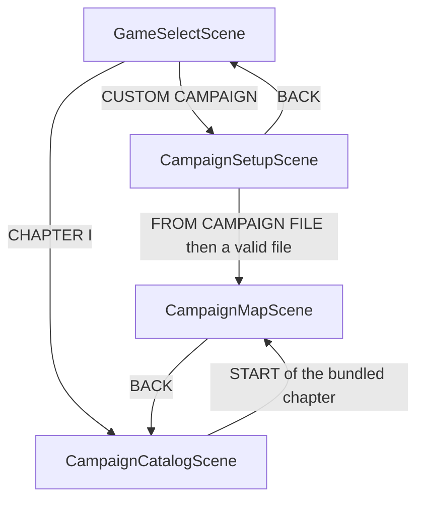

# Setup campaign from an editor file

Status: implemented.

**CUSTOM CAMPAIGN** on Choose a game opens a **Setup campaign** scene. **FROM CAMPAIGN FILE** reads a `chapter-i.json` exported by the campaign editor and starts a new Chapter I run from that file. The map, the rules, and the rest of the chapter settings in the file are what the run copies at start. The bundled `chapter-i.json` is not changed, and it is not merged into the file.

`campaigns.md`, `campaigns_api.md`, `campaigns_ui.md`, `apiv2/API_DOCUMENTATION.md`, and `site/html5Simple/SCENES.md` are updated to match when this lands. No new AWS resource. No Terraform.

## Decisions

1. **The upload is the editor document, whole.** Export writes `ChapterSettings`: `id`, `title`, `goal`, `rulesetVersion`, `tileCount`, `rules`, `startingInventory`, `defenderKits`, `rounds`, `easyRewards`, and `tiles`. `buildChapterDefinition` already turns that object into the definition `Campaign.start` copies. Tiles are the map. `rules` is the rules. Inventory, kits, rounds, and rewards are how those tiles play. The start does not copy some fields from the file and the rest from the bundled chapter.

2. **The run is Chapter I.** `settings.id` must be `chapter-i`. Any other id is `400`. The instance `definitionId` is `chapter-i`, so the catalog, the one-active-run rule, battles, and the score stay on Chapter I. The instance `title` and `goal` are the file's. The catalog row title and goal stay the bundled definition. A file exported without renaming shows **Chapter I** on the map.

3. **A file start replaces the started Chapter I.** Bundled Start while this player already has `chapter-i` in `started` is still `409` and writes nothing. A file start finishes that run as `abandoned` with no score, including when a battle is open, and starts the file as the new run. The scene does not ask the player to Leave first.

4. **Victories from a file count on the Chapter I row.** History and `bestScore` are grouped by `definitionId`. A custom map that finishes in victory raises Chapter I's best total. That is the cost of playing the file as Chapter I.

5. **The server checks the file. The page does not.** `safeParseChapterSettings`, then `checkChapterSettings` with no baseline, then `chapterErrors`. Errors are `400` and the first `message` is the RFC 7807 `detail`. Warnings do not block, which is the same bar as Export. `version-unchanged` is a warning and needs a baseline, so this call passes none. The page does not load the Zod schema.

6. **Same start write.** After the definition is built, the save is the existing `Campaign.start` plus `users.save` with `If-Match`. The response is `{ campaign }` and the user ETag. The settings object is not stored beside the instance. The instance already holds the copied tiles and rules.

7. **The file dialog is an HTML input.** The game is a Phaser canvas. **FROM CAMPAIGN FILE** clicks a hidden `<input type="file" accept=".json,application/json">`. The scene reads the text and posts JSON. The input is removed on shutdown.

8. **A failed post is not sent again by itself.** Same rule as the other campaign commands. `412` re-reads the catalog ETag and stops. The player picks the file again. Any other failure shows the detail. **BACK** stays active after a failure and while the post is in flight.

## What exists today

| Fact | Where |
|---|---|
| **CUSTOM CAMPAIGN** is on Choose a game and only logs. | `GameSelectScene.js` |
| Start is `POST /apiv2/external/campaigns` with `{ definitionId }` and `If-Match`. It loads `findDefinition`, which is the bundled `CHAPTER_I`. | `CampaignController.start`, `CampaignService.start`, `CampaignRegistry.ts` |
| `Campaign.start` copies that definition onto the instance: id, title, rules, inventory, tiles. | `Campaign.ts` |
| The editor downloads the same JSON `ChapterSettingsSchema` accepts. Export is disabled while `chapterErrors` is non-empty. | `tools/campaign-editor/src/io/files.ts`, `serialize.ts` |
| The catalog lists registry definitions only. A started `chapter-i` is **CONTINUE**. | `CampaignService.catalogBody` |
| The map opens with `{ instanceId }` and GETs before drawing. BACK returns to the catalog. | `CampaignCatalogScene.goMap`, `CampaignMapScene` |
| The page has no campaign schema. `campaignClient.start` sends `{ definitionId }`. | `campaignClient.js` |

## Navigation



**CHAPTER I** still starts the bundled definition. Lobby **BLITZ GAME** is unchanged. A file run is the started Chapter I, so the catalog shows **CONTINUE** for it and a history row opens that same map.

## API

`POST /apiv2/external/campaigns` accepts either body. `If-Match` stays required.

```json
{ "definitionId": "chapter-i" }
```

```json
{ "settings": { "id": "chapter-i", "title": "Chapter I" } }
```

`settings` is the editor file. The route schema is a strict union: one of `definitionId`, or `settings` as `ChapterSettingsSchema`. A body with both, or with neither, is `400`. The bundled start path is unchanged.

`CampaignService.startFromFile(userId, settings, ifMatch)`:

| Step | Result |
|---|---|
| `safeParseChapterSettings` fails | `400`, first issue `message` |
| `settings.id !== 'chapter-i'` | `400`, `Campaign file must be Chapter I` |
| `JSON.stringify(settings).length > 65536` | `400`, `Campaign file is too large` |
| `chapterErrors(checkChapterSettings(settings))` is non-empty | `400`, first error `message` |
| `buildChapterDefinition` | the definition |
| This player has `chapter-i` `started` | That run finishes `abandoned`. The file starts. Bundled Start is still `409` |
| Save | `{ campaign }` and the new ETag |

`65536` is the cap on the settings object after parse. A stock export is about 15 KB. The check runs before the user document is written.

Unknown keys, a bad tile, a missing objective, and the other schema and check errors stay `400`. They do not become `500`. `buildChapterDefinition` runs only after the errors are empty.

## Scene

`CampaignSetupScene`, registered in `game.js` and `index.html`. Phone frame, same outline buttons as Choose a game.

| Shown | Action |
|---|---|
| **Warm Adventure** | Title |
| **Setup campaign** | Subtitle |
| **FROM CAMPAIGN FILE** | Primary. Opens the file input. |
| Detail line | Present only after a failure. The server `detail`, or a local read error. |
| **BACK** | `GameSelectScene` |

On create, GET the catalog and keep its ETag. Draw no definitions. A failed read shows **Could not read the campaign** and **Reload**, same words as the catalog.

The file must be `<= 65536` bytes and must parse as JSON. Otherwise the scene shows **Campaign file is too large** or **Invalid JSON** and does not post. A parsed object is posted as `{ settings }` with the catalog ETag.

Success reads `campaign.id` and starts `CampaignMapScene` with `{ instanceId }`. The map GETs, so the setup response is not drawn as the map. A missing id shows **Could not read the campaign**.

While the post is in flight the file button does nothing. Shutdown removes the input and ignores a late response, same generation guard as the catalog.

`campaignClient.startFromFile(settings, etag)` posts `{ settings }`. `start(definitionId, etag)` stays the catalog call.

## Tests

`CampaignService.test.ts`:

- The bundled `chapter-i.json` through `startFromFile` matches a definition start: `definitionId` `chapter-i`, title **Chapter I**, the bundled rules, and the camp tile.
- A file with one changed tile label and one changed `attackFee` starts with those values. The bundled `CHAPTER_I` constant is unchanged.
- A warning-only file still starts.
- Schema failure, `id` other than `chapter-i`, a check error, and a settings object over `65536` bytes throw `ValidationError` and leave the user file without a new campaign.
- A second file start while the first is `started` abandons the first and starts the file. A bundled start while that new run is `started` throws `ConflictError`.
- `{ definitionId: 'chapter-i' }` still starts the bundled chapter.

Controller: the union rejects a body that has both keys.

No new scene test runner. After implementation, open `http://127.0.0.1:8099/index.html`, go Choose a game → **CUSTOM CAMPAIGN** → **FROM CAMPAIGN FILE**, and confirm a stock export lands on the map with title **Chapter I**. Confirm a file with a different tile label shows that label, and **CHAPTER I** without a file still uses the bundled map.

## Out of scope

A second chapter id. Editing the map in the game. Writing the file back to the repo. A list of saved files. Changing `chapter-i.json`. A separate best-score row for file runs. Terraform.
