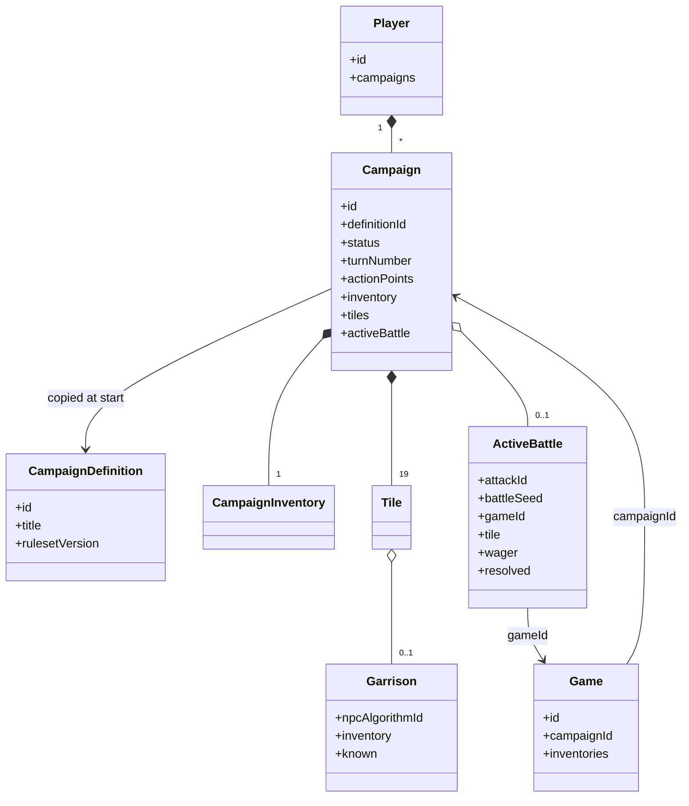

# Campaigns — design specification

Status: design only. Not implemented. API plan: [campaigns_api.md](./campaigns_api.md). UI plan: [campaigns_ui.md](./campaigns_ui.md). This file stays the rulebook.

First release is one definition, **Chapter I** (`chapter-i`). The player can buy from the marketplace for copper. The marketplace does not buy from the player. Numbers in [Chapter I](#chapter-i-ruleset-version-1) are tuning constants on the definition, not schema.

## Review of the brief

The brief describes a real feature. Several rules a player will hit on the first session are missing. This spec keeps the intent and closes those gaps.

Naming in the brief drifts across **campain**, **company**, and **campaign**. The domain name is **campaign**. The id on a game is `campaignId`. There is no Company type.

| Brief | Decision |
|---|---|
| "Instance of campaign is composite of Player" | Kept. Instances live inside the user document. One player file is the only read for catalog, start, and map actions. Games stay separate, because a match is updated on every throw. |
| Player lists started and finished campaigns. Absence means not started. | `not_started` is a catalog view, never a stored row. Stored instances are only `started` or `finished`. |
| One type may be played many times. Two `started` instances of the same type are forbidden. | One active instance per `(player, definitionId)`. A replay is a new id. |
| Campaign has no game objects. The game carries the campaign id. | Kept. A game is not a child of the campaign. The campaign stores `activeBattle` while a battle is open. |
| Campaign action chooses game type, settings, and inventories. | The **definition** chooses them. Chapter I always creates an extended PvE match. The player does not pick the loadout. |
| End Game moves items back and may give the tile to the player. | The server does this when the match finishes. The client has no End Game call. |
| Action point spent by "move", restored next turn, one attack per turn. | One map action point per turn, spent only by Attack, restored by End Turn. Throws inside the match do not spend it. |
| Dig, Search, IncreaseMines, turn income, marketplace. | Dig, Search, IncreaseMines, turn income, and buying for copper are specified below. The marketplace does not buy from the player. |
| Player never receives full tile state. | Server tile and player tile view are different types. |
| NPC algorithm can change later. | Each tile the player does not own has a `Garrison` with its own `npcAlgorithmId` and inventory. Chapter I uses `npc-v1` on every garrison. The campaign does not store one algorithm for the whole run. |
| Campaign can finish from an event or an external decision. | `finish(reason)` is the only way an instance ends. Reasons: `victory`, `abandoned`, `external`. |
| prime_stones, cores, and similar names. | Same keys as `GamePlayerInventory`. No second item language. |

Missing from the brief, and decided here:

- What wins, loses, or stalls a campaign.
- Starting map, who owns the first tile, and what "aligned" means.
- Whether fog tiles can be attacked.
- What moves between the two inventories, and what the NPC is paid from.
- What happens to a battle that is abandoned, surrendered, drawn, or broken.
- Soft-lock if a lost battle spends the items and income never gives them back.

## Player fantasy

Chapter I is a short map campaign around the existing rock-paper-scissors match.

The player owns one camp on a hex map. Each turn they may scout the economy of tiles they own, and they may attack one neighboring hex. An attack is a match against the tile's defender. Items wagered on that match leave the campaign until the match ends. A win takes the tile. Taking the citadel ends the chapter. The result that matters is the score: a faster clear, more victories, and more silver and copper. They may abandon, which records no score. They may start the chapter again later; the old run stays as history.

A match started from the lobby, with no campaign, is unchanged.

## Scope

In this release:

- Catalog of one definition, Chapter I.
- Start, read, leave, end turn, attack, dig, search, increase mines, buy from the marketplace.
- One active instance per definition per player. Many finished instances.
- Fog of war, attacks only on neighboring hexes, one attack per turn.
- Battle kit moved into a linked game and resolved back when that game ends.
- The player may play that match, or autobattle it and receive the outcome.
- Victory when the objective tile becomes owned. A victory stores a score. Leave and external finish do not.

Out of this release:

- Selling to the marketplace, and buying silver or gold.
- A second chapter, a campaign editor, or procedural maps.
- Losing a tile the player already owns. Capture only flips a tile toward the player.
- Diagonal attacks, multiple attacks per turn, cooperative campaigns, PvP campaigns.
- Timers that auto-resolve or auto-forfeit a battle.
- Random search. Search is deterministic.
- Dig raising `maxMines`. Only IncreaseMines raises `mines`.
- Spending the action point on Dig, Search, IncreaseMines, or Buy. The definition flag `economyConsumesActionPoint` is `false` so a later chapter can turn it on without a new action model.

## Language

**Campaign definition.** Static design of a chapter: id, title, ruleset version, map template, starting inventory, NPC algorithm, battle kit, action-point rule. Code, not a row per player. Editing a definition does not change instances already started.

**Campaign instance.** One run by one player. Unique id. `createdAt`, `updatedAt`, and `finishedAt` when finished. This is what the brief calls an instance.

**Campaign inventory.** Composite of the instance. Same currencies and items as a game inventory. It is not a second profile wallet. Lobby games do not read it or write it.

**Tile.** Server state of one map cell. Never sent whole to the client.

**Tile view.** What that player is allowed to know about a cell right now.

**Battle.** The open link between an instance and one game. At most one.

**Action point.** Budget for Attack on the map. It is not a rock-paper-scissors throw.

## Aggregates



The user document stores the instances themselves: map, inventory, turn, and battle link. A campaign is never loaded except as part of that player. Catalog, start, tile actions, and battle resolution all read one S3 object, `users/{id}.json`, and write it back with that object's ETag.

`not_started` is still not stored. The catalog computes it from the instances inside the caller.

This is one file on purpose. A 19-tile hex is small next to an S3 get. Finished runs and the action log are what make the file grow; that is accepted for this release. If a later chapter makes the user file heavy, move finished instances out then. Do not split the active run out ahead of that.

The game stays its own document. A match is rewritten on every throw, it has its own ETag, and it seats `NPC_1`. Putting that inside the user file would make every throw a user write. The campaign is not updated during the match, only when the match ends.

So two writes remain, and only for a battle: save the game, then save the user. If the user write fails, the next read of that player finishes resolution. There is no second "campaign ref" write to drift.

The instance has no `playerId`. It is part of the player document, so the owner is that document. The instance id stays, because one player has many runs and the game points at one of them.

Games stay on the game aggregate. The create-context field `episode` becomes `campaign`. `EpisodeContext` is renamed along with it. The shape stays a name:

```json
{ "name": "Chapter I" }
```

That name is the chapter. Attack sets it to `Chapter I`, the definition title. It is the same string the catalog shows as the title. A second run of Chapter I uses the same name, so the name does not tell two runs apart.

When Attack creates the match, the game also stores:

- `campaignId` — the instance id
- `campaignTile` — `{ q, r }` of the defended hex
- `campaignAttackId` — so resolution can be repeated safely

`level.name` is the tile difficulty: `easy`, `normal`, or `hard`. Resolution runs only when `campaignId` is set. A name of `Chapter I` with no `campaignId` does not touch a campaign.

Instance ids are `campaign-` plus a timestamp and a short random suffix, the same shape as game ids. They are unique. They do not contain the player id.

Lobby create still requires `campaign.name`, the same rule `episode.name` has today: a non-empty string. Those games have no `campaignId`. The html5 client sends `campaign` instead of `episode`.

Stored games that still have `episode` are read as `campaign` (same `{ name }` object). New writes use `campaign` only. If both keys are present, `campaign` wins.

The client cannot set `campaignId`, `campaignTile`, or `campaignAttackId` on `POST /apiv2/external/games`. A supplied value is rejected. Only Attack creates a linked game. `CLASS_DIAGRAM.md`, `GAME_FLOW.md`, and `API_DOCUMENTATION.md` change with this rename.

## Status

### Instance

`started` → `finished`

`finished` is terminal. No action other than read applies. Finish reasons:

| Reason | Who |
|---|---|
| `victory` | Server, when the objective tile becomes owned |
| `abandoned` | Player, Leave |
| `external` | Support or a future event, not a player route in this release |

There is no stored `not_started`. There is no `defeat` in Chapter I: tiles are never taken back, and an empty wallet does not end the run. The player can be stuck (see [Stalls](#stalls)). Stuck is not finished.

### Catalog row for a definition

Computed for the caller:

| Condition | `currentStatus` |
|---|---|
| No instance of this definition, or every one is `finished` | `not_started` |
| An instance of this definition is `started` | `started` |

`not_started` after a previous clear means "you may begin a new run". History is a separate list of finished instances. The finished run is not presented as the current run.

### Game

Unchanged: `created`, `started`, `finished`, `broken`.

A linked game moving to `finished` or `broken` is the signal to resolve the battle. The campaign does not poll inside the match.

## Map

Chapter I is a hex of radius 2: 19 tiles. Coordinates are axial `(q, r)`. The camp is `(0, 0)`. A tile is on the map when `max(|q|, |r|, |q + r|) <= 2`. Anything else is not a cell. It is not returned as fog.

Hexes are flat-top, so one neighbor is due north. Pointy-top has no single north edge, and this chapter's road is north to the citadel.

**Aligned** means sharing a side. The six neighbor steps are:

| Direction | `q` | `r` |
|---|---|---|
| Northeast | +1 | −1 |
| North | 0 | −1 |
| Northwest | −1 | 0 |
| Southwest | −1 | +1 |
| South | 0 | +1 |
| Southeast | +1 | 0 |

No other step is a neighbor. A square diagonal is not a direction here. Disabled tiles do not count as a bridge.

Each server tile:

| Field | Meaning |
|---|---|
| `q`, `r` | Position. Identity of the cell. |
| `enabled` | `false`: nobody can own it, and no tile action applies. |
| `owner` | `player` or `neutral`. Disabled tiles have no owner. |
| `revealed` | Fog-of-war memory. Starts from the template. Once true, stays true. |
| `objective` | Capturing it wins the chapter. |
| `product` | Inventory key the mine pays: `stones`, `scissors`, `papers`, or `copper`. |
| `mines`, `maxMines` | How many levels pay. `0 <= mines <= maxMines`. Disabled tiles use 0 and 0. |
| `stashes` | Ordered hidden piles. Each pile is `{ id, items, currencies, found }`. |
| `difficulty` | `easy`, `normal`, or `hard`. Selects the garrison's starting kit. Meaningless on a disabled tile or the starting tile. |
| `garrison` | The tile's NPC. `{ npcAlgorithmId, inventory, known }`. `known` becomes true after a lost battle, and `inventory` is then the stock the next attack uses. `null` on a tile the player owns. |
| `dugThisTurn`, `searchedThisTurn`, `increasedThisTurn` | Cleared on End Turn. |

Ownership does not change except by a victorious attack onto a neutral enabled tile. The player cannot attack a tile they own. Nothing un-owns a tile.

### What the player sees

Every response that includes the map sends all 19 tile views, including fog, so the client can draw the hex. A view contains only the fields in the table below. Stash contents, a garrison the player has not yet beaten, and unfound stash ids stay on the server.

| View | When | Fields |
|---|---|---|
| Hidden | `revealed` is false | `q`, `r`, `visibility: hidden` |
| Blocked | Revealed and disabled | `q`, `r`, `visibility: blocked` |
| Seen | Revealed, enabled, not owned | `q`, `r`, `visibility: seen`, `owner: neutral`, `difficulty`, `rounds`, `objective`, and `garrison` only after a loss on that tile |
| Owned | The player owns it | `q`, `r`, `visibility: owned`, `owner: player`, `difficulty`, `objective`, `income`, `mines`, `maxMines`, `dugThisTurn`, `searchedThisTurn`, `increasedThisTurn`, `searchAvailable` |

`rounds` is only on a seen tile. In Chapter I it is `BO5` or `BO7`. The client shows it before Attack. An owned tile has already been taken, so it does not repeat `rounds`.

`garrison` on a seen tile is `{ npcAlgorithmId, inventory }` and only appears after a resolved loss against that tile. `inventory` is what the NPC had left, and it is the stock the next attack copies onto `NPC_1`. A later loss replaces it. Hidden tiles never include it. An open battle does not change it until the match resolves. The stored `known` flag is not sent.

`income` is only on an owned tile: `{ product, perTurn }`. `perTurn` is what End Turn will add from this tile, `mines × unit` of `product` (unit 1 for a gesture, 2 for copper). A seen tile does not include it. The player learns the pay by owning the hex. The client shows `mines` of `maxMines` and offers upgrade only when `mines < maxMines` and `increasedThisTurn` is false. At the cap the server still rejects another upgrade.

`dugThisTurn`, `searchedThisTurn`, and `increasedThisTurn` are only on an owned tile. Each is true after that action has already been accepted on this tile during the current turn. They are false at the start of a turn, including the turn the tile is captured. The client uses them to show the action as spent. They are not a permission. Dig, search, and upgrade are checked again on the server, and a second use in the same turn is rejected with no write.

`searchAvailable` is true only on an owned tile that still has an unfound stash. It can be true when `searchedThisTurn` is also true: a stash remains, and the search action is still spent until End Turn.

### Fog

At start, the camp and its six neighbors are revealed. The other twelve cells are hidden.

A legal attack target is always already revealed: it must share a side with a tile the player owns, and those neighbors were revealed when that tile was gained. The player never attacks blind.

On victory, the taken tile is revealed (it already was) and each of its neighbors that exists on the map is revealed, including disabled neighbors, which show as blocked.

## Turns and action points

`turnNumber` starts at 0. Start does not pay income. The view also has `turns`, which is `turnNumber + 1`. The map shows that number as Turns. It starts at 1. It is the number the score will use if the player wins on this turn, including the open turn, so the counter on the map and the counter on the result are the same.

`actionPoints` starts at 1. Attack requires at least 1 and spends 1. End Turn sets action points back to the definition maximum (1) after income. Unused points are not banked.

Dig, Search, IncreaseMines, and Buy do not spend the action point in Chapter I. Dig, Search, and IncreaseMines are still limited to once per tile per turn. Buy is limited by copper.

End Turn is legal with the point spent or unspent. It is not legal during a battle.

Order inside End Turn:

1. Reject if the instance is finished or a battle is open.
2. For each tile the player owns, add income to the campaign inventory.
3. Clear `dugThisTurn`, `searchedThisTurn`, and `increasedThisTurn` on every tile.
4. Set `actionPoints` to the maximum.
5. Increment `turnNumber` by 1.
6. Append an income event. Touch `updatedAt`.

Income is paid per owned tile from that tile's mine. A mine has one product: stones, scissors, papers, or copper. It pays `mines × unit` of that product. The unit is 1 for a gesture and 2 for copper. Disabled tiles and neutral tiles pay nothing. A tile captured this turn does not pay until the next End Turn. The citadel's mine does not pay during Chapter I, because taking it ends the chapter before another End Turn.

## Campaign inventory

Same shape as `GamePlayerInventory` items and currencies:

- Currencies: `gold`, `silver`, `copper`
- Items: `stones`, `scissors`, `papers`, `NA_effect_stone`, `NA_effect_scissors`, `NA_effect_papers`, `NT_effect`

The brief's prime stones are `NA_effect_*`. Cores are `NT_effect`.

Counts are non-negative integers. A debit that would go below zero rejects the whole action. Nothing is partially spent.

The campaign inventory has no `userId` and no `playerId`. It belongs to the instance, and the instance belongs to the player document.

## Battles

### What one battle spends

The campaign loses what the player throws. Leftovers of the kit come back. Coins are not thrown.

A best-of-5 match is first to 3. The planning case is a 3–2 that also has one draw: six throws. A throw is sized to matter and not to empty the stack: stone 3, paper 3, scissors 2, under the caps of 9, 7, and 4. Two throws of each gesture, plus one size effect and one type effect:

| | stones | scissors | papers | NA effect | NT effect |
|---|---|---|---|---|---|
| One best-of-5, played out | 6 | 4 | 6 | 1 | 1 |
| A 3–0 sweep, about half of that | 3 | 2 | 3 | 0 | 0 |

The gate and an easy hex are best of 5, the length already played: first to 3, about 6 stones, 4 scissors, 6 papers, and one effect of each kind. The citadel is best of 7, first to 4. Played out, that is about a third more: 8 stones, 5 scissors, 8 papers, and one or two effects. That spends the whole kit below.

### Wager

Chapter I's battle kit is fixed by the definition. Attack checks that the campaign inventory contains every kit amount, then debits exactly those amounts. Anything above the kit stays in the campaign. Coins are not part of the kit.

That wager becomes the player's `GamePlayerInventory` on the new game. The defender's inventory is the garrison on that tile, not a copy of the player and not a fresh difficulty kit. A first attack uses the chapter's starting kit. After a loss, the next attack uses whatever the garrison has left. The NPC does not take items from the campaign. Chapter I garrisons hold no coins, so the NPC row still starts at 0 coins.

### Match length

A round win is one decisive throw. Draws do not count toward the length, and they still spend items. The match ends at `trunc(n / 2) + 1` round wins.

| Tile | `rounds` | Round wins to take it |
|---|---|---|
| easy | `BO5` | 3 |
| normal, the gate | `BO5` | 3 |
| hard, the citadel | `BO7` | 4 |

Best of 3 is too short for this chapter. An easy hex and the gate are both best of 5. The easy fight is still the lighter one, because its defender kit is smaller. The citadel is the only best of 7, so the long match is the objective, and its defender kit is larger as well.

Best of 9 is not used. It is not a create-context length today (`RoundsLength` stops at `BO7`; `BO9` exists only as a medal length). First to 5, plus draws, also outlasts the player's kit (8 stones, 5 scissors, 8 papers) more often than the citadel's kit (12, 8, 8). The player would lose by running out of throws.

### Attack rules

All of these are required. Failure rejects the action and changes nothing, including the action point.

- Instance is `started`.
- No open battle.
- `actionPoints >= 1`.
- Target exists on the map, is enabled, and is neutral.
- Target shares a side with at least one tile the player owns.
- If the client sends `from`, that cell is owned by the player and is a hex neighbor of the target. If `from` is omitted, any owned neighbor is enough.
- Inventory can pay the battle kit.
- Target is not disabled and is not already owned.

Then, in order:

1. Debit the kit. Spend one action point. Store `activeBattle` with a new `attackId`, a `battleSeed`, the tile, the wager, `gameId` still empty, `resolved: false`.
2. Create the game (extended, PvE, `NPC_1`, the garrison inventory as the NPC row, campaign link set, including `campaignNpcAlgorithmId`). `campaign.name` is `Chapter I`. `level.name` is the tile difficulty. `rounds` is `BO5` or `BO7` from the match-length table. An algorithm other than `npc-v1` is rejected before the user file is saved.
3. Store `gameId` on `activeBattle`.

If step 2 fails, refund the kit, restore the action point, and clear `activeBattle`.

While `activeBattle` is set, map commands, Buy, and Leave are rejected. The player either plays the match on the game API, or sends Autobattle. Lobby games with no `campaignId` stay allowed; they do not move campaign items.

### Autobattle

Autobattle is a way to finish the open campaign match without throwing. It is not a second combat system. The server plays both sides through the same processor that accepts a human throw, saves the finished game once, and then runs the same win, loss, or broken resolution as a match the player finished by hand.

The command is allowed only while this instance has an open battle whose game has no moves yet. A game that already contains a throw is played out by hand. Lobby games have no autobattle.

The defender is the actor named on that tile's garrison. Chapter I is `npc-v1`, today's `NPC_1` actor. A linked game with no `campaignNpcAlgorithmId` is also `npc-v1`. Its random choices in this run come from `battleSeed`, stored on the battle when Attack creates it. A retry of an unfinished game with the same seed plays the same match. A game that is already finished is not simulated again. The repair path only applies the outcome.

The player side is a fixed policy, so the spend stays near the best-of-5 estimate and a careful human can still do better by hand:

1. Stone 3. The first stone throw of the battle also spends `Overpower` when `NA_effect_stone` can be paid.
2. Paper 3.
3. Scissors 2.
4. Stone 3.
5. Paper 3. The first of these that can pay `NT_effect` also spends `Protection`.
6. Scissors 2, then the cycle repeats.

Size is lowered to the stock when the stock is at least 1 and below the planned size. A gesture that cannot be paid is skipped. No legal gesture means surrender, which is a loss. Effects that cannot be paid are omitted. No other effects are used.

The loop stops when the game is `finished` or `broken`. A cap of 48 player throws treats a game that has not ended as `broken`, and the broken path refunds the wager. A best of 7 does not approach that cap.

The response is the campaign view plus `battleOutcome`:

| Field | Meaning |
|---|---|
| `result` | `victory` or `defeat` |
| `playerRoundWins`, `npcRoundWins` | Decisive rounds each side won |
| `q`, `r` | The tile |
| `captured` | Whether the player now owns it |
| `reward` | `{ items, currencies }` credited for the capture, or null on a loss. Only keys that were added. |
| `spent` | `{ items }` taken from the kit and not returned. Only keys with a count above zero. |

The throws stay on the game. The campaign screen shows the outcome, not the board. A client that wants the throws reads the game.

### When the match ends

The same server path that finishes or breaks the game resolves the battle before it returns to the client. Resolution is keyed by `attackId` and `gameId`. A second delivery is a no-op.

**Finished, player won**

- Add the player's remaining game inventory (items and currencies) back to the campaign.
- Add the tile's victory reward.
- Set the tile's owner to `player`. Reveal its hex neighbors that exist on the map.
- Discard the defender inventory.
- Clear `activeBattle` after marking the attack resolved.
- If the tile is the objective, finish the instance with `victory`.

**Finished, player lost** (including surrender)

- Add the player's remaining game inventory back.
- No victory reward. Owner unchanged. Fog unchanged.
- The action point stays spent.
- Clear `activeBattle`.

A best-of match ends with a winner. There is no draw result to handle. A surrendered match is a loss.

**Broken**

- Refund the original wager, not the leftover game inventory.
- No reward. Tile unchanged. Restore the action point, because the match did not happen.
- Clear `activeBattle`.

Items thrown during the match are already gone from the game inventory, so a real win or loss does not return them. That is the cost of the battle. A broken match gives them back.

If the game write succeeds and the campaign write fails, `activeBattle.gameId` still points at a finished or broken game, or the game link points at this instance while `resolved` is false. The next read of the instance completes resolution before building the view. The client does not call a separate collect action.

## Tile actions

Shared checks, all on the server: instance `started`, no open battle, coordinates in range, tile enabled, and the player owns the tile. A client flag is not consulted. Costs and yields change the campaign inventory in the same write as the tile flag. The response is the updated instance, so the owned view shows the new inventory and `dugThisTurn`, `searchedThisTurn`, or `increasedThisTurn`. A failed check writes nothing.

### Dig

- Not `dugThisTurn`.
- `mines >= 1`.
- Can pay the dig cost.
- Debit the cost, credit the yield, set `dugThisTurn`.

Dig does not change `mines` or `maxMines`.

### Search

- Not `searchedThisTurn`.
- At least one stash with `found: false`. If none, reject before charging. The view's `searchAvailable` is false in that case, so a correct client will not send it.
- Can pay the search cost.
- Debit the cost. Mark the first unfound stash in list order as found. Credit that stash. Set `searchedThisTurn`.

The player learns the contents from the inventory change and the action result, not from the tile view beforehand.

### IncreaseMines

- Not `increasedThisTurn`.
- `mines < maxMines`.
- Can pay the cost.
- Debit the cost, add 1 to `mines`, set `increasedThisTurn`.

## Leave and victory

**Leave.** Started, no open battle. Finish with `abandoned`. No income for the open turn. Inventory stays on the finished instance as history and is not spendable. No refund of items already lost in earlier battles.

**Victory.** Applied inside battle resolution, not as a player action. The objective tile is owned, the reward and the returned leftovers are already in the inventory, then the score is calculated and stored. The instance is `finished`, and `finishedAt` is set. That write is the user document.

**Score.** Only a `victory` has one. `abandoned` and `external` store no score. A missing score is not zero.

The score is an integer, frozen at the finish. Later tuning of the weights does not rewrite it. `rulesetVersion` on the instance is the version of the weights and of the starting wallet used as the baseline.

Inputs, all taken after the citadel reward is in the inventory:

| Input | Meaning | Weight in Chapter I |
|---|---|---|
| `turns` | `turnNumber + 1`. The winning turn counts, even though the player does not End Turn after the citadel. | Strong. 50 points subtracted per turn. |
| `victories` | Tiles the player owns, minus the camp they started with. A lost battle does not add one. | Medium. 20 points each. |
| `silver` | `max(0, silver in inventory − silver at start)`. Chapter I starts at 0. | Medium. 20 points each. |
| `copper` | `max(0, copper in inventory − copper at start)`. | Low. 1 point each. |

Gold, stones, papers, scissors, and effects are not scored. They are how a run is played. Silver and copper are what a remarkable finish shows.

```
raw = 200 − turns × 50 + victories × 20 + silver × 20 + copper × 1
total = max(0, raw)
```

The stored object is `{ total, turns, victories, silver, copper }`. The four inputs are the amounts used, not the points. The client can show the points from the weights of that ruleset.

One turn costs more than one victory or one silver. It costs as much as 50 copper. A single detour that adds a victory, a silver, and a small pile of copper can beat a bare rush. A second detour, or several turns of mine income, cannot. A lost battle adds a turn and no victory.

Chapter I examples, using the rewards below. The south stash is part of the rich finish.

| Run | turns | victories | silver gained | copper gained | total |
|---|---|---|---|---|---|
| Gate, then citadel | 2 | 2 | 3 | 14 | 214 |
| South stash, then gate, then citadel | 3 | 3 | 5 | 18 | 228 |
| That path, plus easy (1,0), then the gate and the citadel | 4 | 4 | 5 | 22 | 202 |
| Lose the gate once, then the bare rush | 3 | 2 | 3 | 16 | 166 |

The remarkable finish of this chapter is the short path plus the south stash. The bare rush is close behind it. Wandering the rim, and losing a fight, score lower. These totals are a tuning target for ruleset 1, not a promise that every play of those routes matches the copper column; income depends on which tiles were owned at each End Turn. The routes above are the ones used to pick the weights.

A finished instance is immutable.

## Chapter I ruleset version 1

Definition id `chapter-i`. Title `Chapter I`. `rulesetVersion` 1. Every neutral garrison uses `npc-v1` (today's `NPC_1` actor) and starts from the easy, normal, or hard kit. `economyConsumesActionPoint` false. `actionPointsPerTurn` 1. Mine income is per tile, in the map table.

Goal text, safe to show the client: "Take the citadel. Fewer turns, more victories, and more silver and copper make a higher score."

### Starting inventory

| | |
|---|---|
| stones 14, scissors 10, papers 14 | Two played-out best-of-5 fights, with a little over |
| NA_effect_stone 2, NA_effect_scissors 2, NA_effect_papers 2, NT_effect 2 | Two effects of each kind |
| gold 0, silver 0, copper 16 | Silver is found, not carried in. Copper pays for digs and searches. |

### Battle kit (debited from the player)

stones 8, scissors 5, papers 8, one of each `NA_effect_*`, `NT_effect` 1. No coins.

That is the played-out best of 5, plus a few items so the stack does not run out on a draw. A played-out best of 7 spends this kit. Anything not thrown comes back.

### Defender kits

| Difficulty | stones | scissors | papers | NA stone | NA scissors | NA papers | NT |
|---|---|---|---|---|---|---|---|
| easy | 6 | 3 | 4 | 0 | 0 | 0 | 0 |
| normal | 9 | 4 | 7 | 1 | 0 | 0 | 0 |
| hard | 12 | 8 | 8 | 1 | 1 | 1 | 1 |

Defender coins are 0.

### Economy

Dig costs 4 copper and returns two turns of that tile's mine at once: `2 × mines × unit` of the same product. A stone mine at 1 returns 2 stones. A copper mine at 1 returns 4 copper, which pays the dig back and nothing more, so a copper tile is mined, not dug. Search costs 6 copper and is only offered when a stash remains. IncreaseMines costs 6 copper.

| Action | Cost | Yield |
|---|---|---|
| Turn income, per owned tile | none | `mines × unit` of that tile's product. Unit is 1 for a gesture, 2 for copper. |
| Dig, once per owned tile per turn | 4 copper | Two turns of that mine, immediately |
| Search, once per owned tile per turn | 6 copper | The next unfound stash |
| IncreaseMines, once per owned tile per turn | 6 copper | `mines += 1`, not above `maxMines`. Same product. |

One lost best-of-5 costs about 6 stones, 4 scissors, and 6 papers. Three digs on a stone tile (12 copper, 6 stones) replace the stones. The start wallet's 16 copper is four digs, or two searches and one dig. It is not a fund for digging every hex.

### Marketplace

The player buys campaign items for copper. There is no selling. Silver and gold are not for sale. Bought goods land in the campaign inventory. The price list is part of the definition and is included on the instance view.

A purchase does not spend an action point and does not advance the turn. It is rejected while a battle is open, on a finished run, or when the copper cannot cover the whole order. `amount` is a positive integer. One order is one item key. Paying for part of an order does not happen.

Prices sit above digging. A stone mine returns 2 stones for 4 copper, which is 2 copper a stone. The market charges more, so a mine you own is the better refill and the market is how you cover a gap.

| Item | Copper each |
|---|---|
| stones | 3 |
| papers | 3 |
| scissors | 4 |
| NA_effect_stone, NA_effect_scissors, NA_effect_papers | 8 |
| NT_effect | 12 |

Scissors cost more than stones or papers because the stack is the small one: a played-out fight spends 4, and the kit asks for 5. An NA effect is one strong throw. An NT effect is the rarest thing in the kit, and one of them costs most of the starting 16 copper.

Replacing a whole played-out fight at these prices is 6×3 + 4×4 + 6×3 + 8 + 12 = 72 copper. The player cannot do that from the start wallet. They buy the few pieces they are short.

### Victory rewards

Added on top of returned leftovers. An easy tile pays 2 of its mine product and 2 copper. A copper easy tile pays 4 copper and no gesture.

| Tile | Reward |
|---|---|
| easy, gesture mine | 2 of that gesture, 2 copper |
| easy, copper mine | 4 copper |
| gate | 3 stones, 1 scissors, 4 copper, 1 silver |
| citadel | 4 papers, 2 stones, 1 NT_effect, 8 copper, 2 silver |

### Map template

`P` camp, owned. `N` the north gate, normal. `H*` the citadel, hard, objective. `E` easy. Chapter I has no disabled tiles. The hex edge is the boundary. Stashes are marked `s` and listed under the grid. Rows are a flat-top layout; the coordinates are the source of truth.

```
                 (0,-2) H*
          (-1,-1) Es        (1,-2) Es
    (-2,0) E    (0,-1) N         (2,-2) E
 (-2,1) E   (-1,0) E     (1,-1) E    (2,-1) E
    (-2,2) E    (0,0) P          (2,0) E
       (-1,1) E     (1,0) E
          (-1,2) E  (0,1) Es  (1,1) E
                    (0,2) E
```

| Tile | Mine, per level per turn | mines | max | Notes |
|---|---|---|---|---|
| (0,0) camp | 2 copper | 1 | 3 | Owned. No stash. Revealed. |
| (0,−1) gate | 1 stone | 1 | 3 | Normal. Revealed. The only neighbor of both the camp and the citadel. |
| (1,−1) | 1 stone | 1 | 2 | Easy. Revealed. |
| (1,0) | 1 paper | 1 | 2 | Easy. Revealed. |
| (0,1) south | 1 scissors | 1 | 2 | Easy. Revealed. Stash. |
| (−1,1) | 2 copper | 1 | 2 | Easy. Revealed. |
| (−1,0) | 1 scissors | 1 | 2 | Easy. Revealed. |
| (0,−2) citadel | 1 paper | 2 | 4 | Hard. Objective. Hidden until a neighbor is owned. The mine does not pay before the chapter ends. |
| (1,−2) | 1 paper | 1 | 2 | Easy. Hidden. Stash. Also a neighbor of the citadel. |
| (2,−2) | 1 stone | 1 | 2 | Easy. Hidden. |
| (2,−1) | 2 copper | 1 | 2 | Easy. Hidden. |
| (2,0) | 1 paper | 1 | 2 | Easy. Hidden. |
| (1,1) | 1 stone | 1 | 2 | Easy. Hidden. |
| (0,2) | 2 copper | 1 | 2 | Easy. Hidden. |
| (−1,2) | 1 scissors | 1 | 2 | Easy. Hidden. |
| (−2,2) | 1 paper | 1 | 2 | Easy. Hidden. |
| (−2,1) | 1 stone | 1 | 2 | Easy. Hidden. |
| (−2,0) | 1 scissors | 1 | 2 | Easy. Hidden. |
| (−1,−1) | 1 stone | 1 | 2 | Easy. Hidden. Stash. |

Stashes, one pile each. Opening one costs 6 copper.

| Tile | Contents |
|---|---|
| (0,1) south of camp | 2 silver, 4 scissors, 6 copper |
| (−1,−1) | 4 stones, 1 NA_effect_stone, 4 copper |
| (1,−2) | 1 silver, 4 papers, 1 NA_effect_papers, 4 copper |

The cell under "Mine, per level per turn" is the unit, not `mines` times the unit. A copper unit is 2, so the camp cell says 2 copper and a mines value of 1 pays 2. A stone unit is 1. The citadel's unit is 1 paper and its `mines` is 2, so the pay would be 2 paper. Chapter I ends before that pay happens. In the API, stone is `stones`, paper is `papers`, scissors is `scissors`, and copper is `copper`.

The south stash pays its own search back in copper. The prize is 2 silver and one battle of scissors. That is why the three-turn route scores 228 against the two-turn rush at 214. The other two stashes replace a lost stack. They are not worth a turn for the score. A further easy hex scores 202. The citadel is not a neighbor of the camp. `enabled` remains on the tile for a later chapter that needs a blocked hex. Chapter I does not author one.

### Stalls

Chapter I does not auto-finish a poor player. The view reports stalls in `blockedReasons` so the client can explain them. The array may be empty, and it may hold more than one code. An action point of 0 is not a code. The client reads `actionPoints` for that.

- Attack available on the map, but the inventory cannot pay the kit (`cannot_afford_battle`).
- No legal attack target (`no_attack_target`). This should not happen while the citadel is uncaptured and a path of enabled tiles remains; still report it if the map is ever mis-authored.
- A battle is open (`battle_in_progress`).

Digging a gesture tile and ending the turn recovers that gesture. A copper tile's dig only returns the copper it cost. Tuning is meant to keep the starting wallet able to open the first battle, and able to open another after one lost fight if the player digs. That is a playtest check, not a hidden rule.

## Commands

Player commands, each one transaction on the user document. The client sends `If-Match` with that document's ETag. A stale ETag changes nothing. A campaign command and a profile command share this ETag; profile writes are rare, and a conflict means the client re-reads.

| Command | Body | Success |
|---|---|---|
| Start | `{ definitionId }` | New instance, status `started`, turn 0, action points 1, template copied, inventory initialized |
| End turn | `{ type: end_turn }` | Income, flags cleared, action points restored, turn incremented |
| Attack | `{ type: attack, q, r, from? }` | Battle open, `gameId` returned. `from` is `{ q, r }` |
| Autobattle | `{ type: autobattle }` | The open match is simulated. Response includes `battleOutcome` and the campaign view after resolution. |
| Cancel attack | `{ type: cancel_attack }` | The open match has no throw. The game is `broken`, the kit and the action point return, and `activeBattle` is cleared. |
| Dig | `{ type: dig, q, r }` | Updated campaign. That tile's `dugThisTurn` is true. |
| Search | `{ type: search, q, r }` | Updated campaign, plus `found` for this response only. |
| Increase mines | `{ type: increase_mines, q, r }` | Updated campaign. `mines` and `income.perTurn` rise. `increasedThisTurn` is true. |
| Buy | `{ type: buy, item, amount }` | Updated campaign. `item` is a priced key. |
| Leave | `{ type: leave }` | Status `finished`, reason `abandoned` |

Start is `POST /apiv2/external/campaigns`, not an action on an id. It requires `If-Match`, the same user ETag the catalog returns. The body is `{ campaign }`, and `campaign.id` is the new instance id.

Rejected commands use the existing RFC 7807 error style. The instance is not written.

| Situation | Outcome |
|---|---|
| Unknown definition, unknown instance, or another player's instance | Not found. Do not reveal that the id exists for someone else. |
| Start while this player already has `started` for that definition | Conflict |
| Any command on a finished instance | Conflict |
| Stale ETag | Precondition failed |
| Bad coordinates, missing fields, not a hex neighbor, own tile, disabled tile, unowned dig, kit shortfall, cost shortfall, no action point, second dig this turn, mines already max, no stash, buy amount below 1 | Validation, no writes |
| Map command, Buy, or Leave during `activeBattle` | Conflict, include `gameId` |
| Autobattle or Cancel attack with no open battle, or after a throw has already been played | Conflict |
| Marketplace or any unknown `type` | Validation. `sell` is unknown. A `buy` of silver, gold, or an unpriced key is validation. |

## Response

Every successful command, and every `GET` of one campaign, returns the instance view and the user document's `ETag`. The catalog `GET` stays the summary in [Reads](#reads). The client sends the ETag as `If-Match` on the next command. A profile write uses the same ETag. A `412` means re-read, then retry.

The body is one object:

| Field | When |
|---|---|
| `campaign` | Always. The instance view. |
| `gameId` | Attack, when the match was created. |
| `battleOutcome` | Autobattle, after resolution. |
| `found` | Search, this response only. `{ items, currencies }` with only the keys the stash granted. Later reads do not repeat it. |

`campaign.rules` is copied from the instance's `rulesetVersion`, so the client does not hardcode Chapter I:

| Field | Chapter I |
|---|---|
| `digCost` | 4 copper |
| `searchCost` | 6 copper |
| `increaseMinesCost` | 6 copper |
| `battleKit` | The attack kit: 8 stones, 5 scissors, 8 papers, one of each NA effect, 1 NT effect |
| `marketplace` | The copper price of each item |
| `scoreWeights` | `{ base: 200, perTurn: 50, perVictory: 20, perSilver: 20, perCopper: 1 }` |

`rules` is stored on the instance at start, from that `rulesetVersion`. A later edit to the definition does not change a run already going. The result screen uses the stored `rules.scoreWeights` and the stored `campaign.score`. `perTurn` is subtracted. The others are added. `campaign.score` is the outcome `{ total, turns, victories, silver, copper }`. It is absent until victory. It is not the weights.

`campaign.log` is the last 20 visible events, newest first. Each entry is `{ at, turn, type, summary }`. `type` is one of `income`, `dig`, `search`, `purchase`, `attack`, `battle_won`, `battle_lost`, `battle_refunded`, `mines_increased`, `left`, `victory`. `summary` is a short phrase the player may see, such as `2 stones` or `gate`. It does not name a defender kit or an unfound stash.

A match played on the game API does not include `campaign` in the game response. When that game reaches `finished` or `broken`, the client reads `GET /apiv2/external/campaigns/{id}` and draws the map from that view. Autobattle already returns the resolved campaign.

## Reads

**Catalog.** For each definition the server knows: id, title, goal text, `currentStatus`, active `instanceId` if started, `bestScore` (the highest `score.total` among victories, or null), and finished instances newest first (`instanceId`, `finishedAt`, `finishReason`, `score` or null). Built from the user document. The response is a summary, not the maps. The response `ETag` is the user document's, so Start can send it as `If-Match`.

**Instance.** The user document's ETag. Status, reason if finished, definition id, title, ruleset version, `rules`, `turnNumber`, `turns`, action points, inventory, 19 tile views, `activeBattle` as `{ gameId, q, r }` or null, `blockedReasons`, `log`, and `score` when the finish was a victory. `turns` is `turnNumber + 1` and is the number the client shows. Tile views only: the stored tiles are not a response. The title is `Chapter I`, the same string stored on a linked game as `campaign.name`. A run in progress does not include a score. The turn, the owned tiles, and the wallet are already on the view, and the total is calculated once at the end. The server may store a fuller audit log than the 20 entries in `log`.

Finished instances remain readable.

## Use cases

### UC-1 First look

The player has no Chapter I instance. Catalog shows `chapter-i` as `not_started` and an empty history.

### UC-2 Start

Start `chapter-i`. Response is the new instance: turn 0, 1 action point, starting inventory, camp owned at (0,0), its six neighbors seen, the citadel and the rest of the rim hidden. The instance is stored on the player.

### UC-3 Second start while active

Start again. Conflict. The existing instance is unchanged.

### UC-4 Read the map

Hidden cells are only coordinates. The seen gate (0,−1) shows normal difficulty and `rounds` `BO5`. It does not show income or the defender's stack. An easy neighbor also shows `BO5`. The citadel, once revealed, shows `BO7`. The camp is owned, so its view includes `income` of 2 copper per turn, `mines` 1, `maxMines` 3, and `dugThisTurn`, `searchedThisTurn`, and `increasedThisTurn` are false. `searchAvailable` is false because the camp has no stash. The map shows `turns` as 1.

### UC-5 Attack the gate

Attack (0,−1) from (0,0). Kit leaves the campaign inventory. Action points become 0. Response includes `gameId`. The new game's `campaign.name` is `Chapter I`, and `campaignId` is this instance. A second attack, a dig, an end turn, and leave are all rejected while that game is unfinished. The player may play the match on the game API, or autobattle it.

### UC-5b Autobattle the gate

Autobattle on that open game. The server plays the match, then resolves it. The response carries `battleOutcome` and the campaign after the win or the loss. The player does not send throws. The throws are on the saved game. Autobattle again is rejected. Autobattle after the player has already thrown one move is rejected.

### UC-6 Win the gate

The match finishes with the player as winner. Leftover wager items return. The normal victory reward is added. (0,−1) is owned. Its newly seen neighbors are the citadel (0,−2), (−1,−1), and (1,−2). The citadel is visible as hard and objective. `activeBattle` is null. Action points stay 0 until End Turn.

### UC-7 Lose the gate

The match finishes with the defender as winner, or the player surrenders. Leftovers return. Items already thrown stay spent. (0,−1) stays neutral. No reward. The player can dig the camp on this same turn (action point is not required) or end the turn.

### UC-8 Broken match

The linked game becomes `broken`. The full wager returns. The action point returns. The tile stays neutral.

### UC-9 End the turn

No battle is open. End Turn adds each owned mine's product, clears per-tile action flags, sets action points to 1, and increments the turn. Doing it on turn 0 is the first payday. The camp pays 2 copper. Doing it with the point unspent is allowed.

### UC-10 Dig, upgrade, search

On the owned camp, dig once: pay 4 copper and receive 4 copper back, because the camp mines copper. After the gate is owned, dig it once: pay 4 copper, gain 2 stones. A second dig on that tile this turn is rejected. IncreaseMines once: pay 6 copper, mines increases by 1. Search on the camp is rejected because it has no stash. After a later capture of (0,1), search pays 6 copper and grants 2 silver, 4 scissors, and 6 copper. The following read does not offer search on that tile.

### UC-10b Buy

The player buys 2 stones for 6 copper. The stones are added and the copper is removed. Buying 1 `NT_effect` for 12 copper works the same way. A buy that costs more copper than the wallet has is rejected and changes nothing. `sell` is rejected. Buying during a battle is rejected.

### UC-11 Take the citadel

From an owned (0,−1), attack (0,−2) and win. Hard reward is applied, the citadel is owned, the score is stored, and the instance is `finished` with `victory`. End Turn and Attack are rejected. Catalog `currentStatus` is `not_started`. History lists this instance as victory and shows its score. `bestScore` is that total if no higher victory exists.

### UC-12 Leave

No battle open. Leave. Instance `finished` with `abandoned`. Partial turn pays nothing. `score` is absent. The client opens the catalog, which allows a new start and does not list the abandoned run. The run does not change `bestScore`.

### UC-13 Replay

After UC-11 or UC-12, Start creates a new id, a fresh map, and a fresh inventory. The old instance is still readable and still finished. Two started instances still cannot exist.

### UC-14 Illegal attacks

Each of these rejects with no inventory change and no game created: own camp, a step that is not one of the six neighbor deltas, a hidden cell that is not adjacent, the citadel (0,−2) before a neighbor of it is owned, a coordinate outside the radius-2 hex, attack with 0 action points, attack without the kit, attack while a battle is open.

### UC-15 Lobby match

`POST /apiv2/external/games` with a `campaign.name` and no server-set `campaignId` still creates today's match and does not read the campaign inventory. The body uses `campaign`, not `episode`. Sending `campaignId` on that call is rejected.

### UC-16 Two players

A player cannot read or command another player's instance id. The response is not found.

### UC-17 Stale write

Two clients send End Turn with the same ETag. One applies. The other gets precondition failed and must re-read. Income is not applied twice.

### UC-18 Resolution retry

The match is already finished and the campaign still shows that battle unresolved (the follow-up write failed). The next read of the instance applies win, loss, or refund once, then returns the repaired view.

### UC-19 External finish

A support action finishes a started instance with reason `external`. No score is stored. Player commands stop. An open battle is not auto-played; support must not call this while `activeBattle` is set, and the domain rejects it in that case the same way Leave does. Closing the battle first is a support step (resolve the game, or mark it broken so the wager returns).

### UC-20 A second victory

The player finishes again with a higher score. History has both totals. `bestScore` is the higher one. The older victory keeps the score it stored.

## Corner cases

**Start copies the template.** Later edits to Chapter I numbers do not reshape a run already in progress. `rulesetVersion` on the instance records what it copied.

**Objective captured with other actions unused.** Victory finishes the instance inside resolution. Leftover action points and undug tiles do not matter. The reward and the returned leftovers are already in the inventory before the score is calculated. The winning turn counts as a turn.

**Score once.** A retry of the same citadel resolution must not recompute a second total. The stored score stays. Leave and external finish do not write a zero.

**Win on the last item.** The kit was affordable at Attack time. Spending items inside the match cannot un-pay the attack.

**Zero leftovers.** A player who throws away the whole kit still resolves cleanly. Add zero, then add the reward on a win.

**NPC inventory never merges into the player.** Only the human row of `game.inventories` returns to the campaign purse. On a loss, the NPC row is written back onto that tile's garrison and `known` becomes true, so the view and `battleOutcome.garrison` show what is left. The next attack seats `NPC_1` from that reduced stock. An empty garrison can still be attacked; the NPC surrenders when it cannot throw. On a win the garrison is removed and its leftovers are not paid out. A broken or refunded battle leaves the garrison and `known` unchanged. A save from before garrisons loads `defenderKit` plus the old campaign `npcAlgorithmId` (or `npc-v1`) as a hidden garrison.

**Currencies on the game.** The kit moves no coins, so the player's game coins start at 0. If the match never credits coins, zero comes back. A future match reward that lands in the game inventory would return with the leftovers; Chapter I victory coins are granted by the campaign, not by `GameOutcome`, so they are not doubled.

**GameOutcome stays on the game.** Medals and match rewards remain the game's concern. Campaign victory reward is a campaign rule. This release does not also copy `GameOutcome` coins into the campaign.

**Surrender.** Game rules already give the opponent the match. Campaign treats that as a lost battle.

**Created versus started on the game.** Today's processor often leaves a live match in `created` until it is `finished`. The campaign must not treat `created` as "battle over". Open means the game is not `finished` and not `broken`.

**Leave during battle.** Rejected. The player surrenders or finishes the match first, which resolves loot, then Leave is allowed. This avoids a second writer deciding the fate of the wager.

**End Turn during battle.** Rejected, so income cannot be farmed while a wager is sitting in a match.

**Action point and a failed attack.** Validation failures do not spend the point. Only a committed attack does. A broken game gives the point back.

**Autobattle is one save.** The match is played in memory and the finished game is written once. Intermediate throws are not saved. A second autobattle does not roll the match again. If the game write landed and the user write did not, the next read resolves that finished game and does not simulate.

**Double End Game.** Retry after a successful resolution sees `resolved` for that `attackId` and does not grant the tile, the leftovers, or the reward again.

**Finish while already finished.** Victory resolution must tolerate the instance already being finished only if this same `attackId` was applied. Any other finish of an already finished instance is rejected.

**Dig at mines 0.** Rejected. Chapter I does not author owned tiles at 0 mines. IncreaseMines cannot run when `mines == maxMines`.

**Search spam.** The second search in the same turn is rejected even if another stash remains. The next turn can take the next pile. Order is the template order, not a shuffle.

**IncreaseMines then income.** Income uses the mines value at End Turn. An upgrade earlier in the turn counts.

**Capture then income.** The new tile's mines count on the following End Turn only.

**Disabled neighbor.** Revealed as blocked. Attack, dig, search, and upgrade are rejected. It does not pay income and it does not extend adjacency.

**From-tile lies.** `from` not owned, or not aligned to the target, rejects the attack even if some other owned tile would have been a legal origin.

**Off the hex.** A `(q, r)` that fails the radius test is validation, not a hidden tile. Hidden tiles are unrevealed cells that are on the map. At the start, twelve of the nineteen are hidden. An old `episode` key on a stored game loads as `campaign.name`. A create body that still sends only `episode` is rejected.

**Unknown action type.** Rejected. `sell` is not a command. `buy` is the marketplace.

**Inventory key drift.** Campaign inventory accepts only the game item and currency keys. A definition that names something else does not load.

**Idempotent start.** Start is not idempotent. Two sequential starts after a finish are two instances. Two overlapping starts: one wins, the other conflicts. The client retries a lost response by reading the catalog, not by starting again blindly. If the create succeeded, the catalog shows `started`.

**One ETag.** Start, leave, dig, and end turn are a single user-document write. There is no campaign file and no ref to reconcile. Two devices still conflict if they write with the same ETag, and only one End Turn applies.

**Finished history grows the user file.** List history newest first. Chapter I runs are short, and keeping them on the player is the choice for this release. Do not embed games inside the campaign. The later cut, if one is needed, is finished instances and the old action log — not the active run.

**Active game id empty.** Between debit and game create, a crash can leave a wager debited and no `gameId`. That battle record is an incomplete attack. The next read refunds the wager, restores the action point, and clears it, but only when `gameId` is empty. It must not refund a battle that already has a game id.

**Another player's id.** Lookup is inside the caller's user document. An id that is not there is not found, including an id that belongs to someone else.

**Player deleted or missing.** Out of scope. Battle resolution loads the user id already stored on the game, then finds `campaignId` in that document.

## Screens

The html5 client gains a Chapter I path. Blitz stays. `BlitzGameScene` and `TestsScene` send `campaign` instead of `episode`. A lobby name stays the string they send today. A campaign battle is not created by those scenes.

`GameSelectScene` adds a Chapter I button beside Blitz. That button loads the catalog.

| Screen | What it shows |
|---|---|
| Catalog | Goal text, `currentStatus`, Start when `not_started`, Continue when `started`, history of victories and external finishes with `score.total` or no score. Abandoned runs are omitted. `bestScore` when one exists. |
| Map | The 19 flat-top hexes, north up. `turns` is shown on the map from the first moment, starting at 1. Also action points, inventory, and `blockedReasons`. A selected hex opens the action panel. The shop and the log are panels on this screen. |
| Battle | Shown while `activeBattle` is set. Play opens the existing extended-game scene with `gameId`. Autobattle calls the command and shows `battleOutcome` here. |
| Score | Shown when `campaign.score` is present. One line per input, using `rules.scoreWeights`, then `score.total`. Leave returns to the catalog. An external finish shows the reason and no score. |

The action panel reads the tile view. An owned hex shows `income.product`, `income.perTurn`, and `mines` of `maxMines`. Dig is offered when `dugThisTurn` is false, at `rules.digCost`, including on a copper hex where the yield equals the cost. Search is offered when `searchAvailable` is true and `searchedThisTurn` is false, at `rules.searchCost`. Upgrade is offered when `increasedThisTurn` is false and `mines < maxMines`, at `rules.increaseMinesCost`. A seen hex shows `rounds` and offers Attack when it shares a side with an owned hex, `actionPoints` is at least 1, and `cannot_afford_battle` is absent. The button names the length: best of 5, or best of 7 on the citadel. The kit named as the cost is `rules.battleKit`. The shop lists `rules.marketplace` and spends copper from the inventory. A finished victory shows the map and the score, and offers none of these actions. Leave returns to the catalog. An external finish shows the reason and no score.

After the extended-game scene sees the match `finished` or `broken`, it returns to the map. The map loads `GET /apiv2/external/campaigns/{id}` before drawing. It does not invent the loot from the game payload.

## API surface for the implementation plan

Player routes, under the external API, caller taken from the token:

- `GET /apiv2/external/campaigns` — catalog
- `POST /apiv2/external/campaigns` — start
- `GET /apiv2/external/campaigns/{id}` — instance view
- `POST /apiv2/external/campaigns/{id}/actions` — one command, `If-Match` required

The success body is the [response](#response) object. Errors stay RFC 7807, as today's game routes do.

Game create and game play stay on the current game routes. Attack is the campaign command that calls game create internally. The game response does not embed the campaign. The client reloads the campaign after the match ends.

Support finish is `POST /apiv2/internal/users/{userId}/campaigns/{id}/finish` with `{ "reason": "external" }`. It is rejected while `activeBattle` is set. It is not on the player loop except UC-19.

Persistence: instances are a `campaigns` array on the existing user document. Same ETag the user repository already uses. No `campaigns/` prefix. Games stay under `games/`.

Domain services suggested by the boundaries:

- Definition registry, in code, Chapter I only.
- Campaign service: start, command, read, resolve battle, repair.
- Game processor unchanged for throws. On transition to `finished` or `broken`, if `campaignId` is set, call resolve. Lobby games skip that call.

## Suggested slices for the implementation plan

1. **Instance without a map economy.** Definition, instance, inventory value object, `campaigns` on the user document, catalog, start, read, leave, user ETag, finished immutable. Map stored and returned as views, but Attack, Dig, Search, IncreaseMines, and End Turn return a clear "not available" until their slice. Prefer implementing End Turn in this slice anyway if income is easy; it has no game dependency.
2. **End Turn and tile views.** Fog, income, action points, per-turn flags.
3. **Attack and resolution.** Wager, linked game, win, loss, surrender, broken refund, read repair, reject `campaignId` on public game create. Autobattle uses the same resolution. Victory when the citadel is taken, including the frozen score.
4. **Dig, Search, IncreaseMines, and Buy.** Prices are the Chapter I table.
5. **Internal finish** for support.

Marketplace is buy-only, in slice 4.

## Acceptance for this design

A later plan can treat this document as done when an implementation covers every use case above, the Chapter I tables, and the corner cases, without a second inventory vocabulary and without letting the client author `campaignId` on a lobby game.

Open on purpose, not forgotten:

- Whether a later chapter sets `economyConsumesActionPoint`.
- Extra chapters, and any win condition other than an objective tile.
- Auto-forfeit if a battle is left unfinished for a long time.
