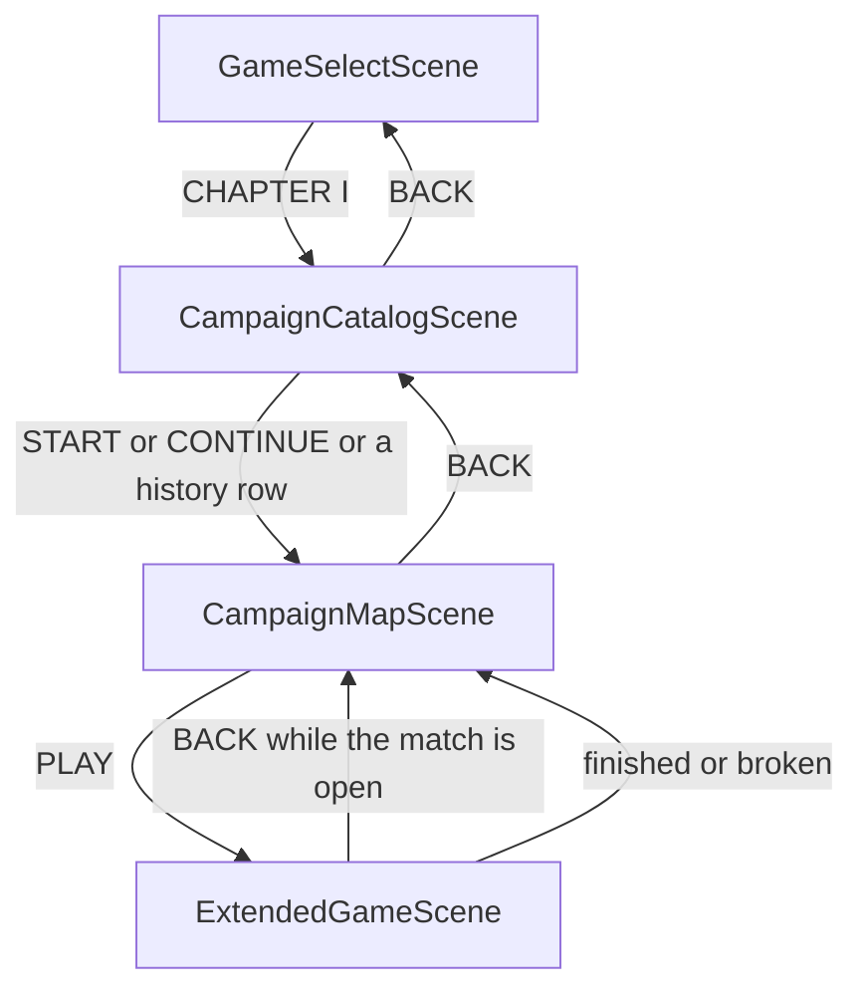

# Campaigns UI — implementation plan

Status: plan only. Not implemented.

Rules live in [campaigns.md](./campaigns.md). The HTTP contract lives in [campaigns_api.md](./campaigns_api.md). This file is the build order for the html5 client. When this plan disagrees with the design, the design wins and this plan is updated.

Out of this plan: API routes, Terraform, a second chapter, selling to the marketplace, and retargeting Play onto `BlitzGameScene`. No new AWS resources. The lobby rename of `episode` to `campaign` stays in the API plan.

## Decisions locked here

1. **Two new scenes, not four.** `CampaignCatalogScene` is the catalog. `CampaignMapScene` is the map, and the battle sheet, the score sheet, the shop, and the log are panels on it. They share one campaign view and one ETag. A separate Phaser scene for each panel would reload the instance on every toggle.

2. **Play opens `ExtendedGameScene` with the existing `gameId`.** Attack has already created the match. `BlitzGameScene` always calls `createGame` and is the lobby match, so it stays out of this path. `ExtendedGameScene` already loads `data.gameId`. A later plan can point Play at Blitz once Blitz can adopt a game instead of creating one.

3. **The hex map is wire graphics on the 390×844 frame.** Same monospace outline language as `GameSelectScene`. It does not stamp a heat field. Flat-top axial math places the nineteen cells. The ASCII map in the design is a picture of that math, not a second coordinate table.

4. **The client does not hardcode Chapter I numbers.** Costs, the battle kit, marketplace prices, and score weights come from `campaign.rules`. Tile difficulty, rounds, income, mines, and flags come from that tile's view. The only fixed geometry is the radius-2 hex: six neighbor deltas and `max(|q|, |r|, |q + r|) <= 2`.

5. **Labels are display words. Payload keys stay the inventory keys.** Stone, Scissors, Paper, Stone NA, Scissors NA, Paper NA, Core, Gold, Silver, Copper. The request body for Buy uses `stones`, `NA_effect_stone`, `NT_effect`, and the other `ITEM_KEYS`. The client never sends a display word as an item key.

6. **One ETag, stored beside the view.** Catalog GET, instance GET, Start, and every action return it in the `etag` response header (`access-control-expose-headers` already lists `etag`). The client sends that exact header value as `If-Match`, quotes included. A command that fails does not change the stored view. A 412 re-reads and stops. The player taps the command again if it is still on the fresh view. End Turn and Buy stay legal after a stale write, so sending them again would pay income twice or buy the stones twice.

7. **The map draws only from a campaign read or a campaign command response.** After Play, the map GETs the instance before drawing. It does not copy leftovers, rewards, or capture from the game payload. `found` and `battleOutcome` are shown from the command that returned them, then dropped. The next draw uses the view alone.

8. **Attack omits `from`.** Any owned neighbor is a legal origin. The client does not ask the player to pick one.

9. **A finished run is the same map with the sheets closed.** History opens that instance by id. No action, shop purchase, end turn, or leave is offered. A missing `score` is not shown as zero.

10. **`economyConsumesActionPoint` is not on the view.** Dig, Search, Upgrade, and Buy are offered without spending the action point. If a later ruleset rejects them for the point, the client shows the 400 and does not grow a local copy of the flag.

## What the client does today

| Fact | Where |
|---|---|
| Choose a game is BLITZ GAME and BACK. | `GameSelectScene.js` |
| Blitz creates an extended match and sends `campaign: { name: 'Episode1' }`. A finished match opens `AdvancedGameResultsScene`. | `BlitzGameScene.js` |
| `ExtendedGameScene` loads `data.gameId` and never creates a game. BACK always goes to `TestsScene`. Match over disables the buttons and stays on the scene. | `GamePlayScene.js`, `ExtendedGameScene.js` |
| `isGameFinished` treats `finished`, `completed`, and `ended` as over. `broken` stays in play. | `SimpleGameSceneUtil.js` |
| `GameAPI.request` and `GameClient.request` return the JSON body and drop headers. Nothing sends `If-Match`. | `api.js`, `gameClient.js` |
| Local pages call `http://127.0.0.1:3000`. Auth is the bearer token already on `gameAPI`. | `api.js` |
| Scenes are script tags in `index.html` and the array in `game.js`. Player-facing flow is `SCENES.md`. | `index.html`, `game.js`, `SCENES.md` |
| There is no test runner under `site/`. | — |

The campaign routes already exist on the API. This plan only consumes them.

## Navigation



Tests still open `ExtendedGameScene` with no `campaignId`. That path still returns to `TestsScene` and still stays on the scene when the match ends. Blitz still opens `AdvancedGameResultsScene`. A campaign battle does not.

## Modules

```
site/html5Simple/js/campaign/campaignClient.js   GET catalog, GET instance, start, action, ETag
site/html5Simple/js/campaign/hex.js              axial placement, neighbor test
site/html5Simple/js/campaign/offers.js           which buttons the current view may send
site/html5Simple/js/campaign/scoreLines.js       one display line per score input
site/html5Simple/js/campaign/labels.js           key to display word, cost and stack phrases
site/html5Simple/js/scenes/CampaignCatalogScene.js
site/html5Simple/js/scenes/CampaignMapScene.js
```

Pure functions stay free of Phaser and free of `export`. The page loads them as classic scripts, the same way it loads `api.js`. Each file assigns one global: `CampaignHex`, `CampaignOffers`, `CampaignScoreLines`, `CampaignLabels`. `campaignClient.js` assigns `campaignClient` once `gameAPI` exists, the same pattern as `gameClient.js`.

`node --test site/html5Simple/js/campaign/campaign.test.js` loads those files with `vm.runInNewContext` and asserts on the globals. A `type="module"` script tag would break the rest of the page, so the tests do not import the files. Scene behavior is checked in the browser against the local API.

`CampaignMapScene` holds `view`, `etag`, and `notice`. `notice` is the one-shot `found` or `battleOutcome` from the last command, or null. A command response sets `notice` from that body, and clears it when the body has neither. A GET clears `notice`. Dismissing the notice reveals the sheet the new view calls for.

## Client

`campaignClient` is constructed with `gameAPI`, same pattern as `gameClient`. It uses `gameAPI.token` and `gameAPI.baseUrl`.

Every method returns `{ body, etag }`. `etag` is `response.headers.get('etag')`. The stored copy is that string. A missing header on a success is a client error (`Campaign changed` is the wrong message; the player sees `Could not read the campaign` and the scene reloads the last GET).

| Call | Request |
|---|---|
| `catalog()` | `GET /campaigns` |
| `start(definitionId, etag)` | `POST /campaigns` `{ definitionId }`, `If-Match` |
| `get(id)` | `GET /campaigns/{id}` |
| `act(id, body, etag)` | `POST /campaigns/{id}/actions`, `If-Match` |

`act` bodies are only the design's commands: `end_turn`, `attack` `{ q, r }`, `autobattle`, `dig`, `search`, `increase_mines`, `buy` `{ item, amount }`, `leave`. No `from`, no `sell`, no link fields.

Errors are the existing `APIError`. The scene reads `error.data.detail` and, on 409, `error.data.gameId`.

A failed command is never posted again by itself. The player taps it again when the fresh view still offers it.

| Status | What the scene does |
|---|---|
| 412 on a command | GET the document that owned the ETag. Catalog for Start, the instance for an action. Store the new ETag and draw that body. Do not send the command again. |
| 412 on a GET | Send that GET once more. A repair write can lose the race. The second body is what the scene draws. A second 412 shows **Reload**. |
| 409 with `gameId` | GET the instance, store the ETag, open the battle sheet. The rejected command is not applied locally. |
| 409 whose `detail` is `The battle already has a move` | GET the instance. Keep **PLAY**. Remove **AUTOBATTLE**. |
| 409 whose `detail` is `No open battle` | GET the instance and draw it. The battle is already gone. |
| Any other 409 | Show the detail. Start-while-started reloads the catalog and opens the `instanceId` already there, and does not post Start again. |
| 400 | Show the detail. Keep the previous view. |
| 404 | Show the detail. Leave the map for the catalog. |
| Network failure after a POST | GET the same document the 412 row uses. Draw it. Do not POST again. If that document is now `started`, open its `instanceId`. If the instance has `activeBattle`, open the battle sheet. |

## Catalog

`GameSelectScene` adds **CHAPTER I** above **BLITZ GAME**, same primary button. It starts `CampaignCatalogScene`.

The scene GETs the catalog and keeps that ETag for Start.

For each `definitions[]` row:

| Shown | Source |
|---|---|
| Title | `title` |
| Goal | `goal` |
| Best | `bestScore`, omitted when null |
| Button | **START** when `currentStatus` is `not_started`. **CONTINUE** when `started`. |
| History | Newest first, with `abandoned` rows omitted. Each remaining row is the finish word and, when `score` is an object, `score.total`. |

Finish words: `victory` is the total alone, `external` is **Ended**. Abandoned runs stay on the player and are not listed. A null score on a victory row is not rendered as 0; the row shows **Victory** until a total exists. Chapter I writes a score for every victory, so this is only the empty case.

START posts `{ definitionId: row.id }` with the catalog ETag. The response body is `{ campaign }` plus a new ETag. The scene starts `CampaignMapScene` with that id. The map GETs before drawing, so a catalog response that is already stale still repairs.

CONTINUE and a history row start the map with `instanceId`. CONTINUE is the active run. A history row is a finished run. Both land on the same scene.

BACK returns to `GameSelectScene`.

The scene loops the array. A second definition later is another block on this screen, not a new scene.

## Map

Phone frame, top to bottom:

1. Title (`campaign.title`), **Turn** `campaign.turns`, and the attack word. `turns` starts at 1. The attack word is **Attack ready** when `actionPoints >= 1`, and **Attack spent** when it is 0. `turnNumber` is not shown.
2. Inventory strip: the three currencies, the three gestures, the three NA counts, Core. Zeros stay visible.
3. The hex field.
4. One bottom sheet. Shop, log, and the cell sheet replace one another. An outcome or search notice draws above the sheet the new view calls for, and dismissing it reveals that sheet.

Chrome buttons while `status` is `started` and `activeBattle` is null: **END TURN**, **SHOP**, **LOG**, **LEAVE**, **BACK**. A finished run keeps **LOG** and **BACK**. SHOP on a finished run is the price list with no BUY. LEAVE asks first: **Leave this chapter? It will not be scored.**

`blockedReasons` sit under the attack word, one line each, and only while `battle_in_progress` is absent. An open battle has already taken the kit out of the wallet, so `cannot_afford_battle` is often present at the same time. That line would claim the player still has to pay. The battle sheet is the whole explanation until the battle is gone.

| Code | Line, after the battle is gone |
|---|---|
| `cannot_afford_battle` | You need the battle kit before you can attack. |
| `no_attack_target` | No neighboring tile to attack. |

An empty array shows nothing. Action points are never turned into a reason code.

### Hexes

Flat-top, north up. Size is whatever fits the field after pad. Placement, with `y` growing downward:

```
x = size * 3/2 * q
y = size * (sqrt(3) / 2 * q + sqrt(3) * r)
```

`(0, -2)` is the top cell. A cell is a neighbor only by the six deltas in the design (north is `q = 0, r = -1`). The hit target is the hex, at least 48px across where the field allows.

| View | Mark on the cell |
|---|---|
| `hidden` | Gray stroke, no text. |
| `blocked` | Gray fill. Chapter I authors none. The branch still draws. |
| `seen` | `E`, `N`, or `H`. An objective cell adds `*`. |
| `owned` | `St`, `Sc`, `Pa`, or `C`, then `mines/maxMines`. The camp at one of three copper mines is `C 1/3`. |

The full words live on the sheet: Easy, Normal, Hard, Objective, Stone, Scissors, Paper, Copper. A radius-2 cell cannot hold them. The client does not label a coordinate "gate", "camp", or "citadel". Those names are not on the view. The log may still show them, because that text is the server's `summary`. Selection is a heavier stroke. A seen cell that shares a side with an owned cell is the attackable outline, even when the Attack button is hidden.

There are always 19 views. A coordinate the view did not send is not invented.

### Action sheet

Tap a cell to open it. Tap the same cell, or BACK on the sheet, to close it. The sheet reads that one view.

Owned cell, and the run is started, and no battle is open:

| Button | Offered when | Label |
|---|---|---|
| Dig | `dugThisTurn` is false and `mines >= 1` | **Dig · {digCost.copper} copper for {2 × income.perTurn} {product}** |
| Search | `searchAvailable` and not `searchedThisTurn` | **Search · {searchCost.copper} copper** |
| Upgrade | not `increasedThisTurn` and `mines < maxMines` | **Upgrade · {increaseMinesCost.copper} copper · {mines} to {mines + 1} of {maxMines}** |

`digCost`, `searchCost`, and `increaseMinesCost` are `{ copper: number }` on the view. The label reads `.copper`. The yield on Dig is `2 × income.perTurn` of `income.product`. That is the design's two turns of the mine, and Dig pays it on this turn, so the owned view is enough. Search does not preview the stash.

A spent action stays on the sheet as disabled text (**Dug**, **Searched**, **Upgraded**), and is not sent. A cost the wallet cannot pay is shown and disabled, and is not sent. `searchAvailable` true with `searchedThisTurn` true shows **Searched** and does not offer Search again this turn.

Seen cell, started, no battle:

The sheet shows the difficulty and the length. **Best of 5** for `BO5`, **Best of 7** for `BO7`. **Attack** is offered only when the cell shares a side with an owned cell, `actionPoints >= 1`, and `cannot_afford_battle` is absent. The button names the length and lists `rules.battleKit` with the display words (**8 Stone, 5 Scissors, …**). Otherwise the length is shown and Attack is absent. Hidden and blocked cells have no actions.

END TURN is legal with the point spent or unspent. The label is **End turn**, with no amount. Owned tiles already show `income.perTurn`, including a tile taken this turn, and the server skips that tile until the next End Turn. `acquiredTurn` is not on the view, so a sum would overstate the payday. The log line after the command is the amount that was paid. The button is hidden while a battle is open or the run is finished.

### Shop

One row per key in `rules.marketplace`, in this order: stones, papers, scissors, the three NA keys, `NT_effect`. The price is the number on that key, copper each. Amount starts at 1. **BUY** sends `{ type: 'buy', item, amount }` where `item` is the key and the copper line is `price × amount`. No silver row, no gold row, no sell. BUY is disabled when the wallet cannot cover the line, while a battle is open, and when the run is finished.

### Log

`campaign.log` as returned, newest first. Each row is the turn, then `summary`. The client shows that phrase unchanged, including a place name or a raw item key the server wrote. It does not fill in a defender kit or a stash the summary does not name.

### Search notice

A search response includes `found` once. The sheet shows **Found** and the keys with a count above zero, using the display words. The following GET does not have `found`. The inventory strip updates from `campaign` in that same response.

### Leave and the other finish

LEAVE posts `{ type: 'leave' }`. The returned view is finished, `finishReason` `abandoned`, no `score`. The client then opens `CampaignCatalogScene`. It does not stay on the map.

`finishReason` `external` uses **Ended. No score.** The client has no button for that finish.

## Battle

When `activeBattle` is set, the battle sheet replaces the action sheet. The attacked cell is the one at `activeBattle.q`, `activeBattle.r`. Map commands, shop BUY, END TURN, and LEAVE are not offered. LOG still opens.

| `activeBattle.gameId` | Sheet |
|---|---|
| A non-empty id, and this session has not been told the match has a move | **PLAY**, **AUTOBATTLE**, and **BACK** |
| A non-empty id, and Autobattle or Cancel attack returned `detail` `The battle already has a move` | **PLAY** only |
| Null | **Finishing the last battle…** and another GET. Still null: no PLAY, no AUTOBATTLE. The next GET is the repair that refunds an empty `gameId`. |

PLAY starts `ExtendedGameScene` with `{ gameId, campaignId, returnTo: 'CampaignMapScene' }`. It does not call `createGame`.

**BACK** posts `{ type: 'cancel_attack' }`. It is offered only while Autobattle is offered. The returned view has no `activeBattle`. The kit and the action point are back, and the cell sheet is what remains when that cell is still selected. A throw already played rejects the command, drops **BACK** and **AUTOBATTLE**, and keeps **PLAY**.

AUTOBATTLE posts `{ type: 'autobattle' }`. The response replaces the view and opens the outcome sheet:

| Line | Source |
|---|---|
| Victory or Defeat | `battleOutcome.result` |
| Rounds | `playerRoundWins`–`npcRoundWins` |
| Captured or Held | `captured` |
| Gained | `reward` keys above zero, or nothing on a loss |
| Spent | `spent.items` keys above zero |

The throws stay on the game. This sheet does not read them. A second Autobattle is not offered once the view's `activeBattle` is null. `detail` `The battle already has a move` drops AUTOBATTLE and keeps PLAY. `detail` `No open battle` reloads the instance and draws that view.

The outcome notice sits above the sheet the resolved view calls for. Dismissing it reveals that sheet. A citadel autobattle returns both `battleOutcome` and `campaign.score`, so the notice comes first and the score sheet is what remains. A win by Play has no `battleOutcome`. The score sheet and the log line are the result.

### Return from Play

`GamePlayScene` reads `campaignId` and `returnTo` from its start data.

When `campaignId` is absent, behavior stays as it is: BACK goes to `TestsScene`, and a finished match stays on the scene with **Match over**.

When `campaignId` is set:

- BACK goes to `returnTo` with that id, while the match is still open. The map GETs. The battle sheet is still up, because `activeBattle` remains.
- The match is over when the game status is `finished`, `completed`, `ended`, or `broken`. The scene then goes to the map with that id. It does not open `AdvancedGameResultsScene`.
- `created` and `started` are still an open battle. The scene does not treat them as over.

The map's `create` always GETs before the first draw. A resolve that landed during the game PUT is on that GET. If the GET still shows `activeBattle` for a game the play scene just saw as finished or broken, the map GETs once more. It still does not invent the loot.

This release does not add a surrender button. The play scene has none today. A loss on this path is a played loss or an autobattle loss.

## Score

When `campaign.score` is present and no outcome notice is up, the score sheet is the bottom sheet and the action buttons stay hidden. An outcome notice from the same response is dismissed before this sheet shows. Lines, top to bottom, amounts from `score`, weights from `rules.scoreWeights`:

| Line | Arithmetic |
|---|---|
| Base | `scoreWeights.base` |
| Turns | `score.turns`, subtracted by `perTurn` each |
| Victories | `score.victories`, added by `perVictory` each |
| Silver gained | `score.silver`, added by `perSilver` each |
| Copper gained | `score.copper`, added by `perCopper` each |
| Total | `score.total` |

`perTurn` is the weight that is subtracted. The others are added. The total shown is the stored total. The lines explain it. They are not a second score the client stores.

A finished run without `score` uses the finish-reason sheet from the map section. The catalog's **Best** is `bestScore` from the catalog GET, not a total summed on the client.

## Copy the view is allowed to derive

All of these are on the response. None of them read a stash, an unknown garrison, or `startingInventory`. A `garrison` on a seen tile is shown, because that stock is already known.

- Attackable: `visibility === 'seen'` and some owned cell is one of the six neighbors.
- Dig yield: `2 × income.perTurn` of `income.product`. Dig pays this on the current turn.
- Copper costs: `rules.digCost.copper`, `rules.searchCost.copper`, `rules.increaseMinesCost.copper`.
- Upgrade preview: `mines + 1`, capped by the offer rule `mines < maxMines`.
- Kit and price phrases: keys in `rules.battleKit` and `rules.marketplace` with a count above zero.
- Score lines: `score` and `rules.scoreWeights` only.

End Turn has no derived amount. The payday depends on `acquiredTurn`, and the view does not include it.

`blockedReasons` and the button rules are display. The server checks again. A 400 or 409 leaves the last good view on screen and shows `detail`.

## Slices

Each slice ships the scripts, the `index.html` tags, the `game.js` registration, and the `SCENES.md` rows it makes true. Cache-bust query strings on new and edited script tags move, same as the existing tags.

### Slice 1 — Client, catalog, read-only map

The path from Choose a game to a drawn hex, with no commands except Start.

- `campaignClient` and the ETag rules above, including the reload after a lost Start. The test file loads the globals through `vm`.
- CHAPTER I on `GameSelectScene`.
- Catalog: goal, status, best, history, START, CONTINUE.
- Map GET, header, inventory strip, 19 hexes, BACK. No action sheet yet. A started run and a finished run both draw. `activeBattle` shows the cell and the words **Battle in progress** without PLAY. Stall lines stay hidden while that battle is open.
- `CampaignHex` tests: `(0, -2)` is above `(0, 0)`; the six deltas match the design; `(3, 0)` is off the radius-2 hex. Cell marks are `E` / `N` / `H`, `*` on an objective, and `C 1/3` on an owned copper mine.

Done when a guest can open Chapter I, start it, see turn 1, one attack, the starting wallet, the camp owned, six neighbors seen, and the rim hidden. BACK returns to the catalog, and the catalog then says CONTINUE. A second START is not offered.

### Slice 2 — Economy sheets

End turn, dig, search, upgrade, shop, log, leave, and the finished sheet.

- Offers and labels, with tests for the camp on turn 1: dig offered at `digCost.copper` for `2 × perTurn` copper, search not offered, upgrade offered, attack offered on the six seen neighbors and not on a hidden cell. End Turn is offered with no payday string. A fixture that also owns a tile with `income.perTurn` still produces no payday string.
- Score-line test with the design's weights object and one stored score. The total line is the stored total. An absent score produces no lines.
- `CampaignLabels` reads `{ copper: 4 }` as `4`. Passing the object through as text is a failed test.
- Disabled spent actions are not sent. A short wallet disables the button.
- Search shows `found` once.
- LEAVE confirms, then opens `CampaignCatalogScene`. The catalog does not list that run. Opening the map of an abandoned id directly still shows **Left. No score.** and has no economy buttons.
- 400 keeps the wallet as it was. 412 reloads the instance and does not send the command again.

Done when the camp can be dug, the turn can be ended, the log shows the server's income summary, a buy of stones spends copper, and Leave returns the catalog to START with no abandoned row and the previous best unchanged.

### Slice 3 — Attack, play, autobattle, victory

- Attack sends `{ type: 'attack', q, r }` and opens the battle sheet from `activeBattle` and `gameId`.
- PLAY and the `GamePlayScene` return rules. Tests-scene play is unchanged. Add a helper for campaign match-over that includes `broken`, and use it only when `campaignId` is set.
- AUTOBATTLE outcome notice. `detail` `The battle already has a move` leaves PLAY and removes AUTOBATTLE. `detail` `No open battle` reloads and draws the instance.
- A lost Attack response reloads the instance. `activeBattle` opens the battle sheet. Attack is not posted again.
- 409 with `gameId` on END TURN, DIG, BUY, or LEAVE opens the battle sheet after a GET.
- A citadel autobattle shows the outcome notice first. Dismissing it shows the score sheet from `campaign.score` and `rules.scoreWeights`. A citadel win by Play opens the score sheet directly. The catalog shows `not_started`, the history total, and `bestScore`.

Done when the gate can be taken by Play or by Autobattle, the map after Play shows the owned gate only once the GET returns it, a loss leaves the gate neutral and still allows Dig on the camp, and the citadel win shows the score lines and stores the run in history. A broken match returns the kit and the attack on the following GET, which the player can see because the wallet and **Attack ready** match the pre-attack turn. The battle sheet shows no kit-stall line while the fight is open.

### Slice 4 — Browser pass

No new feature. Walk the list below on the local API in the game frame, phone width. Fix what the pass finds before calling the plan done.

## Acceptance

A guest session against the local API:

1. Catalog before any run: goal text, no best, START. UC-1.
2. START shows turn 1, the starting wallet, camp owned, six seen neighbors, rim hidden. UC-2, UC-4.
3. START again is not on screen while that run is open. UC-3.
4. Attack the north neighbor, PLAY, win. The map's GET shows that cell owned and the new neighbors seen, including the objective. The game scene did not create the match. UC-5, UC-6.
5. AUTOBATTLE on a fresh attack shows the outcome sheet and does not ask for a throw. A second autobattle is not offered. UC-5b.
6. A lost attack leaves the cell neutral. Dig on the camp is still offered. UC-7.
7. END TURN with the attack unspent pays the camp and shows turn 2. UC-9.
8. Dig, upgrade, and a search after the south cell is owned. The search notice matches `found` and does not remain on the next visit. The camp offers no search. UC-10.
9. BUY two stones. The copper line matches `marketplace` times the amount. UC-10b.
10. Take the objective. The score sheet uses the stored weights and the stored total. The catalog offers START, lists the total, and shows that best. UC-11.
11. LEAVE on a later run opens the catalog on START and does not change the best. UC-12.
12. START after a victory creates a new run. The victory row still opens a quiet map. An abandoned run is not on the catalog. UC-13.
13. Attack on an owned cell, a hidden cell, or with the attack spent is not sent. UC-14.
14. BLITZ GAME still starts its own match and still ends on the results scene. UC-15, as far as the client can see.
15. Two tabs: the second END TURN shows the conflict once, reloads, and does not double the income. UC-17.

The client never posts `campaignId`, `campaignTile`, `campaignAttackId`, `campaignBattleSeed`, or `campaignNpcAlgorithmId` on `POST /games`. Blitz and Tests keep sending `campaign: { name }` only.

A seen tile may include `garrison` after a defeat on that hex. The cell sheet then adds a Garrison panel under the difficulty lines. The panel lists the same counts as the wallet strip, with Core on its own row so a number is not wrapped away from its name. Zeros stay visible. A defeat notice still adds `Defender left …`, or `Defender has nothing left` when the remainder is empty. The client does not show a garrison that the response omitted.

## Build notes

- Bump the query string on every script tag this work adds or edits.
- Register both scenes in `game.js` and document them in `SCENES.md`, including the CHAPTER I row on GameSelectScene.
- Keep campaign sessions on the 390×844 frame. Do not route them through the 780×844 tests hub.
- Do not read `campaign.tiles` as server tiles. The array on the response is already the views.
- Do not cache a campaign view in `localStorage`. The ETag lives in the scene that last received it.
- Keep the campaign scripts as classic globals. The node test loads them with `vm`. Do not add `export` or `type="module"` for these files.
- Read copper costs from `.copper`. Do not stringify `digCost`, `searchCost`, or `increaseMinesCost`.
- Do not put a payday on End Turn. Do not show stall lines while `battle_in_progress` is set.
- On 412, or on a network failure after a POST, draw the reloaded document and wait for the next tap.
- Surrender, a Blitz-skinned campaign battle, and heat on the hex field stay out. The first needs a play-scene control this game does not have. The second needs Blitz to adopt a `gameId`. The third is a different screen from the match.
