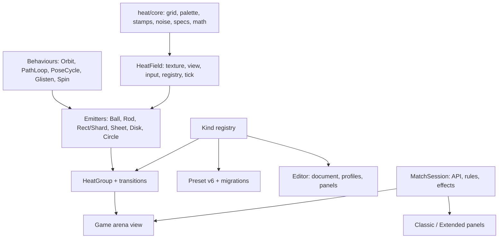

# Heat map, composites, games, and editors: refactor plan

Status: proposal. Scope: `site/html5Simple` only. No API changes.

Revision: step 1 is now [heatmap_step1_ui_objects_transitions.md](heatmap_step1_ui_objects_transitions.md). It focuses on the heat UI objects, the composites, and a transition system with reliable start and reset. Where the two plans differ on emitters, props, or groups, step 1 wins. In particular, items keep their own fields: no shared group clocks, and no template-prefixed params. The editors are tools, so Phase 6 is low priority.

Step 1 (UI object structure and composite animations) is planned in detail in [heatmap_ui_objects_transitions.md](heatmap_ui_objects_transitions.md). It comes before the editor work below.

## Why

The heat-map work grew one sandbox at a time. Each new effect copied the file before it and added a branch. It works, but:

- Adding one new object kind means editing about ten places in six files.
- The Composite UI Editor is a copy of the UI Editor plus branches. The two pairs of scenes add up to over 2,300 lines.
- The uncommitted work adds per-frame "is this still attached?" guards to ten scenes to cover lifecycle leaks. The guards hide the cause and don't fix it.
- The local advanced match re-implements the match logic that `GamePlayScene` already has.

The plan splits the code into layers with one contract each. It then migrates in phases, and the game stays shippable after every phase.

## What exists today

| Area | Files |
|---|---|
| Heat field + emitters | `fx/HeatMapFx`, `fx/RotatedHeatMapFx` (shared field + hot ball), `fx/HotRodFx`, `fx/BackHighlightFx` (rect + shard), `fx/SheetFx`, `fx/HotCircleFx`. Each also has an `attachX(scene, …)` that builds a private field for one sandbox. |
| Editable wrappers | `ui/UiHeatMap`, `ui/UiHotBall`, `ui/UiHotRod`, `ui/UiBackHighlighter`, `ui/UiShard`, `ui/UiSheet`, `ui/UiNewSheet`, pulses (`HorisontalPulse`, `VerticalPulse`, `VictoryPulse`) |
| Composites | `ui/HotMapUiComposite` base, with Stone (balls), Scissor (shards), Paper (sheets), New Paper (disks) |
| Editors | `UIEditorScene` + `UIEditorToolsScene`, `CompositeUIEditorScene` + `CompositeUIEditorToolsScene`, `ui/UiPropEditor`, `ui/UiEditorPreset` |
| Games | `GamePlayScene` (+ `ClassicGameScene`, `ExtendedGameScene`), `LocalAdvancedGameScene` |
| Other heat consumers | `MenuScene` skin (`ui/UiSkin` + `resources/ui-editor-init.json`), nine sandbox scenes |

## Findings

### 1. The heat field is implemented six times

- The palette (`heatRgb`) is copied four times: HeatMapFx, RotatedHeatMapFx, HotRodFx, and HotCircleFx.
- The diffusion step is copied three times (plus HotCircle's wind variant).
- Pointer-to-cell conversion is copied three times. Pixel-to-cell conversion is copied four more times: `heatMapCellAt` in LocalAdvanced and one helper per pulse.
- Clamp-to-spec has six variants (`clampHeatParam`, `clampNamedParam`, `clampHotRodParam`, `clampBackHighlightSpec`, `clampHotCircleParam`, `clampNewSheetSpec`), plus hand-rolled clamps in each composite.
- Every `attachX` builds its own grid, texture, image, hit zone, and shutdown handler.
- Shared helpers live in whichever file needed them first:
  - SheetFx paints with `paintHotRodHeat`.
  - BackHighlightFx converts coordinates with `hotRodPctToCoord`.
  - UiNewSheet spaces its balls with `hotMapStoneEvenPhaseGoals`.
  - UiHotBall reads `UI_EDITOR_BALL_PARAM_KEYS` from the preset file.
  - `copyOrbitPoint` is defined in the preset file and used everywhere.

  Only the script order in `index.html` holds this together.

### 2. Emitters have no common contract

- The field keeps three lists: `balls`, `rods`, and `highlighters`, and in practice `highlighters` holds everything else. HotMapUiNewPaper registers itself as a highlighter only to get an `advance()` tick. It never stamps.
- There are four wrapper shapes:
  - UiHotBall wraps `motion`.
  - UiHotRod, UiBackHighlighter, UiShard, and UiSheet wrap `emitter`.
  - UiNewSheet is the emitter itself.
  - Composites own parts.

  All other code has to know which shape it's dealing with, for example `heatMapRegistration`, `captureLocal` / `applyLocal`, and `releaseObject`.
- Behaviour is changed by monkey-patching. All three pulses replace `emitter.advance` on a UiHotRod, and two of them also replace `stamp`. The Scissor flight replaces `emitter.stamp` and puts it back when the flight ends.
- UiBackHighlighter and UiShard are the same class with different tabs. Both are about 180 lines and use the same emitter factory. `nudgeCenter` is copied into three wrappers.
- Params are flattened by hand. Every wrapper and composite writes a large `params` getter (`fromWidth`, `toGlisten`, `newBallInit_tiltX`, `shardSpeed`, …). Each one also needs a matching key map so UiPropEditor can nudge the values: `BACK_HIGHLIGHT_POSE_KEYS`, `SHEET_EMITTER_POSE_KEYS`, `HOT_MAP_SCISSOR_SHARD_POSE_KEYS`, `HOT_MAP_PAPER_POSE_KEYS`, …
- Shared timing is coordinated through `field.sheetEpoch`, a frame counter with a sheet-specific name. Paper's ball, glisten, and shape clocks and New Paper's shared spin compare epochs so they step only once per frame.
- There are side effects on shared state. Calling `new UiNewSheet(heatMap)` without `ownField: false` overwrites diffusion, cooling, and view for the whole field.

### 3. Kind strings are how new kinds get added

There are 113 `kind === '…'` checks in 11 files. Adding a kind means editing:

- `heatMapRegistration`
- `HotMapUiComposite.captureLocal` / `applyLocal`
- `uiObjectTypeLabel`
- `shiftUiObjectCopy`
- `spawnObject`
- `releaseObject`
- `activePropEditor` / `syncPropEditors`

It also means adding a new prop editor instance and a new array on the host scene.

### 4. The composites are four hand-written variants

- The base class is generic (center, spawn, parts, offsets), but its offset logic is a switch on kind.
- Each subclass has its own "init" template with its own nudge, clamp, copy, and serialize code: `ballInit`, `shardInit`, and `sheetInit` (twice).
- Each group has its own add animation:
  - Stone: balls orbit in from the spawn point and spread their phases.
  - Scissor: shards fly in and spin.
  - Paper: a pair of balls travels in, splits, and the sheet is revealed.
  - New Paper: balls travel in, and a "drama" plays on remove.

  That logic lives in three different places: the composite, the SheetFx emitter (`travel` state), and UiNewSheet (`ballTravel`, `drama`). The editor already calls these "transitions" and has ADD / REMOVE / HIT / BREAK tabs. HIT and BREAK are empty, and there is no transition type.
- The editor is wired to the groups by assigning `onPartAdded` and `onPartRemoved` properties from the tools scene.

### 5. Two editors, one copied from the other

- CompositeUIEditorScene is a copy of UIEditorScene. CompositeUIEditorToolsScene (1371 lines) is a copy of UIEditorToolsScene (603 lines) plus branches.
- The object list, scrolling, rows, file bar, panels, and BACK button are copied verbatim.
- `noteStonePart`, `noteScissorPart`, `notePaperPart`, and `noteNewPaperPart` differ only in which array they touch. `ensureStoneListed`, `ensureScissorListed`, `ensurePaperListed`, and `ensureNewPaperListed` are the same.
- Ten `UiPropEditor` instances are created up front, one per kind, and shown or hidden by kind. Five more are created for transitions.
- There's no document model. The tools scene reads the host scene's arrays (`host.balls`, `host.rods`, `host.highlighters`, `host.shards`, `host.sheets`) and named groups (`host.stone`, …) directly.
- `UiHeatMap` knows about editor overlays: `showFrames` toggles `scene.stageMarkup`.
- The tab, toggle, and stepper widgets are copied into UiPropEditor and seven sandbox scenes. `createMenuButton` exists in 14 files.

### 6. Presets: several formats, lossy, matched by index

- There are four formats:
  - `ui-editor-preset` v2: balls/rods/highlighters arrays, used by the Menu skin.
  - Composite v5: `stone` / `scissor` / `paper` / `newPaper`.
  - Resource files v4, one group per file: `stone-1`, `scissors-1`, `paper-1`, `new-paper-4`.
  - `hotmap-1.json`, which holds only field params.
- `serializeUiEditor` saves only width, height, angle, and heat for highlighters, so shard skew, glisten, and shapeHeat are dropped on save.
- Load applies entries by index onto objects that already exist. The composite editor has to pre-create or prune objects (`ensureKindCount`) so the counts line up.

### 7. Lifecycle leaks and the uncommitted guards

- Phaser reuses scene instances. State on `this` survives `shutdown`, but the field, texture, and view are destroyed.
- LocalAdvancedGameScene runs its move choreography as a long async chain (`await pause…`). `pause` resolves immediately once the scene is inactive. So a chain started on a previous visit keeps running and changes the new visit's composites, because `this` is the same object. The `_visit` counter and the `visitOpen` checks after every `await` are the patch for this. This is the one cross-visit leak I could confirm by reading the code.
- The uncommitted diff also adds:
  - `bindSceneHeatObjects(this)` in ten scene `update()` loops. It re-registers anything missing, every frame.
  - `liveOn` / `bindToField` on composites.
  - `syncSceneComposites()`, which rebuilds a composite if any part is unregistered. It runs every frame and from most handlers.
  - `menuSkinLive`, `healthBarsLive`, and pruning in `ensureKindCount`.

  In the seven sandboxes that use a standalone `attachX` field, `bindSceneHeatObjects` does nothing, because `this.heatMap` isn't a UiHeatMap. These guards look defensive. They cost a full scan every frame and hide whatever the real trigger was.
- `field.update` loops over `highlighters` with `forEach`, and New Paper's `advance()` can remove a sheet from that same list during the loop. This only works because the New Paper registers itself before its sheets.

### 8. Two game implementations

- `GamePlayScene` (Classic / Extended) is in reasonable shape, and the rules live in the subclasses. It's long (1217 lines) because it builds every panel inline.
- `LocalAdvancedGameScene` doesn't extend it. It re-implements:
  - the effect definitions (the same list as `ExtendedGameScene`)
  - the rule that effects of one category replace each other
  - `buildMoveAction`
  - send and error handling, and `showErrorModal`
  - the match-over check
- It finds layout by label string (`boxes.find(b => b.label === 'enemy_data')`).
- Health bars are back highlighters driven by the menu's hover mode. `armHover()` / `setHovered(true)` is used to mean "fade out".
- The outcome sequence (reveal, pause, pulses, remove the loser, post-mortem, victory pulse) is hardcoded in `playMoveResult`.

### 9. Performance (not urgent)

The full stage grid is 130×281, about 36.5k cells. Every frame runs one diffusion pass and one paint with a `Math.pow` per cell; a palette lookup table removes the `pow`. Some emitters also add full-grid passes. Each UiSheet with glisten on fills and scans a full `shine` buffer. Each UiNewSheet fills and scans a full `diskSum` buffer, so a stack of 8 disks adds 16 full-grid passes per frame. Stamping inside each shape's bounding box fixes this.

## Target design



### Layer 1: `heat/core` (no Phaser)

Pure functions over `Float32Array`:

- `stepDiffusion(src, dst, cols, rows, dt, params)`, plus a wind variant
- `paintHeat(imageData, grid, lut)`
- Stamps:
  - `stampDot` with an `add | max` blend
  - `stampLine` with a clip region
  - `stampQuad` for the rect and the shard
  - `stampRibbon` for the sheet
  - `stampDisk`
- `valueNoise`
- `ParamSpec`: `clamp`, `nudge`, `decimals`
- Math: `eulerRotate`, `wrapDeg`, `followK(speed, dt)`, `dtOf(delta)`

The numbers stay exactly as they are today. The blend differences stay, but become explicit: HeatMapFx dots add, hot-ball dots take the max, and the glisten blends toward 1.

### Layer 2: `HeatField` (the Phaser adapter)

One class used by every scene, sandboxes included. It owns the grid, texture, image, and hit zone. It also provides:

- A single ordered registry: `add(emitter, { layer })`, `remove(emitter)`, `has(emitter)`. Layers keep today's stamp order: balls, then rods, then everything else. A removal made during a tick is queued and applied after the tick.
- `addController(obj)` for objects that need a tick but don't stamp, such as groups and clocks.
- A `frame` counter that replaces `sheetEpoch`.
- Coordinate helpers: `toCell(x, y)`, `toPixel(cell)`, `spanToCells(px, axis)`, and `pctToCell` / `cellToPct` for today's −200…200 % space.
- `destroy()`, called on scene shutdown. It detaches every emitter (`emitter.field = null`), so a stale object fails loudly instead of stamping into nothing.

`UiHeatMap` becomes HeatField plus PLAY / STEP / STOP. The transport buttons and the FRAMES / MENU toggles move to the editor.

### Layer 3: emitters and drivers

```js
class HeatEmitter {
  static kind; static label; static PROPS; static TABS;
  constructor(field, data)
  advance(dt)             // motion only
  stamp(grid)             // heat only
  anchors()               // [{ col, row }] points that move with a group
  translate(dCol, dRow)
  serialize() / apply(data)
}
```

- Motion is built from shared drivers instead of copied code:
  - `OrbitMotion` for the ball
  - `PathLoop` for the rod: start to end, then delay and gap
  - `PoseCycle`: from/to poses, delay, gap, cycling, and hover drive. Shared by the rect, the shard, the sheet, and the health bars.
  - `GlistenClock` and `SpinClock`

  Each driver can take a shared clock, so a group can keep its children in sync without comparing epochs.
- Scripted motion becomes an option instead of a patch. Pulses use `new HotRod(field, { motion: 'scripted', clip })`. The Scissor flight becomes an `enter` transition that sets a pose override.
- The kinds after merging:
  - HotBall
  - HotRod
  - HeatRect: the rect and the shard. A shard is a HeatRect with the skew, glisten, and shape props shown.
  - HeatSheet
  - HeatDisk, from UiNewSheet
  - HotCircle

  PlasmaBall stays separate because it isn't a heat emitter.

#### Declarative props

`static PROPS` maps each editor key to a data path and a spec:

```js
static PROPS = {
  isVisible: { type: 'bool', path: 'isVisible' },
  fromWidth: { path: 'pose.from.width', spec: POSE.width },
  centerX:   { get: (e) => e.field.cellToPct('col', e.target.col), set: (e, v) => …, spec: PCT }
};
static TABS = [{ id: 'from', label: 'FROM', rows: [{ key: 'fromWidth', label: 'WIDTH' }, …] }];
```

A shared `PropBinding` derives `params`, `setParam`, `nudgeParam`, and the default `serialize` / `apply` from PROPS. UiPropEditor keeps its UI and reads PROPS. This removes the hand-written `params` getters and every `*_POSE_KEYS` map.

Group templates (`ballInit`, `shardInit`, `sheetInit`) are plain item fields that get copied into each new item, never shared by reference.

### Layer 4: kind registry

```js
HeatKinds.register(HeatRect, { label: 'Highlight', copyShift: 'center' });
HeatKinds.create(kind, field, data);
HeatKinds.label(kind);
HeatKinds.tabs(kind);
```

Each of the 113 kind checks becomes either a registry lookup or a method on the object.

### Layer 5: groups and transitions

`HeatGroup`, which replaces `HotMapUiComposite`:

- Has a center, a spawn point, and ordered parts.
- Moves its parts through `anchors` / `translate` instead of a switch on kind.
- Emits `added` / `removed` events.
- Registers on the field as a controller.

A group is configured instead of subclassed:

```js
const STONE_GROUP = {
  kind: 'stone', item: 'hot-ball', max: 9,
  template: HOT_BALL_DEFAULTS,
  place: evenPhases,           // where item N goes
  enter: orbitInFromSpawn,     // ADD transition
  exit: removeNow              // REMOVE transition
};
```

- Transitions are small state machines with `start(item, ctx)`, `advance(dt)`, and `done`. They take over logic that is spread out today:
  - SheetFx `travel`
  - UiNewSheet `ballTravel` and `drama`
  - Scissor `armShardFlight`
  - Stone `spreadBallPhases`
- HIT and BREAK get the same kind of slot, so the empty editor tabs have something to bind to.
- Shared cycles (Paper's ball, glisten, and shape clocks, and New Paper's spin) become per-item fields. A new item copies the lead item's behaviour state when it's added, and composite-level settings write through to every item. The step 1 plan has the details.

### Layer 6: presets

There is one schema, `heat-scene` v6:

```json
{
  "kind": "heat-scene",
  "version": 6,
  "field": { "diffusion": 9, "cooling": 3, "viewX": 0, "viewY": 0, "viewZ": 0 },
  "objects": [{ "id": "b1", "kind": "hot-ball", "data": {} }],
  "groups": [{ "id": "stone", "kind": "stone", "data": {}, "parts": ["b1"] }]
}
```

- The loader creates objects through the registry and replaces the scene's contents. Nothing is matched by index.
- Migrators read:
  - v2 `ui-editor-preset`
  - the v4 single-group resource files
  - composite v5
  - the field-only `hotmap-1.json`
- Saving goes through PROPS, so nothing is lost.

### Layer 7: one editor

- `EditorDocument`, on the host side, holds the field, objects, groups, and selection, and emits events. The tools scene talks only to the document.
- `EditorProfile` holds what differs between editors:
  - title
  - allowed kinds and groups
  - default preset
  - side tabs: OBJECTS only, or OBJECTS + TRANSITIONS
  - markup overlays

  "UI Editor" and "Composite UI Editor" become two profiles of one `HeatEditorScene` + `HeatEditorToolsScene` pair. The Tests hub keeps both buttons.
- The panels become components:
  - `ObjectListPanel`: scrolling, rows, COPY / DEL
  - `FileBar`
  - `PropsPanel`: one UiPropEditor per kind, created on first use
  - `TransitionsPanel`
- `ui/widgets.js` holds the tab button, toggle, stepper, menu button, panel frame, and row action. The editor, UiPropEditor, the sandboxes, and the Menu all use it.

### Layer 8: games

- `MatchSession` (no Phaser) holds:
  - `gameId` and `gameData`
  - the pending move `{ type, size, effects }`
  - `send()` and error normalization
  - events: `changed`, `resolved`, `error`
  - a `MoveRules` object with three variants:
    - classic: size 0
    - extended: size 1 to 10, cancel decrements
    - local advanced: size is the stack count, with a max per type

  `MOVE_EFFECTS` and the category rule are defined once, here.
- `GamePlayScene` uses MatchSession. Its panel builders move to `ui/gamePanels.js`, so the scene file only does layout.
- `LocalAdvancedGameScene` becomes MatchSession plus three pieces:
  - `HeatArena` view: player and enemy slots, one group per move type, built from a config table
  - `HealthBar` component: a row of HeatRects with an explicit `setLit(n)`
  - `Choreography` runner:

    ```js
    await run([
      reveal('enemy'), wait(5000),
      all(pulse('enemyBeginFight'), pulse('userBeginFight')), wait(2000),
      when('someoneWon', removeAll('loser')),
      when('playerWon', seq(pulse('enemyPostMortem'), clear('player'), victory('player'))),
      when('enemyWon', seq(pulse('userPostMortem'), clear('enemy'), victory('enemy')))
    ], { token });
    ```

    The token is cancelled on shutdown, so the `_visit` checks go away.
- Layout uses named regions (`layout.region('enemy')`) instead of label string searches. The green markup layer reads the same regions.

### Folder layout

```
js/heat/core/      HeatGrid, HeatPalette, HeatStamps, HeatNoise, ParamSpec, HeatMath
js/heat/           HeatField, HeatKinds, PropBinding, HeatPreset (+ migrations)
js/heat/drivers/   OrbitMotion, PathLoop, PoseCycle, GlistenClock, Spin
js/heat/emitters/  HotBall, HotRod, HeatRect, HeatSheet, HeatDisk, HotCircle
js/heat/groups/    HeatGroup, stone, scissor, paper, diskStack, transitions/
js/heat/fx/        RodPulse (horizontal, vertical, victory)
js/editor/         EditorDocument, profiles, HeatEditorScene, HeatEditorToolsScene, panels/
js/game/           MatchSession, MoveRules, moveEffects, Choreography, HeatArena
js/ui/             widgets, UiPropEditor, gamePanels, UiSkin, UiStageMarkup
js/scenes/         thin scenes + SandboxScene base
```

The files stay classic `<script>` globals unless the module decision below goes the other way.

## Migration phases

Each phase ships on its own and keeps every scene working. It's verified against the Phase 0 checks.

### Phase 0: safety net

- Add a Node test harness for the pure code in `site/html5Simple/test/`, using Vitest (as in apiv2). Each pure file gets a two-line tail, `if (typeof module !== 'undefined') module.exports = {…}`, so it loads in Node and still works as a browser global.
- Golden tests:
  - For each emitter kind, run N frames with fixed deltas and compare a hash of the grid.
  - For each preset file, load, save, and compare.
- Write a manual smoke list per scene from `SCENES.md`:
  - Menu skin on and off
  - Save / load in both editors
  - Each sandbox
  - Classic, extended, and local advanced matches, including leaving in the middle of a choreography and coming back
- Reproduce the symptom that led to the uncommitted rebinding guards (leave and re-enter each scene, toggle the menu skin, leave local advanced during a move) and write down the actual cause.

Exit: tests pass on the current code, and the root cause is written down.

### Phase 1: heat core (low risk, no behavior change)

Extract `heat/core`, point every FX file at it, and delete the duplicates. The grid goldens must not change.

Add the palette lookup table as its own step. A table quantizes heat, and the palette is steep near zero: a plain 256-entry table would turn the faintest reds into a visible jump. Index it by `sqrt(heat)` with about 1024 entries, and check painted pixels against the current output within a small per-channel tolerance.

Exit: the FX files contain only their emitter logic, the grid goldens are unchanged, and painted output stays within the tolerance.

### Phase 2: HeatField and lifecycle

- Build HeatField with the single registry, deferred removal, `frame`, the coordinate helpers, and `destroy()`. `attachRotatedHeatField` becomes a thin alias. The per-sandbox `attachX` fields are rebuilt as a HeatField plus one emitter.
- Scene rule: `create()` rebuilds all heat state, and `shutdown` calls `field.destroy()` and cancels async work. Add a `sceneScope(scene)` helper (a cancel token plus disposables) for the editors and games.
- Once the Phase 0 repro passes without them, remove:
  - `bindSceneHeatObjects`
  - `liveOn` / `bindToField`
  - the per-frame `syncSceneComposites`
  - `menuSkinLive`, `healthBarsLive`, `syncResultRods`

Exit: nothing is re-bound per frame anywhere, and the smoke list passes, including leave and re-enter.

### Phase 3: emitter contract and props

- Add the base class, drivers, PROPS / TABS, and PropBinding.
- Merge UiBackHighlighter and UiShard into HeatRect. Turn UiNewSheet into HeatDisk.
- Replace the three pulses with one RodPulse that uses scripted motion instead of monkey-patching.
- UiPropEditor reads PROPS.
- Keep the old class names as aliases until Phase 6.

Exit: the goldens are unchanged, and every editor PROPS panel matches the old one row for row.

### Phase 4: kind registry and groups

- Add HeatKinds.
- Build HeatGroup plus configs for stone, scissor, paper, and the disk stack.
- Extract the transitions: ADD, and REMOVE including the drama.
- Per-item fields plus copying on add replace the shared clocks and the epoch checks.
- Events replace the `onPartAdded` properties.

Exit: there are no `kind === '…'` checks outside the registry, and the composite editor's ADD / REMOVE behave the same.

### Phase 5: presets v6

- Add the schema, loader, migrators, and lossless save.
- Convert the resource files, keeping the originals as migrator test fixtures.
- Load the Menu skin, the composite default, and LocalAdvanced through the new loader.

Exit: every existing JSON loads and survives a save/load round trip, and a saved v6 file reloads identically.

### Phase 6: merge the editors

- Add EditorDocument, profiles, panels, and widgets.
- Delete the CompositeUIEditorScene / ToolsScene duplicates, keeping the scene keys through profiles so the Tests buttons still work.
- Move the FRAMES / MENU toggles out of UiHeatMap.

Exit: both editor entries run on one pair of scenes, and the tools scene is under about 500 lines.

### Phase 7: games

- Add MatchSession, MoveRules, and moveEffects.
- Move GamePlayScene onto them, with its panels moved to `gamePanels`.
- Move LocalAdvanced onto MatchSession + HeatArena + HealthBar + Choreography.
- Switch to named layout regions.

Exit: classic, extended, and local advanced matches play end to end against the local API. Leaving in the middle of a choreography leaves no stray emitters.

### Phase 8: sandboxes and docs

- Add a SandboxScene base that uses UiPropEditor; AlterSheetScene already follows this pattern.
- Rewrite the eight other sandboxes as configs.
- Update `SCENES.md` (including ALTER SHEET, which it doesn't list today) and `UI schema.md`.
- Remove the aliases.

### Order if time is short

0, then 2 (fixes the real leaks), then 1, 3, 4, 7, 5, 6, and 8. The MatchSession part of Phase 7 doesn't depend on the heat work and can go any time after Phase 0.

## Open decisions

Recommended defaults are marked.

1. **Module system.** Stay with classic scripts plus a `module.exports` tail (recommended: the S3 deploy needs no build step), or move to ES modules or Vite later.
2. **Preset back-compat.** Keep reading old files through migrators (recommended), or convert once and drop the old formats.
3. **Editors.** Keep two Tests entries as two profiles (recommended), or one editor with a mode switch.
4. **Uncommitted guards.** Commit them as they are, for a known baseline before starting (recommended), or fold them straight into Phase 2.

## Out of scope

- API changes
- New visual effects
- Changes to how the heat looks or to its tuning numbers
- Classic / Extended visuals
