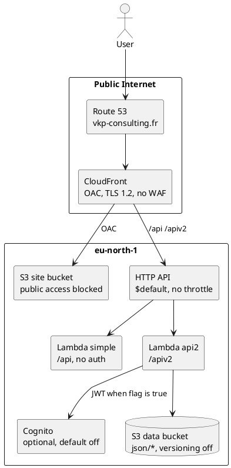

# Well-Architected Review: VKP Consulting

Stored 19 November 2026. Remediations are not started. When the work begins, start with the Do First list in Prioritized Remediation Plan.

> **Classification: CONFIDENTIAL** — This report contains sensitive infrastructure details and unremediated security findings. Restrict distribution to authorized personnel. Do not post to broadly visible channels or ticketing systems without explicit approval.

## Coverage Audit

- BPs evaluated: 261 / 261
- Framework version source: live documentation via ACQUIRE_CORPUS
- Corpus provenance: https://docs.aws.amazon.com/wellarchitected/latest/framework/toc-contents.json at 2026-11-19T22:13:50.759Z · Retrieval method: https_toc_index
- Pillars: 7 · Questions: 57 · Best practices: 261
- Status distribution: 48 Implemented, 80 Partially Implemented, 54 Not Implemented, 41 Not Applicable, 38 Cannot Determine

The live table of contents has no Appendix. Pillars are the parent of each question node. Cloud Foundations is included because it contains the FND questions. AWS documentation MCP was unavailable; the index was fetched over HTTPS. No best-practice identifier was invented. Account services that this repository does not define (CloudTrail, GuardDuty, Organizations, root MFA, Support) are Cannot Determine, not confirmed absent.

## Executive Summary

- **Date**: 19 November 2026
- **Workload**: VKP Consulting public site and game API (`vkp-consulting.fr`)
- **Business Criticality**: Standard
- **Lens Applied**: General
- **Packages Analyzed**: `terraform/`, `apiv2/src` (routing, auth, persistence), `lambda/src`, Cognito trigger Terraform, `INFRASTRUCTURE_OVERVIEW.md`
- **Questions Assessed**: 57/57
- **Findings**: 0 Critical, 12 High, 48 Medium, 74 Low
- **Overall Maturity**: 3 — The shape is right for a small production site (CloudFront, private S3, HTTP API, arm64 Lambda, Cognito, Terraform). Detection and recovery of the game data are not.

This is a single-Region serverless workload in `eu-north-1`. Static pages and the game client come from S3 through CloudFront. `/api/*` hits an unauthenticated echo Lambda. `/apiv2/*` hits the game API, which stores users, games, and campaigns as JSON in S3. Cognito is implemented and can be left off by a default apply.

Three gaps dominate. Nothing pages anyone when the API fails. The data bucket has versioning turned off and no backup, while the API role can delete those objects. `enable_cognito_auth` defaults to false, so a plain `terraform apply` publishes the API without the JWT authorizer.

## Architecture Overview

Viewers are redirected to HTTPS. The site bucket allows `GetObject` only from this distribution. API paths are not cached. The data bucket denies non-TLS and is the system of record. CloudFront access logging is not attached, even though a logs bucket exists. There is no WAF, no response-headers policy, no alarm, and no second Region. Lambda, S3, API Gateway, and CloudFront are multi-AZ inside `eu-north-1`, which is the right fault boundary for this criticality.

## Pillar Scorecard

| Pillar | Score (1-5) | Questions Assessed | Key Strength | Key Gap |
|--------|-------------|-------------------|--------------|---------|
| Cloud Foundations | 3 | 7/7 | DNS, tags, and bucket public-access blocks are in Terraform | No backup standard and no alarm standard for this account's only workload |
| Operational excellence | 2 | 7/7 | Terraform, structured application logs, and a large Vitest suite | No alarms, no pipeline, and the deploy script does not run tests |
| Security | 3 | 11/11 | OAC, TLS 1.2, Zod, RFC 7807, and JWT plus `requireRole` in the app | Authorizer defaults off; Cognito policy is weak; no WAF |
| Reliability | 3 | 13/13 | Managed multi-AZ services, stateless Lambda, ETag on game saves | Data bucket cannot be restored; failures are not alarmed |
| Performance efficiency | 4 | 5/5 | arm64 Lambda, HTTP API, HTTP/2, compression, static caching | Latency figures are estimates, and 128 MB was not measured |
| Cost optimization | 4 | 10/10 | Scale-to-zero, PriceClass_100, no NAT, documented few-dollar model | No budget or anomaly alert |
| Sustainability | 4 | 4/4 | arm64, scale-to-zero, CloudFront compression, JSON in S3 | No usage-efficiency metric |

## Per-Question Assessment

| ID | Question | Status | Risk Level | Key Evidence |
|----|----------|--------|------------|--------------|
| FND01 | Multi-account environment | Partially Implemented | Low | Tags exist; a single account has no org boundary |
| FND02 | Identity and access management | Partially Implemented | Medium | Lambda invoke permission is any API in the account |
| FND03 | Central observability management | Partially Implemented | High | 7-day logs and no metric alarms |
| FND04 | Resource and inventory management | Partially Implemented | High | Data bucket versioning off, no backup |
| FND05 | Security and compliance | Partially Implemented | Medium | Deploy script updates Lambda without tests |
| FND06 | Cloud financial management | Partially Implemented | Low | Project and Environment tags; no cost-category map in repo |
| FND07 | Networking and connectivity | Implemented | — | Apex and www are one Route 53 alias to CloudFront |
| OPS01 | Observe from multiple perspectives | Partially Implemented | Medium | Lambda and API logs exist; CloudFront logging and traces do not |
| OPS02 | Derive essential insights | Not Implemented | Medium | Performance numbers are markdown estimates, not KPIs |
| OPS03 | Adopt change flow processes with quality gates | Partially Implemented | Medium | No CI pipeline; Vitest is not on the deploy path |
| OPS04 | Mitigate deployment risks | Not Implemented | Medium | All-at-once `update-function-code`; rollback cites a bucket Terraform does not create |
| OPS05 | Establish workload supportability for production | Partially Implemented | Medium | Incident section is a symptom table, not a tested runbook |
| OPS06 | Create an effective event response | Not Implemented | High | No CloudWatch alarms or SNS topics |
| OPS07 | Learn and evolve from events | Partially Implemented | Medium | Improvement list exists and stays unchecked |
| SEC01 | Securely operate your workload | Partially Implemented | High | OAC and HTTPS are codified; JWT authorizer is skipped when the flag is false |
| SEC02 | Identity management | Partially Implemented | High | Cognito exists; advanced security off; implicit grant and USER_PASSWORD_AUTH allowed |
| SEC03 | Permissions management | Partially Implemented | Medium | Simple Lambda role can write the website bucket; the handler never uses S3 |
| SEC04 | Detection | Partially Implemented | Medium | API and Lambda logs at 7 days; no alarms; CloudFront logs unused |
| SEC05 | Protecting networks | Partially Implemented | Medium | HTTPS redirect and locked CORS; no WAF and no security headers |
| SEC06 | Protecting compute | Partially Implemented | Medium | API Lambdas are nodejs20.x; Cognito triggers are nodejs18.x |
| SEC07 | Data classification | Partially Implemented | Medium | Site and data buckets are separate; encryption is not declared |
| SEC08 | Protecting data at rest | Partially Implemented | Medium | Public access is blocked; SSE is not in Terraform |
| SEC09 | Protecting data in transit | Partially Implemented | High | TLS 1.2 and OAC are in place; API authentication can ship disabled |
| SEC10 | Incident response | Partially Implemented | Medium | Symptom table; rollback steps reference resources this stack does not create |
| SEC11 | Application security | Partially Implemented | Medium | Zod, JWKS checks, and tests exist; the deploy path does not run them |
| REL01 | Manage service quotas and constraints | Partially Implemented | Low | Design stays inside default quotas; nothing alarms on concurrency |
| REL02 | Plan your network topology | Implemented | — | Public endpoints are Route 53, CloudFront, and HTTP API |
| REL03 | Design your workload service architecture | Implemented | — | Site, echo API, and game API are separate; Zod and problem+json on API v2 |
| REL04 | Design interactions in a distributed system to prevent failures | Partially Implemented | Low | S3 and Cognito are synchronous; ETag on game saves; no idempotency key on create-guest |
| REL05 | Design interactions in a distributed system to mitigate or withstand failures | Partially Implemented | Medium | Lambda timeouts are set; the HTTP API stage has no throttle |
| REL06 | Monitor workload resources | Partially Implemented | High | Logs exist; no alarm sends a notification |
| REL07 | Design your workload to adapt to changes in demand | Partially Implemented | Low | On-demand Lambda scales; no load test |
| REL08 | Implement change | Partially Implemented | Medium | Scripts exist; tests are not in the deploy; updates are mutable zips |
| REL09 | Back up data | Not Implemented | High | Versioning disabled on the game JSON bucket; no backup plan |
| REL10 | Use fault isolation to protect your workload | Partially Implemented | Low | Multi-AZ managed services; no concurrency bulkhead between the two Lambdas |
| REL11 | Design your workload to withstand component failures | Partially Implemented | High | Regional services fail over inside the Region; nobody is notified |
| REL12 | Test reliability | Partially Implemented | Low | Symptom table only; no game day or chaos test |
| REL13 | Plan for Disaster Recovery (DR) | Partially Implemented | Medium | No RTO or RPO; static site can be redeployed from git; game JSON cannot |
| PERF01 | Validate workload performance requirements | Partially Implemented | Low | Estimated latencies in the overview; no numeric SLO or alarm |
| PERF02 | Compute and hardware | Partially Implemented | Low | arm64 on-demand Lambda is a sound choice; 128 MB is unmeasured |
| PERF03 | Data management | Partially Implemented | Low | S3 JSON fits the access pattern; no request metrics |
| PERF04 | Networking and content delivery | Partially Implemented | Low | HTTP/2, compression, PriceClass_100, eu-north-1; access logs not enabled |
| PERF05 | Monitor, test, and improve workload performance | Partially Implemented | Low | Logs exist; no measured performance run |
| COST01 | Practice cloud financial management | Partially Implemented | Medium | Forecast of about $3–8/month; no AWS Budget in Terraform |
| COST02 | Monitor cost and usage | Partially Implemented | Medium | Tags exist; no anomaly detection |
| COST03 | Manage the lifecycle of resources | Partially Implemented | Low | Log retention is 7 days; the unused CloudFront logs bucket has no lifecycle |
| COST04 | Plan for data transfer | Implemented | — | No NAT; CloudFront price class and transfer are called out in the cost model |
| COST05 | Evaluate cost when selecting services | Partially Implemented | Low | Service choices match a small bill; operator time is omitted |
| COST06 | Select the correct resource type, size, and number | Partially Implemented | Low | arm64 and 128 MB are fixed from an assumed 200 ms, not from metrics |
| COST07 | Select the best pricing model | Partially Implemented | Low | On-demand is right at this spend; Region choice is undocumented against price |
| COST08 | Manage demand and supply resources | Partially Implemented | Low | Scale-to-zero is in place; the API stage has no throttle |
| COST09 | Optimize over time | Cannot Determine | — | No recorded review cadence |
| COST10 | Automate operations | Partially Implemented | Low | Terraform and the Lambda script automate pieces; site sync stays manual |
| SUS01 | Measure and monitor sustainability | Not Implemented | Low | No GB-seconds or other efficiency proxy |
| SUS02 | Optimize resource provisioning | Partially Implemented | Low | Scale-to-zero and PriceClass_100; 128 MB may increase duration |
| SUS03 | Enhance workload efficiency | Implemented | — | arm64, static caching, compression, no idle fleet |
| SUS04 | Optimize data and processing | Partially Implemented | Low | Compression and 7-day logs; no lifecycle on stored JSON |

## Full BP Ledger

Every best practice in the frozen manifest is listed once. Evidence is abbreviated to the deciding fact and the file that shows it. Risk is blank when the status is Implemented, Not Applicable, or Cannot Determine.

| BP ID | Pillar | Status | Risk Level | Evidence | Recommendation |
|-------|--------|--------|----------|----------|----------------|
| FND01-BP01 | Cloud Foundations | Not Applicable | | Single account in `terraform/main.tf`; no organization | |
| FND01-BP02 | Cloud Foundations | Partially Implemented | Low | Tags are Project, ManagedBy, Environment only | Add a named owner for billing, security, and operations |
| FND01-BP03 | Cloud Foundations | Not Applicable | | Org data-perimeter boundaries do not apply to this one account | |
| FND01-BP04 | Cloud Foundations | Not Applicable | | No sandbox account estate | |
| FND02-BP01 | Cloud Foundations | Cannot Determine | | Root user and alternate contacts are outside this repo | |
| FND02-BP02 | Cloud Foundations | Cannot Determine | | Workforce MFA is an account control | |
| FND02-BP03 | Cloud Foundations | Cannot Determine | | No workforce IdP for AWS access is defined here | |
| FND02-BP04 | Cloud Foundations | Cannot Determine | | Joiner-mover-leaver process is outside this repo | |
| FND02-BP05 | Cloud Foundations | Partially Implemented | Medium | Invoke permission is `execute-api:*/*/*`; simple role can write the site bucket | Scope invoke to this API and drop the unused S3 write |
| FND02-BP06 | Cloud Foundations | Not Applicable | | No organization for SCPs | |
| FND02-BP07 | Cloud Foundations | Not Applicable | | No multi-account data perimeter; bucket policies are local | |
| FND02-BP08 | Cloud Foundations | Cannot Determine | | Account credential rotation is outside this repo; Lambdas use roles | |
| FND02-BP09 | Cloud Foundations | Cannot Determine | | Permission-review process is not recorded | |
| FND02-BP10 | Cloud Foundations | Not Applicable | | No CI OIDC or host federation; Lambda uses execution roles | |
| FND03-BP01 | Cloud Foundations | Partially Implemented | High | 7-day Lambda and API logs; grep found no alarms | Add an alarm standard and alarms for API and Lambda errors |
| FND03-BP02 | Cloud Foundations | Not Applicable | | Cross-account observability assumes multiple accounts | |
| FND03-BP03 | Cloud Foundations | Not Applicable | | No organization health view | |
| FND04-BP01 | Cloud Foundations | Partially Implemented | Low | Three tags, no owner or enforcement beyond Terraform | Add an owner tag |
| FND04-BP02 | Cloud Foundations | Not Applicable | | No organization inventory | |
| FND04-BP03 | Cloud Foundations | Not Applicable | | One operator's modules, not a shared catalog | |
| FND04-BP04 | Cloud Foundations | Not Applicable | | No EC2 or hybrid fleet to patch | |
| FND04-BP05 | Cloud Foundations | Cannot Determine | | Service-quota process is outside this repo | |
| FND04-BP06 | Cloud Foundations | Not Implemented | High | Data bucket versioning off; backups listed as future work | Enable versioning and a backup plan, then test a restore |
| FND04-BP07 | Cloud Foundations | Not Applicable | | Single Region is acceptable at this criticality | |
| FND04-BP08 | Cloud Foundations | Not Applicable | | No central fault-injection platform | |
| FND05-BP01 | Cloud Foundations | Not Implemented | Medium | `buildAndDeploy.sh` ships without tests or policy-as-code | Run tests and a Terraform check before deploy |
| FND05-BP02 | Cloud Foundations | Cannot Determine | | Break-glass access is an account process | |
| FND05-BP03 | Cloud Foundations | Cannot Determine | | CloudTrail is not defined in this stack | |
| FND05-BP04 | Cloud Foundations | Partially Implemented | Medium | API and Lambda logs only; CloudFront log bucket unused | Attach CloudFront logging to that bucket |
| FND05-BP05 | Cloud Foundations | Cannot Determine | | Account configuration history is outside this repo | |
| FND05-BP06 | Cloud Foundations | Cannot Determine | | Config remediation is not in this stack | |
| FND05-BP07 | Cloud Foundations | Cannot Determine | | GuardDuty is not defined here and not confirmed absent | |
| FND05-BP08 | Cloud Foundations | Not Applicable | | No org-wide vulnerability program | |
| FND05-BP09 | Cloud Foundations | Not Applicable | | No security tooling account | |
| FND05-BP10 | Cloud Foundations | Not Applicable | | No forensics account | |
| FND05-BP11 | Cloud Foundations | Partially Implemented | Medium | TLS 1.2 and data-bucket TLS deny; SSE not declared | Declare SSE on both buckets |
| FND06-BP01 | Cloud Foundations | Cannot Determine | | CUR export is an account billing setting | |
| FND06-BP02 | Cloud Foundations | Partially Implemented | Low | Project and Environment tags; no cost category | Activate those tags as cost allocation tags |
| FND06-BP03 | Cloud Foundations | Cannot Determine | | Account billing alerts were not inspected | |
| FND06-BP04 | Cloud Foundations | Not Applicable | | No third-party license estate | |
| FND06-BP05 | Cloud Foundations | Not Applicable | | No FinOps function; spend is a markdown estimate | |
| FND06-BP06 | Cloud Foundations | Not Applicable | | Spend is too small for commitment discounts | |
| FND07-BP01 | Cloud Foundations | Not Applicable | | No VPC or on-premises network | |
| FND07-BP02 | Cloud Foundations | Not Applicable | | No east-west VPC inspection estate | |
| FND07-BP03 | Cloud Foundations | Implemented | | Apex and www in `terraform/modules/route53/main.tf` | |
| OPS01-BP01 | Operational excellence | Partially Implemented | Medium | Lambda and API access logs; structured app logger; no business metrics | Add error-rate and latency metrics |
| OPS01-BP02 | Operational excellence | Not Implemented | Medium | CloudFront `logging_config` absent | Enable access logs and a synthetic check |
| OPS01-BP03 | Operational excellence | Not Implemented | Medium | S3 and Cognito calls have no dependency metrics | Emit dependency success and latency |
| OPS01-BP04 | Operational excellence | Not Implemented | Medium | No `tracing_config`; X-Ray is unchecked future work | Turn on X-Ray for API v2 |
| OPS02-BP01 | Operational excellence | Not Implemented | Medium | No KPI metrics and no RTO/RPO | Define availability, error, and latency KPIs |
| OPS02-BP02 | Operational excellence | Not Implemented | Medium | Log groups only; no dashboard resource | One dashboard for errors and latency |
| OPS02-BP03 | Operational excellence | Cannot Determine | | No recorded metric-review cadence | |
| OPS02-BP04 | Operational excellence | Cannot Determine | | Logs exist; review practice is unconfirmed | |
| OPS02-BP05 | Operational excellence | Not Implemented | Low | No traces exist to analyze | Review traces after X-Ray is on |
| OPS02-BP06 | Operational excellence | Cannot Determine | | No mention of an AI operations assistant | |
| OPS03-BP01 | Operational excellence | Not Implemented | Medium | No CI; deploy is operator scripts | Add a pipeline from version control |
| OPS03-BP02 | Operational excellence | Partially Implemented | Medium | About 48 Vitest files; `buildAndDeploy.sh` skips them | Fail the release when tests fail |
| OPS03-BP03 | Operational excellence | Partially Implemented | Low | Zod, RFC 7807, and tests exist and are not gated | Run those checks before production changes |
| OPS03-BP04 | Operational excellence | Partially Implemented | Medium | Scripts automate steps; apply and site sync stay manual | Tie build, apply, and site publish into one flow |
| OPS03-BP05 | Operational excellence | Partially Implemented | Low | API is nodejs20.x; triggers are nodejs18.x | Move triggers to the current Node.js runtime |
| OPS04-BP01 | Operational excellence | Not Implemented | Medium | Blue/green unchecked; all-at-once Lambda update | Publish a version and shift an alias |
| OPS04-BP02 | Operational excellence | Not Implemented | Medium | No test gate; rollback cites `s3://backups`, which is not in Terraform | Roll back with Lambda versions and git |
| OPS04-BP03 | Operational excellence | Cannot Determine | | Dependency-upgrade testing is not described | |
| OPS05-BP01 | Operational excellence | Partially Implemented | Medium | Symptom table, not a tested runbook | Write and walk through deploy and restore steps |
| OPS05-BP02 | Operational excellence | Partially Implemented | Medium | Same symptom table is the only incident content | Write a playbook for API and data-bucket failure |
| OPS05-BP03 | Operational excellence | Cannot Determine | | Support plan is an account setting | |
| OPS05-BP04 | Operational excellence | Cannot Determine | | No recorded operational readiness review | |
| OPS06-BP01 | Operational excellence | Not Implemented | High | No alarms or SNS; both are unchecked future work | Alarm on Lambda errors, API 5xx, and throttles |
| OPS06-BP02 | Operational excellence | Not Implemented | Low | No EventBridge or response automation | Notify first; automate only safe repeats |
| OPS06-BP03 | Operational excellence | Cannot Determine | | No named escalation contact | |
| OPS07-BP01 | Operational excellence | Not Implemented | Medium | No post-incident analysis process | Record cause and one follow-up after the next incident |
| OPS07-BP02 | Operational excellence | Partially Implemented | Low | Future list exists and is not ordered | Close alarms and backups first |
| OPS07-BP03 | Operational excellence | Partially Implemented | Low | Docs exist; rollback steps do not match the stack | Correct the rollback section |
| SEC01-BP01 | Security | Partially Implemented | Low | One account for site, API, and data | Split accounts before adding another environment |
| SEC01-BP02 | Security | Partially Implemented | Low | Controls are in Terraform; objectives are not written down | Write the security objectives and check them on change |
| SEC01-BP03 | Security | Cannot Determine | | Security bulletin tracking is not in the repo | |
| SEC01-BP04 | Security | Implemented | | CloudFront, S3, API Gateway, Lambda, Cognito; no OS fleet | |
| SEC01-BP05 | Security | Partially Implemented | High | OAC, HTTPS, and CORS are codified; `enable_cognito_auth` defaults to false | Default the authorizer on and wire Cognito triggers in Terraform |
| SEC01-BP06 | Security | Cannot Determine | | No threat model in the repo | |
| SEC01-BP07 | Security | Partially Implemented | Low | TLS 1.2 and OAC are current; advanced security and WAF are off | Review those on a set cadence |
| SEC02-BP01 | Security | Partially Implemented | Low | Identity pool allows unauthenticated identities; that role has no policy | Turn unauthenticated identities off unless a client needs them |
| SEC02-BP02 | Security | Implemented | | Lambdas use roles; this stack creates no IAM users | |
| SEC02-BP03 | Security | Implemented | | No app-client secret; Lambda env vars are resource identifiers | |
| SEC02-BP04 | Security | Partially Implemented | High | Cognito is the IdP; flag defaults off; no character classes; implicit grant and USER_PASSWORD_AUTH | Require character classes, turn advanced security on, drop the implicit grant |
| SEC02-BP05 | Security | Partially Implemented | Low | Revocation on; refresh tokens last 30 days; auth logs kept 7 days | Shorten refresh lifetime and keep auth logs longer |
| SEC03-BP01 | Security | Partially Implemented | Medium | Account-wide invoke, unused site-bucket write, broad Cognito admin on the API role | Scope invoke, remove the write, keep admin APIs on admin routes |
| SEC03-BP02 | Security | Partially Implemented | Low | Inline Lambda policies; identity-pool roles do not gate the JWT API | Treat JWT and `requireRole` as the API control |
| SEC03-BP03 | Security | Partially Implemented | Low | Public access blocked and OAC scoped; no Access Analyzer in repo | Review public access for this account |
| SEC03-BP04 | Security | Not Applicable | | No cross-account resource shares | |
| SEC03-BP05 | Security | Not Applicable | | No third-party resource shares | |
| SEC04-BP01 | Security | Partially Implemented | Medium | API and Lambda logs at 7 days; CloudFront logging off | Enable CloudFront logs and keep security logs longer than 7 days |
| SEC04-BP02 | Security | Not Implemented | Medium | Alarms are unchecked future work; none in Terraform | Alarm on API errors, Lambda errors, and auth failures |
| SEC05-BP01 | Security | Partially Implemented | Low | CloudFront in front of S3 and API Gateway; Lambda has no VPC | Keep admin routes behind the role check |
| SEC05-BP02 | Security | Partially Implemented | Medium | HTTPS redirect and site-only CORS; no WAF or security headers | Add HSTS and content-type headers, then a WAF web ACL |
| SEC05-BP03 | Security | Not Implemented | Medium | No WAF on the distribution; listed as future work | Attach a managed-rule web ACL |
| SEC05-BP04 | Security | Partially Implemented | Medium | OAC, HTTPS, and CORS are in Terraform; WAF and headers are not | Codify both next to the distribution |
| SEC06-BP01 | Security | Partially Implemented | Medium | nodejs20.x on APIs; nodejs18.x on triggers; no dependency scan in deploy | Move triggers forward and scan dependencies |
| SEC06-BP02 | Security | Not Applicable | | No AMIs or container images | |
| SEC06-BP03 | Security | Implemented | | Lambda only; no SSH or interactive hosts | |
| SEC06-BP04 | Security | Not Implemented | Low | Zip update with no signing or digest check | Verify the artifact digest before publish |
| SEC06-BP05 | Security | Partially Implemented | Low | Runtimes are declared; nodejs18.x remains | Pin supported runtimes and rebuild when one is deprecated |
| SEC07-BP01 | Security | Partially Implemented | Low | Site bucket and data bucket are separate; no written classification | Label site content public and game JSON confidential |
| SEC07-BP02 | Security | Partially Implemented | Medium | Data prefix is scoped; encryption not declared; simple role can write the site bucket | Declare encryption and remove that write |
| SEC07-BP03 | Security | Not Implemented | Low | Known JSON store; no discovery job | Tag sensitivity; add discovery only if content grows |
| SEC07-BP04 | Security | Not Implemented | Low | No S3 lifecycle; listed as future work | Expire logs and define how long game JSON is kept |
| SEC08-BP01 | Security | Partially Implemented | Low | ACM cert and encrypted Terraform state; no bucket encryption block | Declare bucket encryption in Terraform |
| SEC08-BP02 | Security | Partially Implemented | Low | SSE is not codified, so a service default is not guaranteed by this stack | Set SSE-S3 or a customer-managed key |
| SEC08-BP03 | Security | Partially Implemented | Low | Public-access block is codified; encryption is not | Put default encryption in the bucket module |
| SEC08-BP04 | Security | Partially Implemented | Medium | Data role is prefix-scoped; simple Lambda can still write the site bucket | Remove the unused website-bucket write |
| SEC09-BP01 | Security | Implemented | | ACM certificate and TLSv1.2_2021 | |
| SEC09-BP02 | Security | Implemented | | Viewer redirect to HTTPS; data bucket denies non-TLS | |
| SEC09-BP03 | Security | Partially Implemented | High | OAC authenticates CloudFront to S3; JWT authorizer is conditional on the flag | Require the authorizer on protected routes |
| SEC10-BP01 | Security | Partially Implemented | Low | Symptom table; no named response owner | Name the owner and the AWS support path |
| SEC10-BP02 | Security | Partially Implemented | Medium | Rollback example uses a backups bucket this Terraform does not create | Rewrite the plan against resources this stack has |
| SEC10-BP03 | Security | Partially Implemented | Medium | Symptom table is not a tested security playbook | Cover auth failure and unexpected bucket writes |
| SEC10-BP04 | Security | Cannot Determine | | No simulation record in the repo | |
| SEC10-BP05 | Security | Cannot Determine | | No lessons-learned process described | |
| SEC11-BP01 | Security | Cannot Determine | | Single operator; training is not recorded | |
| SEC11-BP02 | Security | Partially Implemented | Low | Zod, RFC 7807, JWKS, and `requireRole`; `SKIP_AUTH` exists for tests | Keep `SKIP_AUTH` out of the production environment |
| SEC11-BP03 | Security | Partially Implemented | Medium | Vitest suite is not on the deploy path | Stop publication when tests fail |
| SEC11-BP04 | Security | Cannot Determine | | No penetration-test report in the repo | |
| SEC11-BP05 | Security | Cannot Determine | | No code-review workflow in the repo | |
| SEC11-BP06 | Security | Not Implemented | Low | Dependencies install from the public npm registry | Audit the lockfile before deploy |
| SEC11-BP07 | Security | Partially Implemented | Medium | CLI zip update and manual S3 sync | Move both behind a tested pipeline |
| SEC11-BP08 | Security | Not Applicable | | There is no pipeline yet to assess | |
| REL01-BP01 | Reliability | Cannot Determine | | Quota inventory is not in Terraform | |
| REL01-BP02 | Reliability | Not Applicable | | One account and one Region | |
| REL01-BP03 | Reliability | Implemented | | On-demand Lambda, short timeouts, HTTP API stay inside default quotas | |
| REL01-BP04 | Reliability | Not Implemented | Low | No quota alarm | Alarm on Lambda concurrent executions |
| REL01-BP05 | Reliability | Not Applicable | | No multi-account quota automation to build | |
| REL01-BP06 | Reliability | Not Applicable | | No second Region that needs spare quota | |
| REL02-BP01 | Reliability | Implemented | | Route 53 alias to CloudFront and HTTP API | |
| REL02-BP02 | Reliability | Not Applicable | | No private or on-premises link | |
| REL03-BP01 | Reliability | Implemented | | Site, data bucket, simple Lambda, and API v2 are separate | |
| REL03-BP02 | Reliability | Implemented | | Game API and echo function are separate codebases | |
| REL03-BP03 | Reliability | Implemented | | Zod and problem+json on API v2 | |
| REL04-BP01 | Reliability | Partially Implemented | Low | S3, API Gateway, and Cognito are named; hard versus soft is not | Record S3 as a hard dependency |
| REL04-BP02 | Reliability | Partially Implemented | Low | Direct S3 and Cognito calls; no circuit breaker | Bound those calls with a timeout |
| REL04-BP03 | Reliability | Not Implemented | Low | No constant-work design; handlers do request-specific work | Keep the error path a fixed problem+json response |
| REL04-BP04 | Reliability | Partially Implemented | Low | ETag If-Match on game and campaign saves; create-guest has no idempotency key | Add an idempotency key on guest creation |
| REL05-BP01 | Reliability | Partially Implemented | Low | Custom error pages for the site; API has no S3 fallback | Return a controlled error when S3 fails |
| REL05-BP02 | Reliability | Not Implemented | Medium | No stage throttle and no app rate limit | Throttle the stage, tighter on login and create-guest |
| REL05-BP03 | Reliability | Not Implemented | Low | No explicit SDK retry budget | Set a small jittered retry limit |
| REL05-BP04 | Reliability | Implemented | | 15 s and 3 s Lambda timeouts inside the 30 s API limit; no queue | |
| REL05-BP05 | Reliability | Implemented | | Same client and origin timeouts are set | |
| REL05-BP06 | Reliability | Implemented | | Stateless Lambdas; durable state in S3 | |
| REL05-BP07 | Reliability | Not Implemented | Medium | No throttle or feature flag to shed load | Make the stage throttle an operator lever |
| REL06-BP01 | Reliability | Partially Implemented | Medium | Lambda and API logs; CloudFront logging off; no custom metrics | Log access and emit 5xx and failed-save metrics |
| REL06-BP02 | Reliability | Not Implemented | Medium | Estimates in markdown; no metric math | Publish error, latency, and failed-save metrics |
| REL06-BP03 | Reliability | Not Implemented | High | Alarms and SNS are unchecked; none in Terraform | Alarm on Lambda errors and API 5xx to SNS |
| REL06-BP04 | Reliability | Not Implemented | Medium | No alarm action exists to automate | Point the alarm at the rollback steps |
| REL06-BP05 | Reliability | Not Implemented | Low | Logs retained 7 days; no metric filter | Add an ERROR metric filter |
| REL06-BP06 | Reliability | Cannot Determine | | Monitoring-review cadence is unconfirmed | |
| REL06-BP07 | Reliability | Not Implemented | Low | No tracing configuration | Turn on X-Ray for API v2 |
| REL07-BP01 | Reliability | Implemented | | Managed services obtain capacity without a server step | |
| REL07-BP02 | Reliability | Implemented | | Those services replace impaired capacity | |
| REL07-BP03 | Reliability | Implemented | | On-demand Lambda with no reserved ceiling | |
| REL07-BP04 | Reliability | Not Implemented | Low | Vitest only; no load test | Load-test game routes before traffic grows |
| REL08-BP01 | Reliability | Partially Implemented | Low | Deploy scripts exist; incident steps are untested | Add a health check and rollback to the deploy notes |
| REL08-BP02 | Reliability | Partially Implemented | Medium | Tests exist and are skipped by `buildAndDeploy.sh` | Run Vitest and stop the zip update on failure |
| REL08-BP03 | Reliability | Not Implemented | Low | No fault injection on the deploy path | One test that forces an S3 error and expects problem+json |
| REL08-BP04 | Reliability | Not Implemented | Medium | `update-function-code` overwrites the function; no alias | Publish a version and move an alias |
| REL08-BP05 | Reliability | Partially Implemented | Medium | Commands are scripted and a person runs them | Run them from a pipeline on merge |
| REL09-BP01 | Reliability | Not Implemented | High | Versioning off on the game JSON bucket; no AWS Backup | Enable versioning so a deleted object can be restored |
| REL09-BP02 | Reliability | Not Implemented | Medium | No backup vault or backup encryption setting | Encrypt the bucket and any backup |
| REL09-BP03 | Reliability | Not Implemented | High | No backup plan; automated backups unchecked | Schedule a backup and alert when it fails |
| REL09-BP04 | Reliability | Not Implemented | Medium | Documented restore target bucket is not in Terraform | Restore one object and record the time |
| REL09-BP05 | Reliability | Not Implemented | High | Versioning off and the API role can Delete `json/*` | Versioning or Object Lock, and narrow Delete |
| REL10-BP01 | Reliability | Implemented | | Lambda, S3, API Gateway, and CloudFront are multi-AZ in-region | |
| REL10-BP02 | Reliability | Not Applicable | | No single-AZ instance or volume | |
| REL10-BP03 | Reliability | Partially Implemented | Low | Separate functions; no reserved concurrency between them | Cap the public echo function |
| REL11-BP01 | Reliability | Partially Implemented | High | Logs without an alarm; CloudFront logging off | Alarm on Lambda errors and API 5xx |
| REL11-BP02 | Reliability | Implemented | | Regional services continue on healthy Availability Zones | |
| REL11-BP03 | Reliability | Partially Implemented | Low | Execution environments are replaced; a bad zip stays until someone updates it | Shift an alias back to the last good version |
| REL11-BP04 | Reliability | Implemented | | Requests use data planes; an AZ loss needs no control-plane change | |
| REL11-BP05 | Reliability | Implemented | | Surviving Availability Zones keep serving | |
| REL11-BP06 | Reliability | Not Implemented | High | No SNS topic and no alarm | Send error alarms to email or SMS |
| REL11-BP07 | Reliability | Partially Implemented | Medium | The design can support a modest target; no target is written | Write an availability target the single Region can meet |
| REL12-BP01 | Reliability | Partially Implemented | Low | Symptom table is not an investigation playbook | Add checks, an owner, and a last-known-good rollback |
| REL12-BP02 | Reliability | Cannot Determine | | Post-incident review practice is unconfirmed | |
| REL12-BP03 | Reliability | Not Implemented | Low | Estimates only; no scalability test | Record p95 and error rate once |
| REL12-BP04 | Reliability | Not Implemented | Low | No chaos test | One forced S3 failure in a test |
| REL12-BP05 | Reliability | Not Implemented | Low | DR runbook unchecked; no game day | Restore one JSON object and redeploy the site from git |
| REL13-BP01 | Reliability | Not Implemented | Medium | No RTO or RPO; DR is future work | Write an RTO and RPO that backup-and-restore can meet |
| REL13-BP02 | Reliability | Partially Implemented | Medium | Site can be redeployed from git; game JSON cannot | Version the data bucket and name backup-and-restore as the strategy |
| REL13-BP03 | Reliability | Not Implemented | Medium | No DR test; rollback bucket is fictional | Time a site redeploy and a JSON restore |
| REL13-BP04 | Reliability | Not Applicable | | No second Region whose drift must be managed | |
| REL13-BP05 | Reliability | Partially Implemented | Medium | AZ recovery is in the managed services; JSON restore is manual | Alias rollback plus a scheduled restore check |
| PERF01-BP01 | Performance efficiency | Partially Implemented | Low | Cold-start and warm figures are estimates | Write latency targets that match standard criticality |
| PERF01-BP02 | Performance efficiency | Implemented | | HTTP API, arm64, 128 MB, PriceClass_100, API cache disabled | |
| PERF01-BP03 | Performance efficiency | Not Implemented | Low | Named metrics are not implemented as KPIs | Set latency and cache-hit numbers |
| PERF01-BP04 | Performance efficiency | Not Implemented | Low | No performance alarm | Alarm on duration and API latency after a tolerance exists |
| PERF02-BP01 | Performance efficiency | Implemented | | nodejs20.x arm64 behind HTTP API and CloudFront | |
| PERF02-BP02 | Performance efficiency | Partially Implemented | Low | Logs exist; no power-tuning record | Keep Duration and Max Memory Used long enough to judge 128 MB |
| PERF02-BP03 | Performance efficiency | Partially Implemented | Low | 128 MB with no measurement | One power-tuning pass |
| PERF02-BP04 | Performance efficiency | Implemented | | On-demand Lambda, no reserved ceiling | |
| PERF02-BP05 | Performance efficiency | Not Applicable | | No GPU or accelerator | |
| PERF03-BP01 | Performance efficiency | Implemented | | JSON objects in S3 match key-based access at this size | |
| PERF03-BP02 | Performance efficiency | Implemented | | Prefix Get/Put instead of a provisioned database | |
| PERF03-BP03 | Performance efficiency | Not Implemented | Low | No S3 request metrics | Enable them or log GetObject latency |
| PERF03-BP04 | Performance efficiency | Implemented | | Single-object access on `json/*` | |
| PERF03-BP05 | Performance efficiency | Implemented | | CachingOptimized for the site; CachingDisabled for the API | |
| PERF04-BP01 | Performance efficiency | Implemented | | CloudFront HTTP/2 and PriceClass_100 in front of eu-north-1 | |
| PERF04-BP02 | Performance efficiency | Implemented | | Compression, HTTP/2, TLS 1.2, HTTP API | |
| PERF04-BP03 | Performance efficiency | Not Applicable | | No VPN or Direct Connect | |
| PERF04-BP04 | Performance efficiency | Not Applicable | | No instances to balance | |
| PERF04-BP05 | Performance efficiency | Implemented | | HTTP/2, TLS 1.2, compression, HTTPS redirect | |
| PERF04-BP06 | Performance efficiency | Implemented | | eu-north-1 and PriceClass_100 for a French audience | |
| PERF04-BP07 | Performance efficiency | Not Implemented | Low | Logs bucket exists and is not attached | Turn logs on before changing price class |
| PERF05-BP01 | Performance efficiency | Partially Implemented | Low | Logs exist; X-Ray and alarms are future work | A latency view and cache-hit ratio |
| PERF05-BP02 | Performance efficiency | Partially Implemented | Low | Estimates only; no measured run | Compare one p95 measurement to the estimates |
| PERF05-BP03 | Performance efficiency | Not Implemented | Low | No performance alarm or auto-remediation | An alarm is enough at this size |
| PERF05-BP04 | Performance efficiency | Partially Implemented | Low | API on nodejs20.x; triggers on nodejs18.x | Move the triggers forward |
| PERF05-BP05 | Performance efficiency | Cannot Determine | | Review cadence is unconfirmed | |
| COST01-BP01 | Cost optimization | Partially Implemented | Medium | $3–8 forecast; no `aws_budgets` resource | Budget near that band with an email alert |
| COST01-BP02 | Cost optimization | Partially Implemented | Low | Envelope is written; live spend is not compared | Alert above $8 |
| COST01-BP03 | Cost optimization | Cannot Determine | | No recorded decommission review | |
| COST01-BP04 | Cost optimization | Cannot Determine | | Service-release review cadence is unconfirmed | |
| COST02-BP01 | Cost optimization | Partially Implemented | Low | Project, Environment, ManagedBy; no component tag | Add Component and activate the tags |
| COST02-BP02 | Cost optimization | Not Implemented | Low | Bill is by service, not per game or request | Record cost per thousand API calls |
| COST02-BP03 | Cost optimization | Not Implemented | Medium | No budget, anomaly detection, or CUR in Terraform | Monthly budget plus a cost anomaly monitor |
| COST03-BP01 | Cost optimization | Partially Implemented | Low | Estate is in Terraform, including an unused logs bucket | Remove it or document why it stays |
| COST03-BP02 | Cost optimization | Partially Implemented | Low | Lambda scales to zero; no S3 lifecycle | Expire the unused logs bucket |
| COST03-BP03 | Cost optimization | Partially Implemented | Low | 7-day CloudWatch retention; S3 has no expiration | Keep the 7-day logs; expire only unused log objects |
| COST04-BP01 | Cost optimization | Implemented | | Transfer is in the cost model; no NAT gateway | |
| COST04-BP02 | Cost optimization | Implemented | | 10 GB CloudFront and 5 GB transfer are modeled | |
| COST04-BP03 | Cost optimization | Implemented | | PriceClass_100, cache, compression, no NAT | |
| COST05-BP01 | Cost optimization | Implemented | | Sized to about 100K requests and 1 GB | |
| COST05-BP02 | Cost optimization | Implemented | | Each service is itemized | |
| COST05-BP03 | Cost optimization | Partially Implemented | Low | AWS prices are listed; operator time for manual deploy is not | Add a rough operator-time line |
| COST05-BP04 | Cost optimization | Not Applicable | | No third-party licenses | |
| COST05-BP05 | Cost optimization | Implemented | | HTTP API, arm64, 128 MB, PriceClass_100, S3 | |
| COST05-BP06 | Cost optimization | Cannot Determine | | One-time estimate; no recurring analysis process | |
| COST06-BP01 | Cost optimization | Implemented | | Low-traffic and higher-traffic cases are both modeled | |
| COST06-BP02 | Cost optimization | Partially Implemented | Low | 128 MB from an assumed 200 ms, not from metrics | Check Duration before changing memory |
| COST06-BP03 | Cost optimization | Partially Implemented | Low | Concurrency is automatic; memory is fixed | Leave concurrency automatic |
| COST06-BP04 | Cost optimization | Not Applicable | | Nothing to share across a second system | |
| COST07-BP01 | Cost optimization | Not Applicable | | On-demand at a few dollars; Savings Plans do not apply | |
| COST07-BP02 | Cost optimization | Partially Implemented | Low | eu-north-1 and PriceClass_100; no price comparison | Note why this Region was chosen |
| COST07-BP03 | Cost optimization | Not Applicable | | No marketplace agreements | |
| COST08-BP01 | Cost optimization | Partially Implemented | Low | 100K and 1M request assumptions; no demand metric | Compare them to real request counts |
| COST08-BP02 | Cost optimization | Not Implemented | Low | No stage throttle or reserved concurrency | A modest HTTP API throttle |
| COST08-BP03 | Cost optimization | Implemented | | On-demand Lambda, no provisioned concurrency | |
| COST09-BP01 | Cost optimization | Cannot Determine | | No named review owner or cadence | |
| COST09-BP02 | Cost optimization | Cannot Determine | | Lifecycle is unchecked; no repeating loop is described | |
| COST10-BP01 | Cost optimization | Partially Implemented | Low | Terraform and the Lambda script; site sync stays manual | Keep changes in Terraform |
| COST10-BP02 | Cost optimization | Not Applicable | | No generative AI workload | |
| SUS01-BP01 | Sustainability | Not Implemented | Low | No efficiency proxy | Track Lambda GB-seconds per request |
| SUS01-BP02 | Sustainability | Not Implemented | Low | No efficiency dashboard | A small view of invocations, duration, and GB-seconds |
| SUS01-BP03 | Sustainability | Cannot Determine | | eu-north-1 is the default; carbon was not the stated reason | |
| SUS02-BP01 | Sustainability | Implemented | | On-demand Lambda, no provisioned concurrency | |
| SUS02-BP02 | Sustainability | Not Applicable | | No separate always-on dev environment in this repo | |
| SUS02-BP03 | Sustainability | Partially Implemented | Low | Price class, arm64, and S3 fit; 128 MB is unmeasured | Compare GB-seconds at 128 MB and one step up |
| SUS02-BP04 | Sustainability | Not Applicable | | No steady-state server baseload | |
| SUS03-BP01 | Sustainability | Implemented | | Scale-to-zero, cache, PriceClass_100, S3 | |
| SUS03-BP02 | Sustainability | Implemented | | CachingOptimized serves repeat assets from the edge | |
| SUS03-BP03 | Sustainability | Implemented | | arm64 HTTP API and S3; no GPU | |
| SUS03-BP04 | Sustainability | Implemented | | `architectures = ["arm64"]` | |
| SUS04-BP01 | Sustainability | Partially Implemented | Low | 7-day logs; no lifecycle on stored JSON | Expire data that no longer has a business use |
| SUS04-BP02 | Sustainability | Implemented | | CloudFront compression and JSON objects | |
| SUS04-BP03 | Sustainability | Implemented | | One Region, PriceClass_100, data bucket in eu-north-1 | |

Ledger row count: 261, matching the manifest.

## Critical and High Risk Findings

No finding is Critical. Twelve High rows collapse into three changes.

**1. Nobody is told when the API fails.** IDs: FND03-BP01, OPS06-BP01, REL06-BP03, REL11-BP01, REL11-BP06. Impact is moderate (the site or game is down and the operator finds out from a user). Likelihood is high because nothing is watching. Evidence: `terraform/main.tf` creates log groups only, and the overview lists alarms and SNS as unchecked. Add three alarms — Lambda errors, API Gateway 5xx, and throttles — to an SNS email. Effort is a few hours. Services: CloudWatch, SNS.

**2. Game and user JSON can be deleted with no copy.** IDs: FND04-BP06, REL09-BP01, REL09-BP03, REL09-BP05. Impact is severe for the players whose saves disappear, and limited to this bucket. Likelihood is medium: the API role has `DeleteObject` on `json/*`, versioning is explicitly false, and there is no backup plan. Evidence: `terraform/main.tf` data bucket module and the Lambda S3 policy. Turn versioning on this week. Add a backup plan and one restore drill after an RPO is written. Effort is small for versioning, a few days for a tested backup. Services: S3 versioning, AWS Backup.

**3. A default apply can publish the API without authentication.** IDs: SEC01-BP05, SEC02-BP04, SEC09-BP03. Impact is severe if production is applied with the default, because `/apiv2` routes that the application expects to protect would have no gateway authorizer, and the pool settings are weak even when the flag is on (advanced security OFF, no character classes, implicit grant, `ALLOW_USER_PASSWORD_AUTH`). Likelihood is medium: the safe path exists and the docs describe it as on, but `terraform/variables.tf` defaults `enable_cognito_auth` to false and Cognito triggers are not attached by a `lambda_config` resource. Set the default to true for this stack, attach the three triggers in Terraform, require character classes, and remove the implicit grant. Effort is about a day, plus a check that the live pool already has the flag on. Services: API Gateway JWT authorizer, Cognito.

## Medium Risk Findings

These are real and should follow the three High themes. They are grouped so the same change is not scheduled five times.

- **Deploy path does not enforce the tests that already exist.** FND05-BP01, OPS03-BP01, OPS03-BP02, OPS03-BP04, OPS04-BP01, OPS04-BP02, SEC11-BP03, SEC11-BP07, REL08-BP02, REL08-BP04, REL08-BP05. `apiv2/buildAndDeploy.sh` runs install, build, zip, and `update-function-code`. Run Vitest first. Then publish a Lambda version and move an alias.
- **No throttle on a public login and guest-create API.** REL05-BP02, REL05-BP07. Set a stage throttle and a tighter limit on `/apiv2/public/*`.
- **Edge inspection and browser headers are absent.** SEC05-BP02, SEC05-BP03, SEC05-BP04. WAF is the larger cost. A response-headers policy (HSTS, `X-Content-Type-Options`, `Referrer-Policy`, a CSP that fits the game) is cheap and should go first.
- **Least privilege on the two Lambdas.** FND02-BP05, SEC03-BP01, SEC07-BP02, SEC08-BP04. Scope `lambda:InvokeFunction` to this API id. Remove the simple function's S3 write. The echo handler never calls S3.
- **Logging is short and incomplete.** OPS01-BP01, OPS01-BP02, OPS01-BP03, FND05-BP04, SEC04-BP01, REL06-BP01. Seven days is a cost win and a forensics loss. Attach the existing logs bucket to CloudFront and keep security-relevant logs for 90 days.
- **Recovery objectives are unwritten, so restore is untested.** REL09-BP02, REL09-BP04, REL11-BP07, REL13-BP01, REL13-BP02, REL13-BP03, REL13-BP05, OPS02-BP01, OPS05-BP01, OPS05-BP02, SEC10-BP02, SEC10-BP03. Write an RTO and RPO that a single Region can meet. Backup-and-restore is enough. Multi-Region is not required.
- **Encryption is not declared.** FND05-BP11. Put SSE-S3 in the bucket module so the control does not depend on an account default.
- **Cognito triggers are on nodejs18.x and are not wired in Terraform.** SEC06-BP01, OPS03-BP05. Move them to nodejs20.x and add the user-pool lambda config the comments already describe.
- **No cost alarm.** COST01-BP01, COST02-BP03. A budget at the documented band is enough.
- **Metrics and tracing are future work, and that is acceptable after alarms exist.** OPS01-BP04, OPS02-BP02, REL06-BP02, REL06-BP04. Dashboard and X-Ray come after the High alarms.

## Low Risk Findings

| ID | Pillar | Title | Recommendation |
|----|--------|-------|----------------|
| FND01-BP02 | Cloud Foundations | Ownership | Name billing, security, and operations owners |
| FND04-BP01 | Cloud Foundations | Attribution tags | Add an owner tag |
| FND06-BP02 | Cloud Foundations | Cost categories | Activate Project and Environment as cost allocation tags |
| OPS02-BP05 | Operational excellence | Analyze traces | Do this after X-Ray exists |
| OPS03-BP03 | Operational excellence | Code quality | Run the existing tests on every change |
| OPS03-BP05 | Operational excellence | Patch management | Leave nodejs18.x |
| OPS06-BP02 | Operational excellence | Automated response | Notify before automating |
| OPS07-BP02 | Operational excellence | Drive improvements | Order the existing future list |
| OPS07-BP03 | Operational excellence | Knowledge | Fix the rollback doc |
| SEC01-BP01 | Security | Separate accounts | Split only when a second environment appears |
| SEC01-BP02 | Security | Control objectives | Write them down |
| SEC01-BP07 | Security | Review new controls | Cadence for WAF, advanced security, and runtimes |
| SEC02-BP01 | Security | Principals | Turn off unauthenticated identities |
| SEC02-BP05 | Security | Credential lifetime | Shorten the 30-day refresh token |
| SEC03-BP02 | Security | Central permissions | Do not treat identity-pool IAM as the API gate |
| SEC03-BP03 | Security | Public access analysis | Review Access Analyzer for this account |
| SEC05-BP01 | Security | Network layers | Document the three trust boundaries |
| SEC06-BP04 | Security | Software integrity | Check the zip digest |
| SEC06-BP05 | Security | Automate compute protection | Pin runtimes |
| SEC07-BP01 | Security | Classification | Label site public and game JSON confidential |
| SEC07-BP03 | Security | Automated classification | A sensitivity tag is enough at this size |
| SEC07-BP04 | Security | Lifecycle | Expire logs and define JSON retention |
| SEC08-BP01 | Security | Key management | Declare SSE; keep certificates in ACM |
| SEC08-BP02 | Security | Encryption at rest | SSE-S3 in Terraform |
| SEC08-BP03 | Security | Automate encryption | Same change, in the bucket module |
| SEC10-BP01 | Security | Key personnel | Name the incident owner |
| SEC11-BP02 | Security | Secure coding | Keep `SKIP_AUTH` out of production |
| SEC11-BP06 | Security | Dependencies | Audit the lockfile |
| REL01-BP04 | Reliability | Quota alarms | Alarm on concurrent executions |
| REL04-BP01 | Reliability | Dependency types | Record S3 as hard |
| REL04-BP02 | Reliability | Loose coupling | Timeout the S3 call |
| REL04-BP03 | Reliability | Constant work | Keep errors a fixed response |
| REL04-BP04 | Reliability | Idempotency | Key create-guest |
| REL05-BP01 | Reliability | Graceful degradation | Controlled error when S3 fails |
| REL05-BP03 | Reliability | Retry limits | Small jittered SDK retry |
| REL06-BP05 | Reliability | Analyze logs | ERROR metric filter |
| REL06-BP07 | Reliability | Tracing | X-Ray after alarms |
| REL07-BP04 | Reliability | Load test | Before traffic grows |
| REL08-BP01 | Reliability | Deploy runbook | Health check and rollback |
| REL08-BP03 | Reliability | Resilience test | One S3-failure test |
| REL10-BP03 | Reliability | Bulkhead | Cap the echo Lambda |
| REL11-BP03 | Reliability | Healing | Alias rollback |
| REL12-BP01 | Reliability | Investigation playbook | Owner and last-known-good |
| REL12-BP03 | Reliability | Scalability test | One p95 measurement |
| REL12-BP04 | Reliability | Chaos | The same S3-failure test |
| REL12-BP05 | Reliability | Game day | Restore one object and redeploy the site |
| PERF01-BP01 | Performance efficiency | Requirements | Write latency targets |
| PERF01-BP03 | Performance efficiency | KPIs | Latency and cache-hit numbers |
| PERF01-BP04 | Performance efficiency | Degradation alerts | After the targets exist |
| PERF02-BP02 | Performance efficiency | Compute metrics | Use Duration and Max Memory Used |
| PERF02-BP03 | Performance efficiency | Right-size | One power-tuning pass |
| PERF03-BP03 | Performance efficiency | Data metrics | S3 request metrics or GetObject latency |
| PERF04-BP07 | Performance efficiency | Network metrics | CloudFront logs before changing price class |
| PERF05-BP01 | Performance efficiency | Critical paths | Latency and cache-hit view |
| PERF05-BP02 | Performance efficiency | Evaluate | Compare one measurement to the estimates |
| PERF05-BP03 | Performance efficiency | Auto-remediate | An alarm is enough |
| PERF05-BP04 | Performance efficiency | Stay current | nodejs20.x on the triggers |
| COST01-BP02 | Cost optimization | Targets | Alert above $8 |
| COST02-BP01 | Cost optimization | Tagging | Component tag |
| COST02-BP02 | Cost optimization | Unit cost | Cost per thousand calls |
| COST03-BP01 | Cost optimization | Lifetime | Remove or justify the unused logs bucket |
| COST03-BP02 | Cost optimization | Lifecycle | Expire that bucket |
| COST03-BP03 | Cost optimization | Retention | Keep 7-day CloudWatch logs |
| COST05-BP03 | Cost optimization | TCO | Add operator time |
| COST06-BP02 | Cost optimization | Size from data | Read Duration first |
| COST06-BP03 | Cost optimization | Automatic sizing | Leave concurrency automatic |
| COST07-BP02 | Cost optimization | Region cost | Note why eu-north-1 |
| COST08-BP01 | Cost optimization | Demand | Compare assumptions to real counts |
| COST08-BP02 | Cost optimization | Throttle | Modest API throttle |
| COST10-BP01 | Cost optimization | Automate ops | Stay in Terraform |
| SUS01-BP01 | Sustainability | Usage efficiency | GB-seconds per request |
| SUS01-BP02 | Sustainability | Dashboard | Invocations, duration, GB-seconds |
| SUS02-BP03 | Sustainability | Match need | Compare 128 MB with one step up |
| SUS04-BP01 | Sustainability | Unnecessary data | Lifecycle on data that has no further use |

## Cross-Pillar Trade-offs

Versioning on the data bucket costs a little storage and removes the High data-loss finding. That trade favors reliability. Leave it on.

Seven-day log retention keeps the CloudWatch bill down and makes an incident from last month uninvestigable. Keep application debug logs at 7 days. Keep API access logs and authentication failures for 90 days.

128 MB and PriceClass_100 are the right cost and sustainability choices until a measurement says otherwise. Do not raise memory or edge coverage to chase the estimated cold start.

WAF managed rules would roughly double a bill that is a few dollars a month. Put the response-headers policy in first. Add a small managed-rule web ACL on CloudFront when the public login and guest endpoints are in real use. The direct `execute-api` hostname bypasses CloudFront, so a WAF only on CloudFront does not cover that hostname. Throttle and JWT on the API itself cover that path.

Disabling cache on `/api/*` and `/apiv2/*` costs origin requests and keeps game state correct. Keep it.

A second Region would raise cost and operational load for an RTO this workload has not defined. Stay in `eu-north-1`.

## Prioritize Improvements — Eisenhower Matrix

| Quadrant | Action | Findings |
|----------|--------|----------|
| **Do First** | This week | Versioning (REL09-BP01, FND04-BP06), alarms (OPS06-BP01, REL06-BP03, REL11-BP06), auth default and trigger wiring (SEC01-BP05), invoke scope and unused S3 write (SEC03-BP01), stage throttle (REL05-BP02), tests in `buildAndDeploy.sh` (OPS03-BP02), response headers, nodejs20.x on triggers |
| **Plan** | This month | Backup plus one restore, written RTO/RPO, Lambda alias rollback, Cognito password classes and no implicit grant, WAF, pipeline |
| **Delegate** | Batch | CloudFront logging, budget alert, SSE in the bucket module, owner tag, fix the rollback doc, idempotency key on create-guest |
| **Defer** | Next review | Multi-account, multi-Region, chaos platform, X-Ray, sustainability dashboard, Savings Plans, code signing, Macie |

### Solution Characteristics

**Do First — protect the JSON and notice outages.** Specific: versioning enabled on the data bucket, three alarms firing to one email, `enable_cognito_auth` default true, triggers attached in Terraform. Measurable: a deleted test object is recoverable, and a forced Lambda error sends mail. Achievable with the current Terraform modules. Relevant because those are the only High findings. Time-bound: five business days. Owner: the person who applies this stack. Two-way door: versioning and alarms can be adjusted without a redesign.

**Plan — make a bad deploy reversible.** Specific: Lambda alias, Vitest in the pipeline, one timed restore, RPO written as "last versioned object" and RTO as "site redeployed from git the same day." Owner: the same operator. Pattern: AWS backup-and-restore, not a second Region.

## Prioritized Remediation Plan

### Quick Wins (< 1 week) — Do First

| Finding | Action | SMART Goal | Owner Suggestion | Effort |
|---------|--------|-----------|-----------------|--------|
| REL09-BP01, FND04-BP06 | `enable_versioning = true` on the data bucket | By day 2, a deleted test object under `json/` restores from a version | Stack owner | Hours |
| OPS06-BP01, REL06-BP03, REL11-BP06 | Alarms for Lambda errors, API 5xx, throttles, to SNS email | By day 3, a test error sends one email | Stack owner | Hours |
| SEC01-BP05 | Default `enable_cognito_auth` to true and add the user-pool lambda config | By day 4, plan shows the authorizer and the three triggers attached | Stack owner | One day |
| SEC03-BP01 | Scope the Lambda permission to this API id; remove the simple function S3 policy | By day 4, the echo role has logs only | Stack owner | Hours |
| REL05-BP02 | Stage throttle, stricter on `/apiv2/public/login` and `create-guest` | By day 5, a burst above the limit returns 429 | Stack owner | Hours |
| OPS03-BP02 | `npm test` before zip in `buildAndDeploy.sh` | By day 5, a failing test aborts the update | Stack owner | Hours |
| SEC05-BP02 | CloudFront response-headers policy | By day 5, responses include HSTS and `X-Content-Type-Options` | Stack owner | Hours |
| SEC06-BP01 | Cognito triggers on nodejs20.x | By day 5, no function runtime is nodejs18.x | Stack owner | Hours |

### Foundation (1-4 weeks) — Plan

| Finding | Action | Phases | Effort | Dependencies |
|---------|--------|--------|--------|--------------|
| REL09-BP03, REL13-BP01 | Write RPO/RTO, then AWS Backup on the data bucket, then restore one object | Write objectives, create the plan, run the drill | A few days | Versioning |
| REL08-BP04, OPS04-BP01 | Lambda versions and an alias; document rollback against those versions | Alias in Terraform, deploy script publishes a version, docs updated | A few days | Tests in the script |
| SEC02-BP04 | Password character classes, advanced security at least in audit, drop implicit grant | Pool change, client change, one login test | A few days | Confirm the live pool settings first |
| OPS03-BP01 | Pipeline that tests, plans Terraform, and publishes the zip | Script first, then a hosted pipeline | One to two weeks | Alias rollback |
| SEC05-BP03 | Small WAF web ACL on CloudFront, and remember the execute-api hostname | Managed rules, then a check that JWT still covers the direct hostname | A few days | Auth flag default |

### Strategic (1-3 months) — Plan

| Finding | Action | Phases | Effort | Dependencies |
|---------|--------|--------|--------|--------------|
| REL13-BP03 | A short game day: redeploy the site from git and restore one player JSON | Script the steps, run once, record the times | Days, after backup exists | Backup plan |
| SEC10-BP02 | Replace the incident table with steps that use only this stack | Rewrite, then walk through once | Days | Alarms and alias |
| OPS01-BP04 | X-Ray on API v2 | After alarms are in use | Small | Alarms |

### Delegate

| Finding | Action | Owner Suggestion | Effort |
|---------|--------|-----------------|--------|
| OPS01-BP02 | Attach the existing logs bucket to CloudFront | Whoever next edits the distribution | Hours |
| COST01-BP01 | Budget alert around the documented monthly band | Whoever watches the bill | Hours |
| SEC08-BP02 | SSE-S3 in the S3 module | Whoever next edits buckets | Hours |
| FND04-BP01 | Owner tag | Whoever next edits tags | Minutes |
| OPS07-BP03 | Delete the `s3://backups` rollback example | Whoever next edits the overview | Minutes |
| REL04-BP04 | Idempotency key on create-guest | API owner | A day |

### Deferred

Multi-account separation, a second Region, a chaos platform, Savings Plans, code signing, and a sustainability dashboard wait until a second environment or a real traffic problem shows up. Single-Region multi-AZ is the availability design this criticality supports.

## Next Steps

1. Turn versioning on for the data bucket and confirm a deleted test object comes back.
2. Add the three CloudWatch alarms and an SNS email, and fire one test notification.
3. Change the Cognito flag default, attach the trigger functions in Terraform, and confirm a protected route still returns 401 without a token.
4. Scope the Lambda invoke permission to this API and remove the echo function's S3 write.
5. Make `buildAndDeploy.sh` run the test suite and stop when it fails.

Nothing in this file has been applied. Treat it as the backlog for a later change, and run `terraform plan` before any apply.
