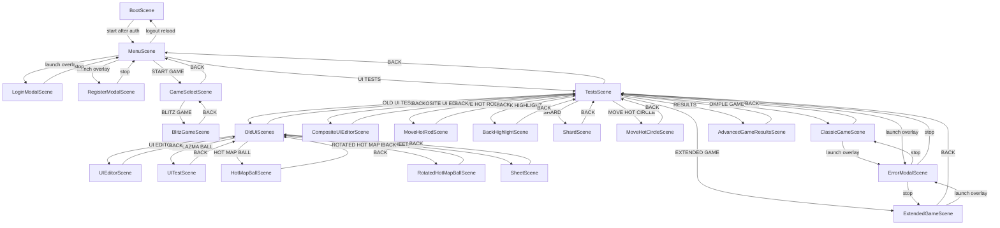

# html5Simple scenes

Phaser scenes in [`js/game.js`](js/game.js). Layout (`?layout=`) and FX (`?fx=`) are independent. Canvas size and other debug labels show only with `?debug=1`.

ClassicGameScene and ExtendedGameScene extend [`GamePlayScene`](js/scenes/GamePlayScene.js), which owns layout, HUD, Stage, scores, and GO. Subclasses only set move size and cancel rules.

## Scene list

| Scene | File | Kind | Player copy |
|-------|------|------|-------------|
| BootScene | [`js/scenes/BootScene.js`](js/scenes/BootScene.js) | Full screen | Title **Warm Adventure**. Subtitle **Getting ready...**, then **Tap to continue** after auth. |
| MenuScene | [`js/scenes/MenuScene.js`](js/scenes/MenuScene.js) | Full screen | Title **Warm Adventure**. Subtitle **Pick a match**. Player name in the corner. Buttons: LOGIN, REGISTER, LOGOUT, INVENTORY (stub), START GAME, UI TESTS, EXIT (stub). Bottom **SKIN IN/OFF**: **IN** fills the menu background with the heat-map preset ([`resources/ui-editor-init.json`](resources/ui-editor-init.json)), including a highlight on each of the seven menu buttons, and cuts the button labels out of a black fill so the heat map shows through the letters; **OFF** keeps the blank background and outline buttons. |
| GameSelectScene | [`js/scenes/GameSelectScene.js`](js/scenes/GameSelectScene.js) | Full screen | Title **Warm Adventure**. Subtitle **Choose a game**. Buttons: BLITZ GAME, BACK. |
| BlitzGameScene | [`js/scenes/BlitzGameScene.js`](js/scenes/BlitzGameScene.js) | Full screen | Opened from Choose a game **BLITZ GAME**. A full-scene heat map. The player builds a stack and sends it as the move in an extended best-of-5 match. A finished match opens the results scene; OK there returns to the menu. BACK returns to Choose a game. |
| TestsScene | [`js/scenes/TestsScene.js`](js/scenes/TestsScene.js) | Full screen, **780×844** (2× game width) | Title **Tests**. Subtitle **Pick a sandbox**. Buttons in two columns: left SIMPLE GAME, EXTENDED GAME, RESULTS, OLD UI TESTS, BUTTONS, SKINNED BUTTON, COMPOSITE UI EDITOR; right MOVE HOT ROD, BACK HIGHLIGHT, SHARD, ALTER SHEET, MOVE HOT CIRCLE, BACK. Entering this hub widens the Phaser canvas. SIMPLE GAME and EXTENDED GAME shrink it back to **390×844** before the match. RESULTS opens a finished-match preview and OK returns here. BACK to Menu restores **390×844**. |
| OldUiScenes | [`js/scenes/OldUiScenes.js`](js/scenes/OldUiScenes.js) | Full screen, **780×844** | Title **Old UI tests**. Subtitle **Pick a sandbox**. Buttons in two columns: left UI EDITOR, UI PLAZMA BALL, HOT MAP BALL; right ROTATED HOT MAP BALL, SHEET, BACK. BACK returns to Tests. |
| CompositeUIEditorScene | [`js/scenes/CompositeUIEditorScene.js`](js/scenes/CompositeUIEditorScene.js) | Stage **390×844**, tools canvas beside it | Copy of UIEditorScene. Same stage and tools layout. Tools canvas is [`CompositeUIEditorToolsScene`](js/scenes/CompositeUIEditorToolsScene.js). BACK returns to Tests. |
| UIEditorScene | [`js/scenes/UIEditorScene.js`](js/scenes/UIEditorScene.js) | Stage **390×844**, tools canvas beside it | Two canvases. The stage canvas is the main game frame, same size and scale as the main screen. **STAGE** hosts one [`UiHeatMap`](js/ui/UiHeatMap.js) with three [`UiHotBall`](js/ui/UiHotBall.js), three [`UiHotRod`](js/ui/UiHotRod.js), and two [`UiBackHighlighter`](js/ui/UiBackHighlighter.js) emitters. Green frames ([`UiStageMarkup`](js/ui/UiStageMarkup.js)) sit on top of that field in the same places as the main-scene panels and buttons for the active layout, including the extended Effects row. They are transparent, non-interactive markup; taps pass through to the heat field. **EFFECTS** **HEAT** **FRAMES** (ON/OFF) shows or hides them. **MENU** (ON/OFF, starts OFF) shows the same kind of frames for the menu: LOGIN, REGISTER, LOGOUT, INVENTORY, START GAME, UI TESTS, EXIT, SKIN, LAYOUT, and FX. The second canvas ([`UIEditorToolsScene`](js/scenes/UIEditorToolsScene.js)) holds **EFFECTS** (FRAMES, MENU, DIFFUSE, COOL, VIEW, PLAY / STEP / STOP) above **PROPS**, with **OBJECTS** on its right. Title **UI Editor** sits on that canvas. The page scrolls sideways when both canvases do not fit. **OBJECTS** is a scrollable name-and-type list with **COPY** and **DEL** on each row. A click selects that object and updates **PROPS**. **COPY** duplicates the type and props, shifts rod **START X/Y** or ball/highlight **CENTER X/Y**, and adds the suffix **copy**. **SAVE** / **LOAD** a local JSON preset. **PROPS** edits that object: balls (VISIBLE, DOT SIZE/HEAT, GEO including PHASE and live CENTER X/Y), rods (VISIBLE, LINE HEAT, GEO, MOVE with START/END X% Y% from −200 to 200, START/END ANG, DELAY at end, GAP at start), or back highlights (FIELD VISIBLE, CYCLING, SPEED, DELAY, GAP, CENTER X% Y%; FROM/TO WIDTH, HEIGHT, ANGLE, HEAT). A highlight eases FROM → TO, pauses DELAY, eases back when CYCLING is on, pauses GAP, then repeats. Tap Stage to move the selected object. BACK on the tools canvas returns to Old UI tests and restores the Tests width. |
| LoginModalScene | [`js/scenes/LoginModalScene.js`](js/scenes/LoginModalScene.js) | Overlay | Title **LOGIN**. Subtitle **Sign in to keep your games**. |
| RegisterModalScene | [`js/scenes/RegisterModalScene.js`](js/scenes/RegisterModalScene.js) | Overlay | Title **Create account**. Subtitle **Save this guest as a real player**. Fields reset on each open. |
| ErrorModalScene | [`js/scenes/ErrorModalScene.js`](js/scenes/ErrorModalScene.js) | Overlay | Caller title and message (for example **Move Failed**). OK closes. |
| ClassicGameScene | [`js/scenes/ClassicGameScene.js`](js/scenes/ClassicGameScene.js) | Full screen | Status: **Loading match...** · **Pick Stone, Scissors, or Paper** · **{move} ready — tap GO** · **Sending {move}...** · **Match over**. BACK returns to Tests. GO sends `size: 0`. |
| ExtendedGameScene | [`js/scenes/ExtendedGameScene.js`](js/scenes/ExtendedGameScene.js) | Full screen | Same layout as classic, plus **EffectsPanel** (buttons **NEG**, **OVER**, **PROT**, **SIZE**) under the current-move status. First tap on a type selects it at size 1 (`STONE 1`). Same tap increments (max 10). Status: **{move} {size} ready — tap GO**. GO sends that size and the selected effects (`effects[]`). At most one size effect and one type effect; tapping a second in the same category replaces the first. Round tiles show the player's used size. Cancel is inactive until a type is selected; at size 1 it clears the type; at size 2+ it shows **MINUS** and decrements size. |
| UITestScene | [`js/scenes/UITestScene.js`](js/scenes/UITestScene.js) | Full screen | Title **UI plazma ball**. Subtitle **Yellow ball test**. **TestPanel** plays a yellow plasma ball on a deep blue field ([`PlasmaBallFx`](js/fx/PlasmaBallFx.js)). Tap the panel and the ball orbits that point at **3 ball sizes**; the orbit center eases to each new tap. BACK returns to Old UI tests. |
| HotMapBallScene | [`js/scenes/HotMapBallScene.js`](js/scenes/HotMapBallScene.js) | Full screen | Title **Hot map ball**. Subtitle **Heat map test**. **TestPanel** starts black. Tap drops a hot dot; heat diffuses into neighboring pixels and brightness follows temperature ([`HeatMapFx`](js/fx/HeatMapFx.js)). **SettingsPanel** has **− / +** steppers for **DIFFUSE**, **COOL**, **DOT SIZE**, **DOT HEAT**. BACK returns to Old UI tests. |
| RotatedHotMapBallScene | [`js/scenes/RotatedHotMapBallScene.js`](js/scenes/RotatedHotMapBallScene.js) | Full screen | Title **Rotated hot map ball**. Subtitle **Orbiting heat test**. A hot ball wanders, then orbits a tap in a tilted plane (ellipse path) ([`RotatedHeatMapFx`](js/fx/RotatedHeatMapFx.js)). **SettingsPanel** has tabs **HEAT** (DIFFUSE, COOL, DOT SIZE, DOT HEAT) and **GEO** (ANG SPEED, RADIUS, TILT X/Y/Z). BACK returns to Old UI tests. |
| MoveHotRodScene | [`js/scenes/MoveHotRodScene.js`](js/scenes/MoveHotRodScene.js) | Full screen | Title **Move hot rod**. Subtitle **Tap to move the line**. A hot line spans the panel (looks infinite); a tap eases it along the direction orthogonal to **ANGLE**. GEO **ANGLE** rotates it in 2D. Emission is noisy ([`HotRodFx`](js/fx/HotRodFx.js)). **SettingsPanel** has tabs **HEAT** (DIFFUSE, COOL, LINE HEAT) and **GEO** (THICKNESS, ANGLE, SPEED, NOISE, GRAIN, FLICKER). BACK returns to Tests. |
| BackHighlightScene | [`js/scenes/BackHighlightScene.js`](js/scenes/BackHighlightScene.js) | Full screen | Title **Back highlight**. Subtitle **Filled rectangle, tap to move**. A filled hot rectangle stamps into the heat field ([`BackHighlightFx`](js/fx/BackHighlightFx.js)). **WIDTH**, **HEIGHT**, **ANGLE**, and **HEAT** ease from **FROM** to **TO**, pause **DELAY**, then either ease back (**CYCLING** on) or snap to **FROM** (**CYCLING** off). **GAP** pauses at **FROM** before the next pass. A tap eases the rectangle center to that point. BACK returns to Tests. |
| ShardScene | [`js/scenes/ShardScene.js`](js/scenes/ShardScene.js) | Full screen | Title **Shard**. Subtitle **Glisten sweeps left to right**. **SKEW** 0 is a rectangle; other values lean it into a parallelogram. **GLISTEN** is on **FROM** and **TO**: **0** is the left edge, **100** is the right, and it eases with the pose. **COOL** sets how fast the trail fades. BACK returns to Tests. |
| SheetScene | [`js/scenes/SheetScene.js`](js/scenes/SheetScene.js) | Full screen | Title **Sheet**. Subtitle **Cosine sheet. Glisten repeats**. The ribbon centerline is cos from 0 to 2π. **WIDTH** is one turn, **HEIGHT** the thickness, **BEND** the wave height, **PHASE** shifts the cosine (degrees, eased FROM → TO), and **SKEW** leans the cross-section. The wave stays horizontal. Heat eases **FROM** to **TO**. **GLISTEN** on **FIELD** turns a bright band on or off. When on, a hot band sweeps along the curve on **GL SPEED**, pauses **GL DELAY**, and repeats. **GL POWER** is how much heat that band stamps into the field. **BALL** is two hot dots (**DOT SIZE**, **DOT HEAT**). One runs the centerline start to end, **DELTA** cells below it. The other runs end to start, **DELTA** cells above it. Both repeat ([`SheetFx`](js/fx/SheetFx.js)). BACK returns to Old UI tests. |
| MoveHotCircleScene | [`js/scenes/MoveHotCircleScene.js`](js/scenes/MoveHotCircleScene.js) | Full screen | Title **Move hot circle**. Subtitle **Tap to move the circle**. A hot ring sits on the heat field; a tap eases its center to the tap. GEO **RADIUS**, **THICKNESS**, and **TILT X/Y/Z**. **WIND** blows the heat and **X SPEED** scrolls every cell horizontally ([`HotCircleFx`](js/fx/HotCircleFx.js)). **SettingsPanel** tabs **HEAT**, **GEO**, **WIND**. BACK returns to Tests. |

Inventory and Exit are still stubs (no scenes). Logout reloads the page so Boot can mint a new guest token.

## Transitions

Helpers in [`js/uiFx.js`](js/uiFx.js). Duration comes from the active FX preset in [`js/frameSize.js`](js/frameSize.js) (`?fx=quiet|casual|arcade`). No separate transition switcher.

| From | To | Motion |
|------|----|--------|
| Boot | Menu | Fade. Auth, then min hold ~800ms, tap to skip after auth. Arcade also flashes. |
| Menu | Game select | Fade. Arcade also flashes. |
| Menu | Tests | Fade (UI TESTS). |
| Tests | Menu | Fade (BACK). |
| Tests | Old UI tests | Fade (OLD UI TESTS). |
| Old UI tests | UI editor | Fade (UI EDITOR). |
| Old UI tests | UI test | Fade (UI PLAZMA BALL). |
| Old UI tests | Hot map | Fade (HOT MAP BALL). |
| Old UI tests | Rotated hot map | Fade (ROTATED HOT MAP BALL). |
| Old UI tests | Sheet | Fade (SHEET). |
| Old UI tests | Tests | Fade (BACK). |
| Tests | Move hot rod | Fade (MOVE HOT ROD). |
| Tests | Back highlight | Fade (BACK HIGHLIGHT). |
| Tests | Move hot circle | Fade (MOVE HOT CIRCLE). |
| Game select | Menu | Fade (BACK). |
| UI editor | Old UI tests | Fade (BACK). |
| UI test | Old UI tests | Fade (BACK). |
| Hot map | Old UI tests | Fade (BACK). |
| Rotated hot map | Old UI tests | Fade (BACK). |
| Sheet | Old UI tests | Fade (BACK). |
| Move hot rod | Tests | Fade (BACK). |
| Back highlight | Tests | Fade (BACK). |
| Move hot circle | Tests | Fade (BACK). |
| Tests | Classic / Extended | Fade after create-game succeeds. Chosen button shows **STARTING...**. Arcade also flashes. |
| Tests | Results | Fade (RESULTS). Arcade also flashes. |
| Classic / Extended | Tests | Fade (BACK). |
| Results | Tests | Fade (OK), when opened from Tests. |
| Results | Menu | Fade (OK), when a match finishes. |
| Menu | Login / Register | Overlay fade + card pop. Parent scene input is paused. |
| Login / Register | Menu | Card pop-out, then stop. |
| Classic / Extended / Tests | Error | Overlay fade + card pop. Parent scene input is paused. |
| Error | Classic / Extended / Tests | Card pop-out, then stop. |

| FX preset | Fade | Modal pop | Flash on Boot→Menu, Menu→Game select, and Tests→play |
|-----------|------|-----------|----------------------------------|
| Quiet (`?fx=quiet`) | 80ms | Opacity only | No |
| Casual (`?fx=casual`) | 180ms | Pop | No |
| Arcade (`?fx=arcade`) | 280ms | Pop | Yes |
